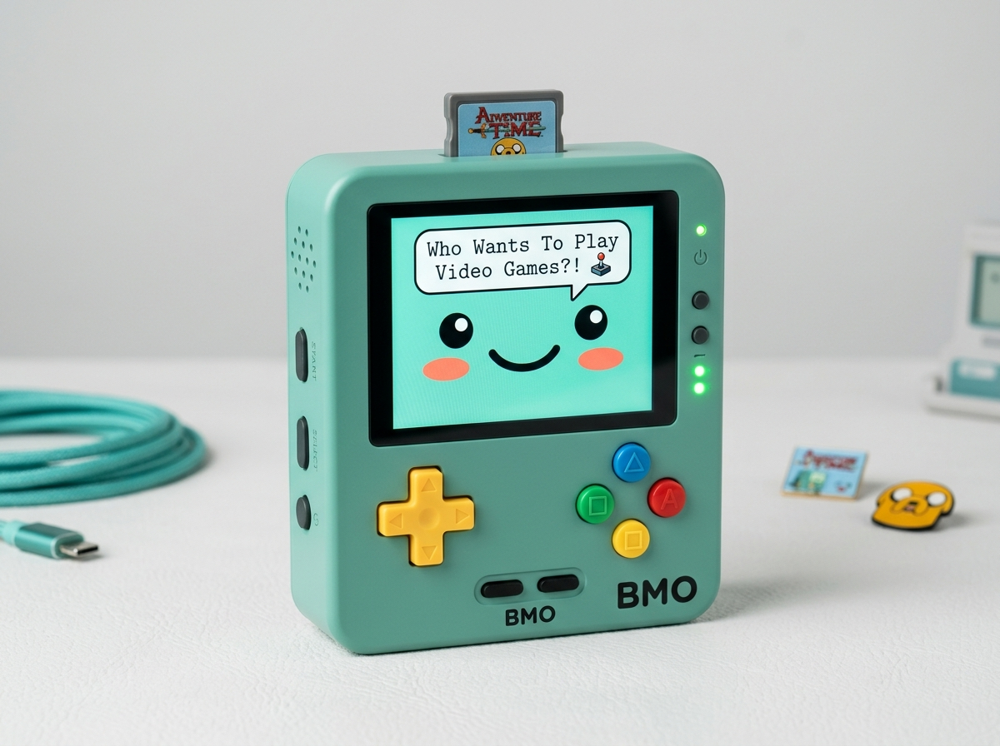
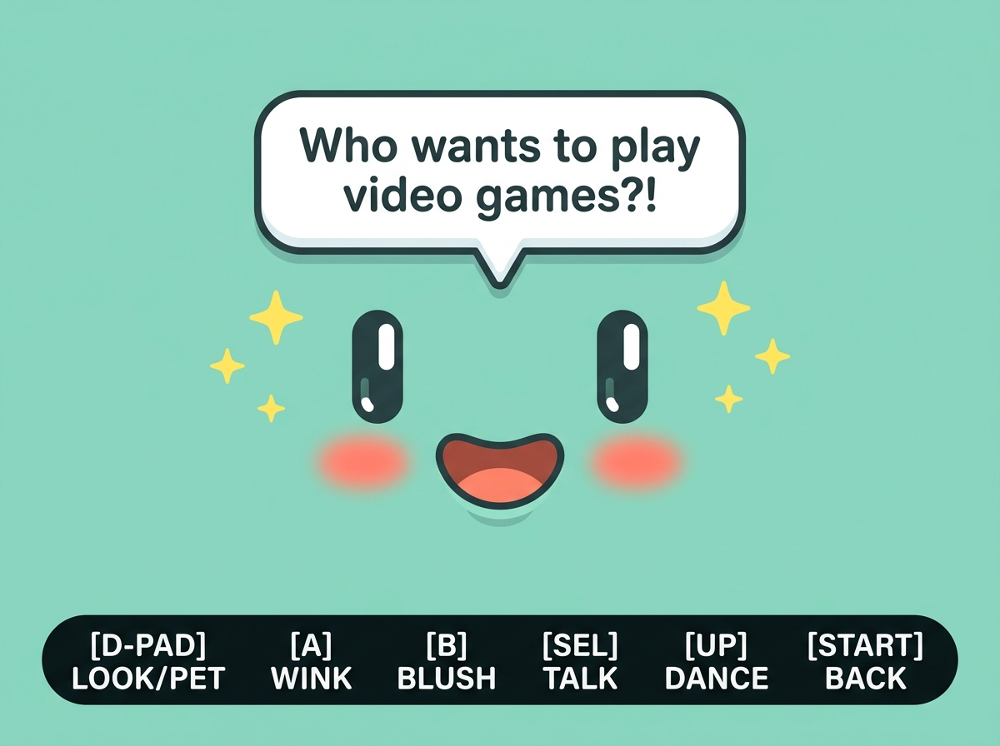
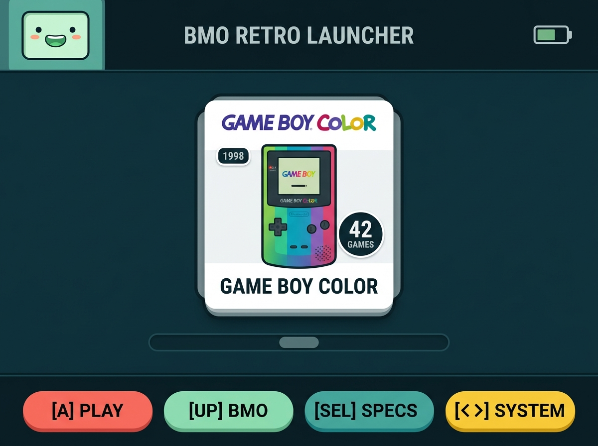
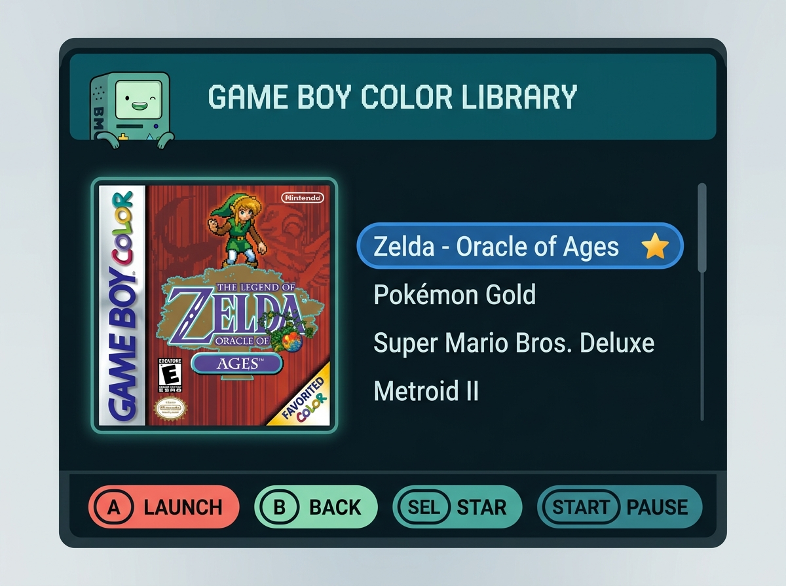
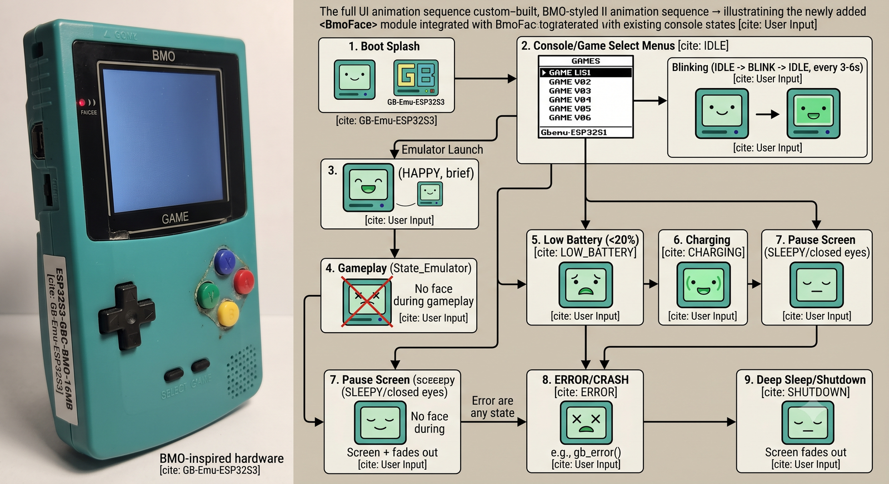

<div align="center">

# ESP32-S3 Handheld Gaming Console (BMO Edition)

[](scripts/validate_repo.py)
[](https://www.espressif.com/)
[]()
[]()
[]()
[]()

Firmware and tooling for a custom handheld game console built around an **ESP32-S3-WROOM-1 (N16R8)**, a **320×240 ST7789 IPS display**, a **MicroSD slot**, and **8 physical buttons**. It runs 14 retro console and game engines alongside an interactive BMO face mode.

<br/>



</div>

---

## Screenshots

<div align="center">
  
  <p><em>BMO face mode with animated expressions and dialogue bubbles.</em></p>
</div>

<div align="center">
  
  <p><em>Console selector carousel.</em></p>
</div>

<div align="center">
  
  <p><em>ROM browser with 64×64 cover art, favorites, and folder support.</em></p>
</div>

<div align="center">
  
  <p><em>Soldered ESP32-S3 perfboard prototype and main UI screens.</em></p>
</div>

---

## Hardware Specs & Pinout

- **MCU:** ESP32-S3-WROOM-1 (`N16R8` — dual-core Xtensa LX7 @ 240 MHz, 16 MB Quad SPI Flash, 8 MB Octal SPI PSRAM)
- **Display:** 2.0" ST7789 IPS TFT (320×240 landscape, 80 MHz SPI)
- **Storage:** MicroSD over SPI (FAT32) + built-in flash fallback ROMs when no SD card is inserted
- **Input:** 8 tactile buttons wired active-low (`INPUT_PULLUP`)

| Component | Signal | GPIO | Notes |
| :--- | :--- | :--- | :--- |
| **ST7789 TFT** | `MOSI` / `SCLK` | `11` / `12` | Shared SPI bus (`FSPI`) |
| | `CS` / `DC` / `RST` / `BLK` | `10` / `9` / `8` / `14` | Backlight PWM on GPIO 14 |
| **MicroSD** | `MOSI` / `MISO` / `SCLK` / `CS` | `11` / `13` / `12` / `15` | Arbitrated with TFT via `SpiArbiter` |
| **D-Pad** | `UP` / `DOWN` / `LEFT` / `RIGHT` | `4` / `5` / `6` / `7` | Active-low with 25 ms debounce |
| **Buttons** | `A` / `B` / `START` / `SELECT` | `16` / `17` / `18` / `3` | GPIO 3 is a strapping pin (see hardware notes) |

> **Hardware note:** Battery ADC (`GPIO 1`) and speaker audio (`GPIO 1` / `GPIO 2`) are disabled in `config.h` (`FEATURE_BATTERY_MONITOR = 0`, `FEATURE_AUDIO = 0`) because those circuits are not populated on the current board.

---

## Supported Systems (14 Cores)

All 14 cores run in PSRAM and share a common lifecycle (`loadRom`, `runFrame`, `destroy`, `saveBatteryRam`, `loadBatteryRam`, `saveState`, `loadState`):

| System | Extensions | Core / Implementation | Native Resolution |
| :--- | :--- | :--- | :--- |
| **Game Boy (DMG)** | `.gb` | Peanut-GB | 160×144 |
| **Game Boy Color** | `.gbc` | Walnut-CGB | 160×144 |
| **NES** | `.nes` | Agnes (Mappers 0, 1, 2, 3, 4) | 256×240 |
| **Sega Master System / Game Gear** | `.sms`, `.gg`, `.sg` | Z80 + VDP + SN76489 | 256×192 / 160×144 |
| **Sega Genesis / Mega Drive** | `.gen`, `.md`, `.smd` | M68000 + VDP | 320×224 |
| **Super Nintendo (SNES)** | `.sfc`, `.smc` | 65C816 + PPU (LoROM/HiROM) | 256×224 |
| **PC Engine / TurboGrafx-16** | `.pce` | HuC6280 + VDC/VCE | 256×240 |
| **Atari 2600** | `.a26` | 6507 + RIOT 6532 + TIA | 160×192 |
| **Atari Lynx** | `.lnx` | 65SC02 + Mikey/Suzy | 160×102 |
| **Bandai WonderSwan / Color** | `.ws`, `.wsc` | NEC V30MZ + Swan VDP | 224×144 |
| **Neo Geo Pocket / Color** | `.ngp`, `.ngc` | TLCS-900/H + K2GE | 160×152 |
| **ColecoVision** | `.col` | Z80A + TMS9928A + HLE BIOS | 256×192 |
| **PICO-8** | `.p8`, `.p8.png` | Built-in PICO-8 cart interpreter | 128×128 |
| **DOOM** | `.wad` | doomgeneric (streams WAD data from SD) | 320×200 |

---

## Features & Controls

- **Dual-Core Display Pipeline:** Emulation and UI run on Core 1 while Core 0 pushes framebuffers over SPI to the ST7789 display.
- **Fast SD Indexing & Folders:** Scans up to 3 levels of subdirectories on the SD card and caches the ROM list in `/.bmo_index` for fast boot times.
- **Save States & Battery Saves:** 5 save state slots per game (`/saves/<game>.st0`–`.st4`) plus automatic `.sav` battery SRAM backup on exit.
- **Cover Art & Screenshots:** Loads 64×64 RGB565 `.raw` or `.bmp` box art from `/boxart` or `/covers`, and saves 24-bit `.bmp` screenshots to `/screenshots`.
- **Favorites & History:** Star games in the menu (`/.favorites.txt`) and track recently played titles (`/history.txt`).

### In-Game & Pause Controls

- **`START + SELECT` (Hold):** Open the in-game pause menu
- **Pause Menu — `UP` / `DOWN`:** Select Resume, Save State, Load State, or Exit to Menu
- **Pause Menu — `LEFT`:** Toggle A/B button swap for the current console
- **Pause Menu — `RIGHT`:** Toggle 1:1 pixel scaling with console bezel vs. full-screen scaling
- **Pause Menu — `SELECT`:** Save a 24-bit `.bmp` screenshot to `/screenshots/`

---

## Building and Flashing

### Requirements
1. [Arduino CLI](https://arduino.github.io/arduino-cli/) or Arduino IDE with **ESP32 Core v3.3.11** installed.
2. Arduino libraries: `Adafruit_GFX` and `Adafruit_ST7789`.

### Compile with Arduino CLI
```powershell
.\arduino-cli.exe compile --fqbn "esp32:esp32:esp32s3:CDCOnBoot=cdc,FlashMode=qio,FlashSize=16M,PartitionScheme=custom,PSRAM=opi" firmware/BmoGameboy
```

> **Important:** The ESP32-S3-WROOM-1 (N16R8) uses **Quad SPI Flash** and **Octal SPI PSRAM**. Always build with `FlashMode=qio` and `PSRAM=opi`, and use `PartitionScheme=custom` so the `partitions.csv` (8 MB `app0`) layout is selected. Setting `FlashMode=opi` will prevent the board from booting.

---

## Repository Layout

```text
├── firmware/BmoGameboy/
│   ├── BmoGameboy.ino             # Main state machine, input handling, and frame loop
│   ├── partitions.csv             # Custom 16 MB flash table (8 MB app0)
│   └── src/
│       ├── core/                  # Display, buttons, SD card, save manager, BMO face renderer
│       ├── emulators/             # Emulator glue wrappers (emu_*.h / emu_*.cpp)
│       ├── vendor/                # C emulator cores (peanut_gb, agnes, doom, sms, pce, etc.)
│       └── assets/                # Built-in flash fallback ROM headers
├── tools/
│   ├── host_cores_runner.c        # Native x64 test harness for all 10 custom C cores
│   ├── telemetry_plotter.py       # Serial frame-time and jitter analyzer
│   ├── bmo_simulator/             # Browser-based 320x240 UI simulator
│   └── guardian/                  # Local lint, test, and verification CLI
├── scripts/
│   ├── validate_repo.py           # Full build + static check script
│   └── fetch_covers.py            # Cover art downloader and RGB565 converter
├── tests/                         # Python unit tests and native C core execution tests
└── docs/                          # Design document and hardware notes
```

---

## Testing & Verification

```powershell
# Run full firmware compile + repository checks
python scripts/validate_repo.py

# Run all unit tests and the native C 50-frame emulator test suite
python -m unittest discover -s tests -v

# Convert or fetch 64x64 RGB565 cover art for an SD card directory
python scripts/fetch_covers.py --sd-root ./sdcard --offline
```

---

## Documentation

- [Software Design Document](docs/software-design-document.md) — Architecture, memory budget, and SPI bus timing.
- [Hardware Notes](docs/hardware-notes.md) — Board wiring, strapping pins, and power notes.
- [Changelog](CHANGELOG.md) — Release history and recent changes.

## License

MIT — see [LICENSE](LICENSE).
