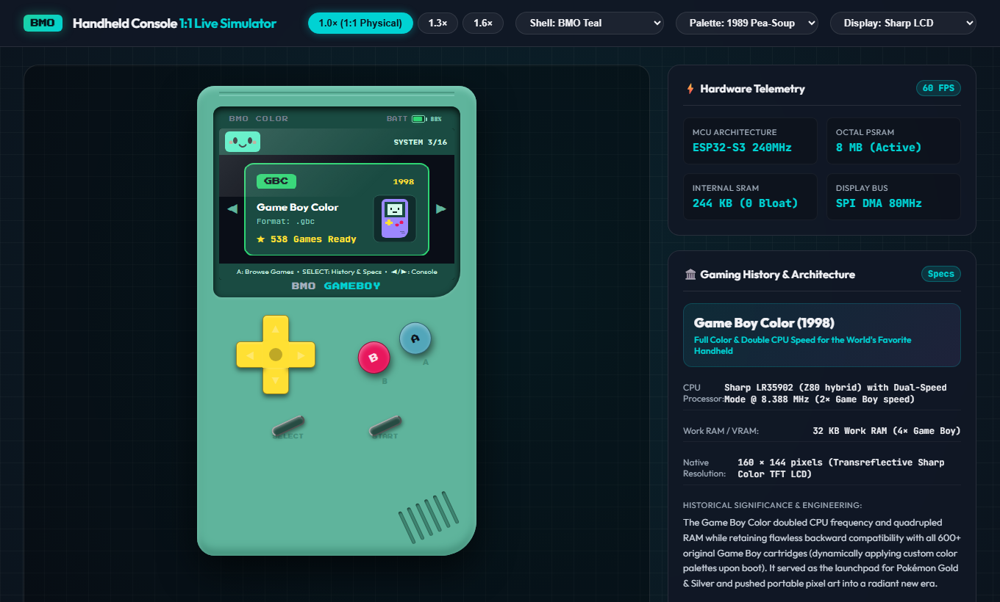
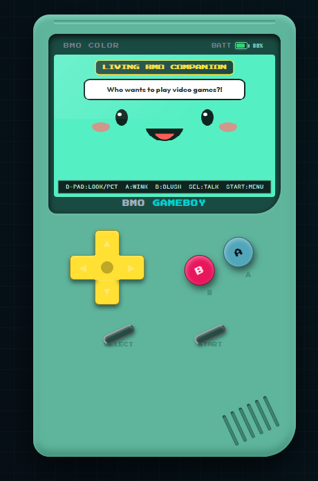
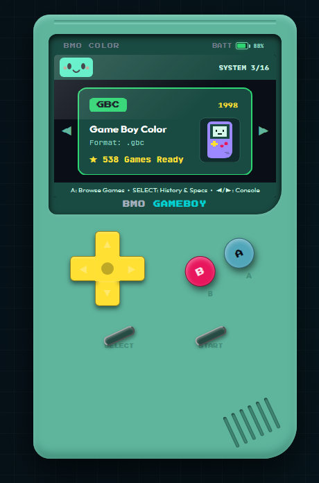
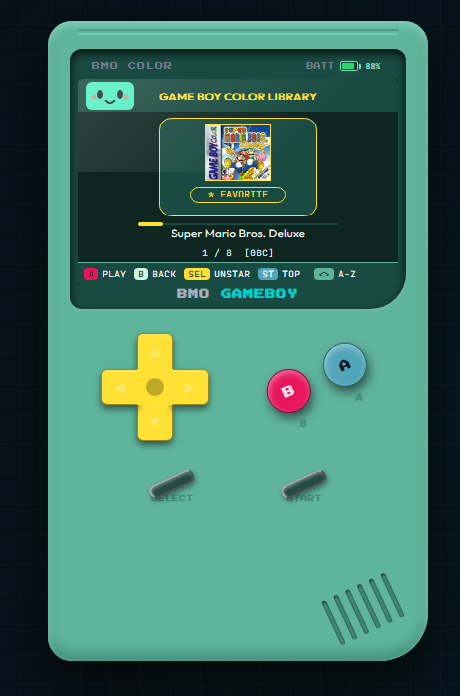
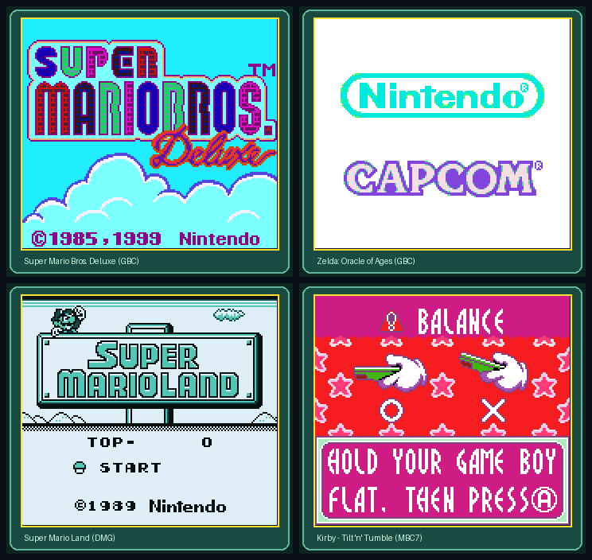

<div align="center">

# ESP32-S3 Handheld Gaming Console (BMO Edition)

[](scripts/validate_repo.py)
[](https://www.espressif.com/)
[]()
[]()
[]()
[]()

Firmware and tooling for a custom handheld game console built around an **ESP32-S3-WROOM-1 (N16R8)**, a **320×240 ST7789 IPS display**, a **MicroSD slot**, and **8 physical buttons**. It runs 14 retro console and game engines alongside an interactive BMO face mode.

<br/>



</div>

---

## Browser Simulator & Native Emulator Screenshots

<div align="center">
  
  <p><em>BMO face mode (320×240 ST7789) with procedural 2D SDF expressions and dialogue bubbles.</em></p>
</div>

<div align="center">
  
  <p><em>Console selector carousel. The browser library now lists only ROMs loaded by the user.</em></p>
</div>

<div align="center">
  
  <p><em>Earlier UI capture; current browser gameplay requires a user-supplied Game Boy ROM.</em></p>
</div>

<div align="center">
  
  <p><em>Direct RGB565 framebuffers captured from the native C emulator cores (<code>Walnut-CGB</code> / <code>Peanut-GB</code>) running Super Mario Bros. Deluxe, The Legend of Zelda: Oracle of Ages, Pokémon Red, and Kirby - Tilt 'n' Tumble (MBC7 accelerometer).</em></p>
</div>

---

## Hardware Specs & Pinout

- **MCU:** ESP32-S3-WROOM-1 (`N16R8` — dual-core Xtensa LX7 @ 240 MHz, 16 MB Quad SPI Flash, 8 MB Octal SPI PSRAM)
- **Display:** 2.0" ST7789 IPS TFT (320×240 landscape, 80 MHz SPI)
- **Storage:** MicroSD over SPI (FAT32) + built-in flash fallback ROMs when no SD card is inserted
- **Input:** 8 tactile buttons wired active-low (`INPUT_PULLUP`)

| Component | Macro (`config.h`) | GPIO | Notes |
| :--- | :--- | :--- | :--- |
| **ST7789 TFT** | `TFT_MOSI` / `TFT_SCK` | `11` / `12` | Shared SPI bus (`FSPI`, 80 MHz) |
| | `TFT_CS` / `TFT_DC` / `TFT_RST` | `10` / `8` / `9` | Display chip select, data/command, reset |
| **MicroSD** | `SD_CS` / `SD_MISO` | `13` / `15` | Shares `TFT_MOSI` (`11`) & `TFT_SCK` (`12`) via `SpiArbiter` |
| **D-Pad** | `BTN_UP` / `BTN_DOWN` / `BTN_LEFT` / `BTN_RIGHT` | `4` / `5` / `6` / `7` | `INPUT_PULLUP` (active-low, 25 ms debounce) |
| **Buttons** | `BTN_A` / `BTN_B` / `BTN_START` / `BTN_SELECT` | `16` / `17` / `18` / `21` | `INPUT_PULLUP` (active-low, read via `GPIO_IN_REG`) |
| **Reserved** | Strapping (`0, 3, 45, 46`), Octal PSRAM (`33–37`) | — | Do not assign to peripherals |

> **Hardware note:** Battery ADC (`BATTERY_ADC_PIN = 1`) and I2S audio (`I2S_BCLK = 38`, `I2S_LRC = 39`, `I2S_DIN = 40`) are disabled in `config.h` (`FEATURE_BATTERY_MONITOR = 0`, `FEATURE_AUDIO = 0`) because those circuits are not soldered on the current board.

---

## Firmware Hardware Simulation

The Wokwi project runs the compiled ESP32-S3 firmware and wires the simulator to the same GPIO assignments in `src/core/config.h`: all eight active-low buttons, the shared display/SD SPI clock and MOSI, separate chip selects, and the SD MISO line. Battery and I2S audio parts are intentionally absent.

1. Compile with the repository's ESP32-S3 settings and the output path used by [`wokwi.toml`](wokwi.toml):

   ```powershell
   .\arduino-cli.exe compile --fqbn "esp32:esp32:esp32s3:CDCOnBoot=cdc,FlashMode=qio,FlashSize=16M,PartitionScheme=custom,PSRAM=opi" --output-dir firmware\BmoGameboy\build\esp32.esp32.esp32s3 firmware\BmoGameboy
   ```

2. Open the repository in VS Code with the Wokwi extension and run **Wokwi: Start Simulator**. The project includes `diagram.json` and `wokwi.toml`.
3. Optional ROM images for the virtual SD card go in `sdcard/`; do not add commercial ROMs to the repository.

Wokwi currently provides an ILI9341 display model, not an ST7789 model. The diagram uses that SPI display as a visual panel substitute; Wokwi also does not expose the display reset/backlight pins. The firmware binary is the actual firmware, but panel-controller behavior is not a one-to-one electrical model. The Wokwi CLI requires a `WOKWI_CLI_TOKEN`; its local diagram linter does not.

## Firmware-Backed BMO Companion

The browser BMO companion compiles the firmware's [`bmo_face.cpp`](firmware/BmoGameboy/src/core/bmo_face.cpp) renderer and calls its real expression, gaze, blink, dialogue, pet, and dance APIs through WebAssembly. It is entered with **UP** from the console carousel and can also activate after 30 seconds without carousel input. In companion mode, use the D-pad to look, **A** to wink, **B** to blush (hold **B** to leave), **SELECT** to talk, **UP** to start/stop dancing, and **START** to return.

The browser supplies a small Arduino timing/randomness shim and draws the face at the firmware's 320×240 resolution. It does not execute the ESP32 state machine, ST7789/SPI transfer, SD-card code, or physical button electrical behavior; the surrounding browser menus remain a port rather than firmware output. Battery and audio remain disabled to match the soldered hardware.

## Playable Browser Game Boy, NES, Atari 2600, and ColecoVision

The browser simulator runs the firmware's vendored Peanut-GB, Agnes, Stella, and ColecoVision sources compiled to WebAssembly. It executes uploaded Game Boy (`.gb`), NES (`.nes`), Atari 2600 (`.a26`), and ColecoVision (`.col`) ROMs with their firmware button mappings and framebuffer sizes. ColecoVision uses its centered 256×192 viewport. Atari uses the firmware's centered 160×192 framebuffer and pre-swapped TIA palette; supported image sizes are 2, 4, 8, 16, and 32 KiB. NES gameplay uses its firmware palette and centered 256×240 viewport; Agnes supports iNES mappers 0, 1, 2, and 4, not mapper 3 or NES 2.0. This does **not** run the ESP32 firmware: menus remain canvas-rendered, and the other 10 console cores remain firmware-only. Unsupported systems are reported instead of drawing a synthetic game.

1. Build the WebAssembly cores (the repository's local WASI SDK is used when present; otherwise set `WASI_SDK_PATH`):

   ```powershell
   python scripts\build_wasm_cores.py
   ```

2. Start the local server:

   ```powershell
   python tools\bmo_simulator\run_simulator.py
   ```

3. Use **Load Game ROM (.gb, .nes, .a26, .col)** to select a ROM you have the right to use. Browser ROM files are limited to 8 MiB; Atari ROMs must also use one of the supported image sizes above. No game ROM is bundled by this simulator.

Controls: arrow keys or the on-screen D-pad, **Z** = A, **X** = B, **Enter** = Start, **Shift** = Select. Hold **Enter + Shift** together to open the pause menu, matching the firmware's **START + SELECT** chord. The save slot is in-memory for the current page session.

This is playable Game Boy, NES, Atari, and ColecoVision software emulation, not a one-to-one electrical/hardware model. The display bezel and system menus are browser-rendered; physical SPI behavior, the ESP32 scheduler, SD-card firmware, and the other 10 firmware emulators are not executed. Browser save state is one in-memory snapshot for the current page session, not the firmware's SD-backed five-slot saves or battery-RAM persistence. Use the separate Wokwi project to run the compiled firmware, noting its ILI9341 display substitute is not the physical ST7789.

---

## Supported Systems (14 Cores)

All 14 cores run in PSRAM and share a common lifecycle (`loadRom`, `runFrame`, `destroy`, `saveBatteryRam`, `loadBatteryRam`, `saveState`, `loadState`):

| System | Extensions | Core / Implementation | Native Resolution |
| :--- | :--- | :--- | :--- |
| **Game Boy (DMG)** | `.gb` | Peanut-GB (MBC1, MBC2, MBC3+RTC, MBC5, MBC7) | 160×144 |
| **Game Boy Color** | `.gbc` | Walnut-CGB (MBC1, MBC2, MBC3+RTC, MBC5, MBC7) | 160×144 |
| **NES** | `.nes` | Agnes (Mappers 0, 1, 2, 4) | 256×240 |
| **Sega Master System / Game Gear** | `.sms`, `.gg` | Z80 + VDP + SN76489 | 256×192 / 160×144 |
| **Sega Genesis / Mega Drive** | `.gen`, `.md`, `.smd` | M68000 + VDP | 320×224 |
| **Super Nintendo (SNES)** | `.sfc`, `.smc` | 65C816 + PPU (LoROM/HiROM) | 256×224 |
| **PC Engine / TurboGrafx-16** | `.pce` | HuC6280 + VDC/VCE | 256×240 |
| **Atari 2600** | `.a26` | 6507 + RIOT 6532 + TIA | 160×192 |
| **Atari Lynx** | `.lnx` | 65SC02 + Mikey/Suzy | 160×102 |
| **Bandai WonderSwan / Color** | `.ws`, `.wsc` | NEC V30MZ + Swan VDP | 224×144 |
| **Neo Geo Pocket / Color** | `.ngp`, `.ngc` | TLCS-900/H + K2GE | 160×152 |
| **ColecoVision / Sega SG-1000** | `.col`, `.sg` | Shared Z80A + TMS9918A core | 256×192 |
| **PICO-8-style runtime** | `.p8` text carts | PICO-8 memory/graphics routines and custom draw-bytecode runner; does not execute Lua cart code or `.p8.png` carts | 128×128 |
| **DOOM** | `.wad` | doomgeneric (streams WAD data from SD) | 320×200 |

### SD-card layout and validation

The firmware scans the SD-card root and subdirectories through three levels for the ROM extensions above. Place supported `.raw` or `.bmp` box art in `/boxart/` or `/covers/`, named to match the ROM basename. Raw images must be exactly 8,192 bytes; BMP images must be 64×64 and use the supported 16-bit or 24-bit formats. ROM indexing and menu arrays are configured for up to 36,000 entries with PSRAM; allocation failure is logged and falls back to 32 entries.

`python scripts/deploy_to_sd.py --destination F:\` prints a dry-run plan using supported ROMs from the top level of `games/` and `.raw`/`.bmp` art from the top level of `roms/boxart/` (it does not copy the `hd/` subdirectory). Writing requires the explicit `--apply` flag and an SD volume labeled `GAMELIB` by default; `--expected-label` can select another label. File copies are content-verified and staged before replacement, and the derived `.bmo_index` is removed so firmware rescans after deployment. The script does not delete files from the card. Do not commit commercial ROMs or cover-art files to the repository.

---

## Features & Controls

- **Dual-Core Display Pipeline:** Emulation and UI run on Core 1 while Core 0 pushes framebuffers over SPI to the ST7789 display.
- **Fast SD Indexing & Folders:** Scans up to 3 levels of subdirectories on the SD card and caches the ROM list in `/.bmo_index` for fast boot times.
- **Save States & Battery Saves:** 5 save state slots per game (`/saves/<game>.st0`–`.st4`) plus automatic `.sav` battery SRAM backup on exit.
- **Cover Art & Screenshots:** Loads 64×64 RGB565 `.raw` or `.bmp` box art from `/boxart` or `/covers`, and saves 24-bit `.bmp` screenshots to `/screenshots`.
- **Favorites, History & Curated Top Picks:** Star games in the menu (`/favorites.txt`), track recently played titles (`/history.txt`), or press **`START`** inside any console library to filter large SD card ROM sets down to curated **`[TOP PICK]`** Hall-of-Fame titles per console.

### In-Game & Pause Controls

- **`START + SELECT` (Hold):** Open the in-game pause menu
- **Pause Menu — `UP` / `DOWN`:** Select Resume, Save State, Load State, or Exit to Menu
- **Pause Menu — `LEFT`:** Toggle A/B button swap for the current console
- **Pause Menu — `RIGHT`:** Toggle 1:1 pixel scaling with console bezel vs. full-screen scaling
- **Pause Menu — `SELECT`:** Save a 24-bit `.bmp` screenshot to `/screenshots/`

---

## Building and Flashing

### Requirements
1. [Arduino CLI](https://arduino.github.io/arduino-cli/) or Arduino IDE with **ESP32 Core v3.3.11** installed.
2. Arduino libraries: `Adafruit_GFX` and `Adafruit_ST7789`.

### Compile with Arduino CLI
```powershell
.\arduino-cli.exe compile --fqbn "esp32:esp32:esp32s3:CDCOnBoot=cdc,FlashMode=qio,FlashSize=16M,PartitionScheme=custom,PSRAM=opi" firmware/BmoGameboy
```

> **Important:** The ESP32-S3-WROOM-1 (N16R8) uses **Quad SPI Flash** and **Octal SPI PSRAM**. Always build with `FlashMode=qio` and `PSRAM=opi`, and use `PartitionScheme=custom` so the `partitions.csv` (8 MB `app0`) layout is selected. Setting `FlashMode=opi` will prevent the board from booting.

---

## Repository Layout

```text
├── firmware/BmoGameboy/
│   ├── BmoGameboy.ino             # Main state machine, input handling, and frame loop
│   ├── partitions.csv             # Custom 16 MB flash table (8 MB app0)
│   └── src/
│       ├── core/                  # Display, buttons, SD card, save manager, BMO face renderer
│       ├── emulators/             # Emulator glue wrappers (emu_*.h / emu_*.cpp)
│       ├── vendor/                # C emulator cores (peanut_gb, agnes, doom, sms, pce, etc.)
│       └── assets/                # Built-in flash fallback ROM headers
├── tools/
│   ├── host_cores_runner.c        # Native x64 test harness for all 11 custom C cores
│   ├── telemetry_plotter.py       # Serial frame-time and jitter analyzer
│   ├── bmo_simulator/             # Browser-based 320x240 UI preview
│   └── guardian/                  # Local lint, test, and verification CLI
├── scripts/
│   ├── validate_repo.py           # Full build + static check script
│   └── fetch_covers.py            # Cover art downloader and RGB565 converter
├── tests/                         # Python unit tests and native C core execution tests
└── docs/                          # Design document and hardware notes
```

---

## Testing & Verification

```powershell
# Run full firmware compile + repository checks
python scripts/validate_repo.py

# Run all unit tests and the native C 50-frame emulator test suite
python -m unittest discover -s tests -v

# Run Guardian pre-flight patch check and all-in-one verification
python -m tools.guardian patch-check
python -m tools.guardian verify

# Export Guardian AI development harness and rules to another repository
python -m tools.guardian export-harness <destination_dir>

# Convert or fetch 64x64 RGB565 cover art for an SD card directory
python scripts/fetch_covers.py --sd-root ./sdcard --offline
```

---

## Documentation

- [Software Design Document](docs/software-design-document.md) — Architecture, memory budget, and SPI bus timing.
- [Hardware Notes](docs/hardware-notes.md) — Board wiring, strapping pins, and power notes.
- [Changelog](CHANGELOG.md) — Release history and recent changes.

## License

MIT — see [LICENSE](LICENSE).
