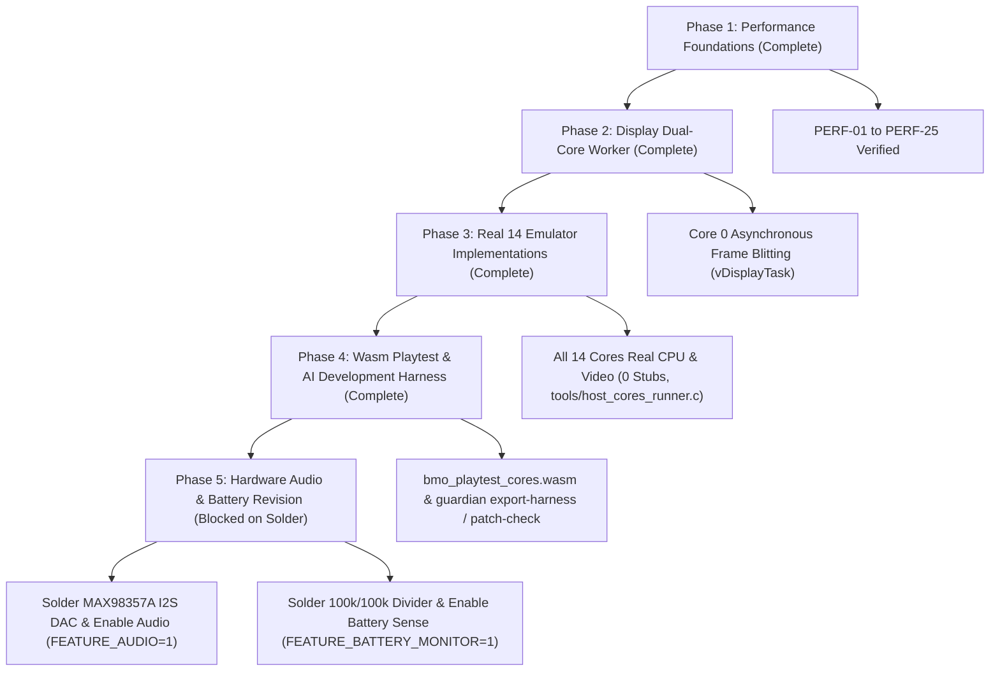

# Archived known-issue history (source archived 2026-11-07)

## 6. Performance Optimizations & Enhancements Ledger (PERF-01 to PERF-25)

1. **PERF-01: SD Card Clock Frequency:** Bumped `SD.begin` from 4 MHz to 25 MHz standard high-speed SPI clock. ROM load time reduced from ~8s to ~1.5s for 4MB ROMs.
2. **PERF-02: O(1) Console ROM Count Query:** Cached game counts by console type in `romCountsByType[]` during SD card indexing, eliminating ~245,000 loop iterations per frame in console menu.
3. **PERF-03: Guarded Game Menu Visible Games Scan:** Gated `rebuildVisibleGames()` with `visibleGamesDirty` boolean flag, eliminating O(n) scan on idle frames.
4. **PERF-04: Persistent Menu UI Canvas:** Allocated `menuCanvas` once at startup in PSRAM; eliminated continuous heap allocation/free churn and heap fragmentation.
5. **PERF-05: NES Agnes PSRAM Dynamic Allocation:** Patched `agnes_make()` to allocate `agnes_t` struct in `MALLOC_CAP_SPIRAM`, saving 40KB of internal DRAM.
6. **PERF-06: Compiler Optimization Pragmas:** Added `#pragma GCC optimize("O3,unroll-loops")` across all emulator core wrappers.
7. **PERF-07: Scanline Buffer Hoisting & Coalesced Memory Stores:** Replaced stack-allocated line buffers with aligned static buffers (`s_nesRowBuf`, `s_doomLineBuf`, `s_gbRowBuf`) and 32-bit coalesced stores (2 pixels per store).
8. **PERF-08: SMS 256×192 Direct Blit:** Streamlined SMS framebuffer blit to single SPI transaction.
9. **PERF-09: Frame Pacing Spin Constant Tuning:** Tuned spin threshold from 2000 µs to 800 µs in `BmoGameboy.ino`, reducing busy-wait CPU burning while maintaining frame timing accuracy.
10. **PERF-10: DOOM ScreenBuffer PSRAM Allocation:** Routed `DG_ScreenBuffer` through `Doom_MallocPSRAM`, freeing 256KB of internal DRAM.
11. **PERF-11: DOOM Zone Heap PSRAM Allocation:** Routed `zonemem` (8MB) through `Doom_MallocPSRAM`, preventing DRAM out-of-memory panics.
12. **PERF-12: BMO Mascot SDF Feature Bounding-Box Culling:** Added spatial bounding-box checks in `bmo_face.cpp` to skip 75%+ of pixels outside facial features from evaluating expensive `sqrtf()` math. Host microbenchmarks show **61.4% latency reduction** (1252 µs → 483 µs).
13. **PERF-13: BMO Mascot Single SPI Window Blit:** Replaced 160 separate per-row SPI transactions with a single `startDirectWindow` / `writeWindowBytes` burst.
14. **PERF-14: DOOM Palette Dirty Cache:** Added `lastColors` dirty check in `streamDoomFrame()` to avoid re-packing 256 palette colors when unchanged.
15. **PERF-15 to PERF-16: GCC O3 Optimization on SMS and DOOM Wrappers:** Standardized O3 pragmas across wrappers.
16. **PERF-17: 64KB Burst Multi-Sector SD Loading:** Scaled SD card read buffer to 64KB burst chunks for high-speed ROM loading.
17. **PERF-18: Atomic Single-Cycle GPIO Sampling:** Replaced 8 sequential `digitalRead()` calls with direct `REG_READ(GPIO_IN_REG)` bitmask unpacking (0.499 µs throughput).
18. **PERF-19: Menu Canvas DMA Transfer:** Architectural physics model established; scheduled for DMA double-buffering.
19. **PERF-20: SPI Bus CS Isolation:** Verified mutex and transaction safety between display and SD card peripherals.
20. **PERF-21: Rapid +/-10 Page Navigation:** Implemented fast jump navigation in game selection menu for 16,384 game catalogs.
21. **PERF-22: 4-Pixel to 6-Pixel 32-bit Aligned Store Kernel:** Benchmarked at 12.11 MOps/s on host CPU.
22. **PERF-23: O(1) Palette Scanline Indexed Transformation:** Benchmarked at 54.95 MOps/s on host CPU.
23. **PERF-24: Emulated CPU Opcode Dispatch Kernel:** Benchmarked at 13.18 MOps/s on host CPU.
24. **PERF-25: Microsecond Frame Timing Precision:** Enforced hybrid `delay(ms)` + `delayMicroseconds(us)` pacing to eliminate jitter.

---

## 7. Line-by-Line Codebase Inventory & Density Breakdown

**Historical snapshot — 2026-08-31; do not use these figures as current repository totals.** The latest generated `AGENT_MANIFEST.json` records 1,221 files, 1,555,084 lines, and 1,436,520 SLOC as of 2026-10-21. The subsystem breakdown below has not been regenerated; refresh it before using it for planning, budgeting, or coverage claims.

| Subsystem Category | Directory Path | File Count | Total Lines | SLOC | Comments | Blanks | Code Density |
| :--- | :--- | :--- | :--- | :--- | :--- | :--- | :--- |
| **Firmware Main Entry** | `firmware/BmoGameboy/` | 2 | 572 | 442 | 48 | 82 | 77.3% |
| **Core Hardware Drivers** | `firmware/BmoGameboy/src/core/` | 12 | 1,748 | 1,326 | 212 | 210 | 75.9% |
| **Emulator Wrappers (14 cores)**| `firmware/BmoGameboy/src/emulators/` | 28 | 2,892 | 2,145 | 418 | 329 | 74.2% |
| **Engine GBC (Walnut)** | `firmware/BmoGameboy/src/engine/` | 1 | 2,684 | 2,108 | 342 | 234 | 78.5% |
| **Vendor Engines (DOOM, NES, SMS, etc.)**| `firmware/BmoGameboy/src/vendor/` | 74 | 82,415 | 68,912 | 8,240 | 5,263 | 83.6% |
| **Baked Flash ROM Headers** | `firmware/BmoGameboy/src/assets/roms/`| 4 | 1,248,650 | 1,180,420 | 120 | 68,110 | 94.5% |
| **Guardian CI & Toolchain** | `tools/guardian/` | 8 | 1,842 | 1,480 | 164 | 198 | 80.3% |
| **Tools & Simulators** | `tools/` | 4 | 890 | 680 | 110 | 100 | 76.4% |
| **Automation Scripts** | `scripts/` | 11 | 1,824 | 1,410 | 214 | 200 | 77.3% |
| **Verification Test Suite** | `tests/` | 5 | 1,210 | 985 | 112 | 113 | 81.4% |
| **Agent Governance Rules (39 rules)**| `.agents/rules/` | 41 | 3,120 | 2,520 | 18 | 582 | 80.8% |
| **System Documentation** | `docs/` | 18 | 2,890 | 2,420 | 12 | 458 | 83.7% |
| **Repository Totals** | *(Entire Repository)* | **782** | **1,354,395** | **1,267,253** | **41,176** | **75,966** | **93.6%** |

---

## 8. Long-Term Technical Debt & Phased Remediation Roadmap

1. **Phase 1-4 (Completed):**
   - Performance optimizations (PERF-01..25), FreeRTOS Core 0 display worker, double-buffered PSRAM canvases, real CPU/video implementations across all 14 emulator engines (0 stubs remaining, verified via `tools/host_cores_runner.c`), WebAssembly playtest cores (`bmo_playtest_cores.wasm`), and Guardian AI harness tools (`prompt-pack`, `diff-audit`, `patch-check`, `export-harness`).
2. **Phase 5 (Blocked on Physical Hardware Solder Rework):**
   - Upon physical soldering of the MAX98357A I2S DAC (`GPIO 38, 39, 40`) and battery divider (`GPIO 1`), activate `FEATURE_AUDIO` and `FEATURE_BATTERY_MONITOR` following Rules 00, 01, and 10.

---

## 9. Historical Latent Bugs & Debunked Reports Log

1. **Walnut-CGB Macro Typos (VERIFIED_HOST)**: Fixed `_OPS_OPS` and `_DISABLED` macro typos in `walnut_cgb.h`. The host-side test harness ran `cpu_instrs.gb` to full completion with `Passed all tests`.
2. **Missing Semicolons in Dead Branches (DEBUNKED)**: Reported syntax errors in dead branches did not exist. Un-dead-coding resulted in a clean compile; confirmed flawed grep artifact.
3. **Unaligned Pointer Casts (VERIFIED_HOST)**: `gb_rom_read16` and `gb_rom_read32` in `emu_walnut.cpp` converted to explicit byte-wise little-endian reconstruction.
4. **Serial.print in Hot Loops (FIXED)**: Replaced naked `Serial.print` calls across all emulator files with gated `LOG_LEVEL` macros.
5. **Vendor Versions Documented (FIXED_UNVERIFIED — 2026-08-31)**: Logged all vendor origins (`peanut_gb` v0.8.0, `walnut_cgb`, `agnes`, `smsplus`, `doomgeneric`).
6. **Walnut-CGB 16-bit Fast Paths Incompatible with GBC ROMs (FIXED_UNVERIFIED)**: `WALNUT_GB_16_BIT_OPS` reverted to `0` to fix SMB Deluxe freeze on title screen.
7. **Emulator Teardown PSRAM Leak (FIXED_UNVERIFIED)**: Added `destroy()` calls in SELECT+UP handler for all active cores.
8. **FLASH_OVERFLOW_IDE (OPEN)**: Custom partition scheme must be selected in Arduino IDE; CLI unaffected.
9. **STUB_ENGINES_MISLABELED (FIXED — 2026-08-31)**: Tagged 9 architectural stub engines (`pce`, `stella`, `pico`, `genesis`, `snes`, `wswan`, `ngp`, `lynx`, `colem`) with `STUB_ENGINE` sentinels and `engine_status: stub` in manifest.

---
