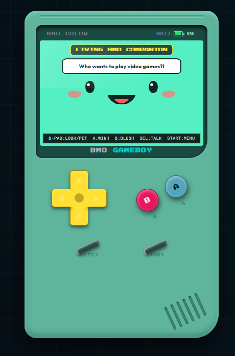
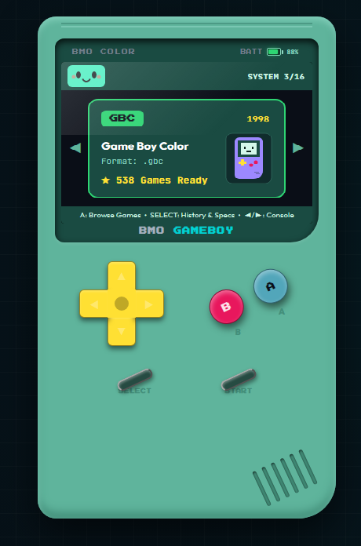
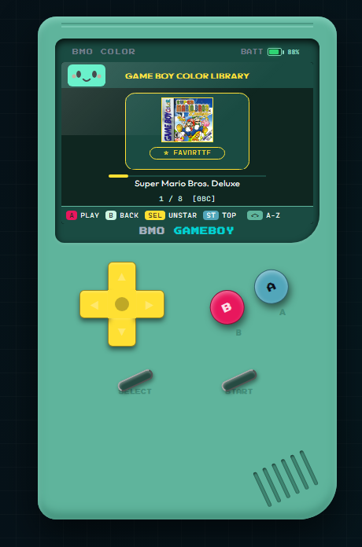
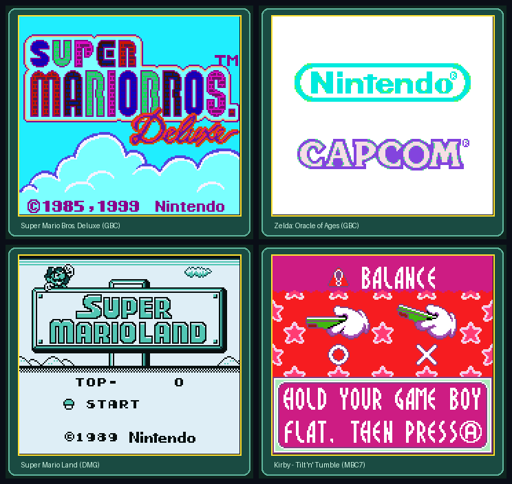

# Repository Guide — Part 1 of 2

[Back to the repository overview](../../README.md)

## Browser Simulator & Native Emulator Screenshots

<div align="center">
  
  <p><em>BMO face mode (320×240 ST7789) with procedural 2D SDF expressions and dialogue bubbles.</em></p>
</div>

<div align="center">
  
  <p><em>Console selector carousel. The browser library now lists only ROMs loaded by the user.</em></p>
</div>

<div align="center">
  
  <p><em>Earlier UI capture; current browser gameplay supports user-supplied Game Boy (<code>.gb</code>), NES (<code>.nes</code>), Atari 2600 (<code>.a26</code>), and ColecoVision (<code>.col</code>) ROMs.</em></p>
</div>

<div align="center">
  
  <p><em>Direct RGB565 framebuffers captured from the native C emulator cores (<code>Walnut-CGB</code> / <code>Peanut-GB</code>) running Super Mario Bros. Deluxe, The Legend of Zelda: Oracle of Ages, Pokémon Red, and Kirby - Tilt 'n' Tumble (MBC7 accelerometer).</em></p>
</div>

---

## Hardware Specs & Pinout

- **MCU:** ESP32-S3-WROOM-1 (`N16R8` — dual-core Xtensa LX7 @ 240 MHz, 16 MB Quad SPI Flash, 8 MB Octal SPI PSRAM)
- **Display:** 2.4" ST7789 IPS TFT (320×240 landscape, 80 MHz SPI)
- **Storage:** MicroSD over SPI (FAT32) + built-in flash fallback ROMs when no SD card is inserted
- **Input:** Eight tactile buttons are recorded as physically wired, active-low (`INPUT_PULLUP`); X, Y, L, R are supported but are not soldered on the current board

| Component | Macro (`config.h`) | GPIO | Notes |
| :--- | :--- | :--- | :--- |
| **ST7789 TFT** | `TFT_MOSI` / `TFT_SCK` | `11` / `12` | Shared SPI bus (`FSPI`, 80 MHz) |
| | `TFT_CS` / `TFT_DC` / `TFT_RST` | `10` / `8` / `9` | Display chip select, data/command, reset |
| **MicroSD** | `SD_CS` / `SD_MISO` | `13` / `15` | Shares `TFT_MOSI` (`11`) & `TFT_SCK` (`12`) via `SpiArbiter` |
| **D-Pad** | `BTN_UP` / `BTN_DOWN` / `BTN_LEFT` / `BTN_RIGHT` | `4` / `5` / `6` / `7` | `INPUT_PULLUP` (active-low, 25 ms debounce) |
| **Buttons** | `BTN_A` / `BTN_B` / `BTN_START` / `BTN_SELECT` | `16` / `17` / `18` / `21` | `INPUT_PULLUP` (active-low, read via `GPIO_IN_REG`) |
| **Extra buttons** | `BTN_X` / `BTN_Y` / `BTN_L` / `BTN_R` | `14` / `42` / `47` / `48` | `INPUT_PULLUP` (active-low, GPIO 42/47/48 read via `GPIO_IN1_REG`) |
| **Reserved** | Strapping (`0, 3, 45, 46`), Octal PSRAM (`33–37`) | — | Do not assign to peripherals |

> **Hardware note:** Battery ADC (`BATTERY_ADC_PIN = 1`) and I2S audio (`I2S_BCLK = 38`, `I2S_LRC = 39`, `I2S_DIN = 40`) are disabled in `config.h` (`FEATURE_BATTERY_MONITOR = 0`, `FEATURE_AUDIO = 0`) because those circuits are not soldered on the current board.

---

## Firmware Hardware Simulation

The Wokwi project runs the compiled ESP32-S3 firmware and simulates all twelve configured active-low button inputs using the GPIO assignments in `src/core/config.h`, including X/Y/L/R that are not soldered on the physical board. The simulated circuit also includes the shared display/SD SPI clock and MOSI, separate chip selects, and SD MISO. Battery and I2S audio parts are intentionally absent. The diagram is not an as-built wiring record.

1. Compile with the repository's ESP32-S3 settings and the output path used by [`wokwi.toml`](../../wokwi.toml):

   ```powershell
   .\arduino-cli.exe compile --fqbn "esp32:esp32:esp32s3:CDCOnBoot=cdc,FlashMode=qio,FlashSize=16M,PartitionScheme=custom,PSRAM=opi" --output-dir firmware\BmoGameboy\build\esp32.esp32.esp32s3 firmware\BmoGameboy
   ```

2. Open the repository in VS Code with the Wokwi extension and run **Wokwi: Start Simulator**. The project includes `diagram.json` and `wokwi.toml`.
3. Optional ROM images for the virtual SD card go in `sdcard/`; do not add commercial ROMs to the repository.

Wokwi currently provides an ILI9341 display model, not an ST7789 model. The diagram uses that SPI display as a visual panel substitute; Wokwi also does not expose the display reset/backlight pins. The firmware binary is the actual firmware, but panel-controller behavior is not a one-to-one electrical model. The Wokwi CLI requires a `WOKWI_CLI_TOKEN`; its local diagram linter does not.

## Firmware-Backed BMO Companion

The browser BMO companion compiles the firmware's [`bmo_face.cpp`](../../firmware/BmoGameboy/src/core/bmo_face.cpp) renderer and calls its real expression, gaze, blink, dialogue, pet, tickle, and dance APIs through WebAssembly (unpacking byte-swapped BGR565 pixels for accurate seafoam mint rendering). You can enter **BMO Mode** directly from the toolbar (**BMO Mode** button or `?state=bmo`), use **Enter BMO Mode** in the **BMO Mode — Mascot Test Bench** sidebar card, press **UP** from the console carousel (`?state=mascot`), or wait 30 seconds on the carousel.

In the sidebar test bench, all 18 `BmoExpression` states (`IDLE` through `CELEBRATING`), instant triggers (`Pet BMO`, `Tickle`, `Wink + Sparkle`, `Bashful Blush`, `Sparkle Joy`), `Dance Party` toggle with `60–220 BPM` slider, 2.5s expression auto-cycle, interactive 2D gaze pad / directional presets (or dragging directly on the 2D screen canvas), firmware quote selector, and custom speech input (`maxlength="63"`) can be triggered immediately without waiting for timers. Auto-sleep (`20s/45s`) and the on-screen HUD legend have dedicated checkboxes. Keypad controls remain active in mascot mode (`D-pad` to look, **A** to wink, **B** to blush or hold **B** to exit, **SELECT** to talk, **UP** to toggle dance, **START** to exit).

The browser supplies a small Arduino timing/randomness shim and draws the face at the firmware's 320×240 resolution. It does not execute the ESP32 state machine, ST7789/SPI transfer, SD-card code, or physical button electrical behavior; the surrounding browser menus remain a port rather than firmware output. Battery and audio remain disabled to match the soldered hardware.

## Playable Browser Game Boy, NES, Atari 2600, and ColecoVision

The browser simulator runs the firmware's vendored Peanut-GB, Agnes, Stella, and ColecoVision sources compiled to WebAssembly. It executes uploaded Game Boy (`.gb`), NES (`.nes`), Atari 2600 (`.a26`), and ColecoVision (`.col`) ROMs with their firmware button mappings and framebuffer sizes. ColecoVision uses its centered 256×192 viewport. Atari uses the firmware's centered 160×192 framebuffer and pre-swapped TIA palette; supported image sizes are 2, 4, 8, 16, and 32 KiB. NES gameplay uses its firmware palette and centered 256×240 viewport; Agnes supports iNES mappers 0, 1, 2, and 4, not mapper 3 or NES 2.0. This does **not** run the ESP32 firmware: menus remain canvas-rendered, and the other 10 console cores remain firmware-only. Unsupported systems are reported instead of drawing a synthetic game.

1. Build the WebAssembly cores (the repository's local WASI SDK is used when present; otherwise set `WASI_SDK_PATH`):

   ```powershell
   python scripts\build_wasm_cores.py
   ```

2. Start the local server:

   ```powershell
   python tools\bmo_simulator\run_simulator.py
   ```

3. Use **Load Game ROM (.gb, .nes, .a26, .col)** to select a ROM you have the right to use. Browser ROM files are limited to 8 MiB; Atari ROMs must also use one of the supported image sizes above. No game ROM is bundled by this simulator.

Controls: arrow keys or the on-screen D-pad, **Z** = A, **X** = B, **Enter** = Start, **Shift** = Select. Hold **Enter + Shift** together to open the pause menu, matching the firmware's **START + SELECT** chord. The save slot is in-memory for the current page session.

This is playable Game Boy, NES, Atari, and ColecoVision software emulation, not a one-to-one electrical/hardware model. The display bezel and system menus are browser-rendered; physical SPI behavior, the ESP32 scheduler, SD-card firmware, and the other 10 firmware emulators are not executed. Browser save state is one in-memory snapshot for the current page session, not the firmware's SD-backed five-slot saves or battery-RAM persistence. Use the separate Wokwi project to run the compiled firmware, noting its ILI9341 display substitute is not the physical ST7789.

---
