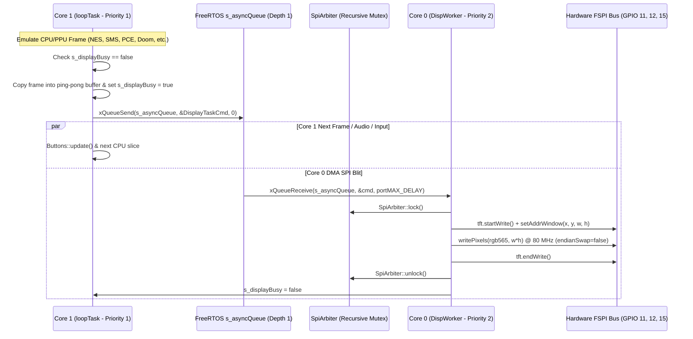
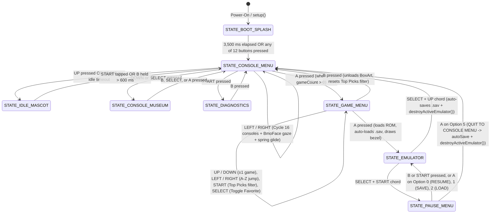

# Software Design Document (SDD): BMO ESP32-S3 Handheld Gaming Console

> **Document Version:** 5.0 (Complete Source-Verified Repository Specification)  
> **Target Microcontroller:** Espressif ESP32-S3-WROOM-1 (`N16R8` — Dual-Core Xtensa LX7 @ 240 MHz, 16 MB Quad-SPI Flash, 8 MB Octal-SPI PSRAM)  
> **Display Controller:** Sitronix ST7789VW 2.4" IPS TFT (240×320 physical portrait panel driven as a 320×240 landscape viewport (`MADCTL = 0xA8`, Rotation 3 + BGR) over 80 MHz Hardware `FSPI`)  
> **Storage Subsystem:** Shared `FSPI` MicroSD Slot (25 MHz SPI, FAT32) + 5 Built-in Flash Fallback ROMs  
> **Control Surface:** 12 Active-Low Tactile Inputs (`INPUT_PULLUP`; 8 Base Game Boy Buttons Physically Soldered + 4 Extended `X, Y, L, R` Buttons Supported in Firmware, Wokwi, and 3D Simulator, Pending Physical Soldering)  
> **Software Stack:** Arduino-ESP32 Core v3.3.11 (ESP-IDF v5.x / FreeRTOS SMP), 14 C/C++ Emulator Engines, Procedural 2D Signed Distance Field (SDF) Mascot Engine, Three.js 3D WebGL Console Simulator, W3C WebAssembly Browser Playtest & Companion Cores, Native x64 C Regression Harness, and Python Guardian Static/AST/ELF/UI Verification Suite  
> **Last Verified Against Source:** 2026-11-07 (`Flash: 5,700,300 / 16,777,216 B [34.0%]`, `DRAM: 218,936 / 327,680 B [66.8%]`, `IRAM: 77,824 B`)

---

## Table of Contents

1. [Executive Summary & System Truth Matrix](#1-executive-summary--system-truth-matrix)
2. [Physical Hardware, Electrical Ground Truth & Mechanical Enclosure](#2-physical-hardware-electrical-ground-truth--mechanical-enclosure)
3. [Complete GPIO Pin Assignment Matrix & Register Architecture](#3-complete-gpio-pin-assignment-matrix--register-architecture)
4. [Complete Repository Directory & File Encyclopedia](#4-complete-repository-directory--file-encyclopedia)
5. [Boot Sequence, Dual-Core RTOS Pipeline & 8-State Finite State Machine](#5-boot-sequence-dual-core-rtos-pipeline--8-state-finite-state-machine)
6. [Memory Hierarchy, Partition Layout & Cache Alignment Invariants](#6-memory-hierarchy-partition-layout--cache-alignment-invariants)
7. [Display Subsystem (`DisplayEmu`), Color Tokens & 80 MHz SPI Bus Physics](#7-display-subsystem-displayemu-color-tokens--80-mhz-spi-bus-physics)
8. [Procedural 2D Signed Distance Field (SDF) Mascot Engine (`BmoFace`)](#8-procedural-2d-signed-distance-field-sdf-mascot-engine-bmoface)
9. [Deep-Dive Specification of All 14 Emulator Cores](#9-deep-dive-specification-of-all-14-emulator-cores)
10. [Storage, Binary Indexing, Save States, Box Art & Persistence](#10-storage-binary-indexing-save-states-box-art--persistence)
11. [Dormant Hardware Subsystems, Hardware Cycle Profiler & Self-Tests](#11-dormant-hardware-subsystems-hardware-cycle-profiler--self-tests)
12. [Complete Public C/C++ Symbol & API Reference](#12-complete-public-cc-symbol--api-reference)
13. [3D WebGL Console Simulator, WebAssembly Cores & Wokwi Simulation](#13-3d-webgl-console-simulator-webassembly-cores--wokwi-simulation)
14. [Native x64 Host Verification, Guardian Toolchain & 9-Phase CI Pipeline](#14-native-x64-host-verification-guardian-toolchain--9-phase-ci-pipeline)
15. [Performance Optimization Registry (`PERF-01`..`PERF-25`) & Known Limitations](#15-performance-optimization-registry-perf-01perf-25--known-limitations)
16. [Complete Vendor C Emulator Struct & Memory Map Reference](#16-complete-vendor-c-emulator-struct--memory-map-reference)
17. [Guardian CLI, MCP Server, Ruleset v8 Catalog & Extensibility Playbook](#17-guardian-cli-mcp-server-ruleset-v8-catalog--extensibility-playbook)

---

## 1. Executive Summary & System Truth Matrix

This repository contains the complete embedded firmware, vendor emulator cores, 3D browser simulator, WebAssembly runtime bridges, hardware wiring specifications, native C test harnesses, and static analysis tooling for a handheld gaming console modeled after **BMO** from *Adventure Time* and built around the **ESP32-S3-WROOM-1 (N16R8)** microcontroller.

This Software Design Document is designed to be a self-contained technical reference so that any external AI agent or human engineer can inspect, review, or extend the system with full knowledge of the hardware constraints, memory budgets, C/C++ data structures, state machine transitions, and verification gates without needing to guess any implementation detail.

### 1.1 Environment Truth Matrix (Physical Hardware vs. Wokwi vs. Browser Simulator)

To prevent architectural confusion between what runs on the physical soldered ESP32-S3 board, what runs in the Wokwi circuit simulator, and what runs in the browser workstation (`tools/bmo_simulator/`), the table below states the exact execution status of every subsystem across all four environments:

| Subsystem / Feature | Physical ESP32-S3 Board | Wokwi Circuit Simulator (`diagram.json` + `wokwi.toml`) | Browser 3D Simulator + WASM (`tools/bmo_simulator/`) | Native x64 Host Test Harness (`tools/host_cores_runner.c`) |
| :--- | :--- | :--- | :--- | :--- |
| **MCU / Execution Target** | Xtensa LX7 Dual-Core @ 240 MHz (`FlashMode=qio, PSRAM=opi`) | Emulated ESP32-S3 running the exact compiled firmware ELF | Browser JS + two WASI WebAssembly modules (`bmo_face_wasm.wasm`, `bmo_playtest_cores.wasm`) | Native x86_64 machine code compiled via MSVC `cl.exe` or `gcc` |
| **Display Panel** | Physical 2.4" ST7789VW IPS TFT (320×240 landscape, 80 MHz FSPI) | Uses `board-ili9341-cap-touch` as a visual SPI substitute (Wokwi lacks an ST7789 model; `TFT_RST` is unwired in Wokwi) | HTML5 2D Canvas (`320×240`) projected onto a Three.js `CanvasTexture` inside the 3D WebGL enclosure | Offscreen BGR565 RAM framebuffers verified via FNV-1a 32-bit hashing |
| **8 Base Buttons (`UP, DOWN, LEFT, RIGHT, A, B, START, SELECT`)** | **Physically soldered** (`GPIO 4, 5, 6, 7, 16, 17, 18, 21`, active-low `INPUT_PULLUP`) | Wired in `diagram.json` (`btn-up`..`btn-select`) to matching GPIOs | Raycast 3D mesh clicks, 2D D-pad/buttons, and keyboard (`Arrows, Z, X, Enter, Shift`) | Programmatic joypad bitmask injection per test frame |
| **4 Extended Buttons (`X, Y, L, R`)** | **Supported in firmware** (`GPIO 14, 42, 47, 48`, `INPUT_PULLUP`), **pending physical soldering** (`UNVERIFIED_HARDWARE`; unwired pins safely read `HIGH` = released) | Wired in `diagram.json` (`btn-x=14, btn-y=42, btn-l=47, btn-r=48`) to GND | Raycast 3D mesh clicks on ABXY diamond & top shoulder bumpers (`A, S, Q, W` keys) | Tested via bitmask injection in SNES/Genesis/DOOM unit tests |
| **MicroSD Slot (`SD_CS=13, SD_MISO=15`)** | **Physically soldered** on shared `FSPI` bus (`SCK=12, MOSI=11`) | Wired (`sd1:CS -> 13, DO -> 15, DI -> 11, SCK -> 12`) | Simulated via browser file upload (`<input type="file">`) and WebSerial SD manager | Tested via mocked/in-memory ROM buffers |
| **BMO Mascot SDF Engine (`bmo_face.cpp`)** | Runs natively on Core 1 into 153,600 B PSRAM canvas | Runs inside compiled firmware ELF | **Runs actual `bmo_face.cpp` compiled to `bmo_face_wasm.wasm`** (all 18 expressions, springs, speech, petting, dance) | Verified via `test_native_cores_execution.py` WASM API tests |
| **Emulator Cores Executed** | **All 14 cores** (`Walnut-CGB, Peanut-GB, Agnes NES, DOOM, SMS/GG, PCE, Atari 2600, PICO-8, Genesis, SNES, WonderSwan, NGP, Lynx, ColecoVision`) | All 14 cores compiled in firmware binary (5 baked GB/GBC ROMs run out-of-the-box) | **4 cores compiled to `bmo_playtest_cores.wasm`**: Game Boy (`.gb`), NES (`.nes`), Atari 2600 (`.a26`), and ColecoVision (`.col`). Other 10 cores are firmware-only | **11 host-portable C cores** (`agnes, atari, colem, lynx, ngp, snes, wswan, genesis, sms, pce, pico`) run 50-frame deterministic execution + save-state tests |
| **Battery Monitor (`GPIO 1`)** | **Not soldered** (`FEATURE_BATTERY_MONITOR = 0`; returns `100%`, `3300 mV`) | Absent from circuit | Disabled to match hardware | Tested via host unit mocks |
| **I2S Audio (`GPIO 38, 39, 40`)** | **Not soldered** (`FEATURE_AUDIO = 0`; `AudioI2S` is a safe no-op stub) | Absent from circuit | Web Audio UI synthesizer in browser (not firmware I2S) | Disabled |
| **I2C FRAM (`GPIO 43, 44`)** | **Not soldered** (`FramSave::init()` probes `0x50` and sets `s_present = false`) | Absent from circuit | Not simulated | Not simulated |

---

## 2. Physical Hardware, Electrical Ground Truth & Mechanical Enclosure

### 2.1 Microcontroller Architecture (`ESP32-S3-WROOM-1-N16R8`)
- **CPU:** Dual-core Xtensa 32-bit LX7 microprocessor running at **240 MHz** (`Core 0` = Protocol/DMA/Display Worker, `Core 1` = Arduino `setup()`/`loop()` Application & Emulator Thread).
- **Internal SRAM:**
  - **DRAM (Data SRAM):** `327,680 bytes` (320 KB usable static + heap data pool). Current firmware static usage: **`218,936 bytes` (66.8%)**, leaving **`108,744 bytes`** free at boot for FreeRTOS stacks (`loopTask`, `DispWorker`, `ipc0`, `ipc1`), DMA descriptors, and heap allocations.
  - **IRAM (Instruction SRAM):** Current firmware static usage: **`77,824 bytes`** for interrupt handlers and `IRAM_ATTR` hot functions (`Walnut-CGB` dual-fetch scanline renderer and CPU loop).
- **External Flash (`16 MB Quad-SPI`):**
  - Connected over **4-bit Quad SPI (`FlashMode=qio`) at 80 MHz**.
  - **CRITICAL HARDWARE INVARIANT:** The `N16R8` module uses **Quad-SPI Flash** and **Octal-SPI PSRAM**. Compiling or flashing with `FlashMode=opi` is strictly forbidden because setting `FlashMode=opi` configures the ROM bootloader to drive Octal Flash pins that do not exist on the flash die, causing an immediate `SPI_FAST_FLASH_BOOT` reset loop. Always compile with:
    ```text
    --fqbn "esp32:esp32:esp32s3:CDCOnBoot=cdc,FlashMode=qio,FlashSize=16M,PartitionScheme=custom,PSRAM=opi"
    ```
- **External PSRAM (`8 MB Octal-SPI`):**
  - Connected over **8-bit Octal SPI (`PSRAM=opi`) at 80 MHz DDR** via internal package pins **GPIO 33 through GPIO 37**.
  - Provides ~160 MB/s sequential bandwidth through the 32-byte line-size CPU Data Cache (`DCache`), but random cache-miss reads incur ~120–180 ns latency.

### 2.2 Display Panel (`ST7789VW` 2.4" IPS TFT)
- **Physical Resolution:** 240 (H) × 320 (V) RGB pixels (portrait native scan order).
- **Configured Viewport:** **320 (W) × 240 (H)** landscape (`tft.setRotation(3)`).
- **Active Viewing Area:** `4.88 cm × 3.66 cm` (4:3 aspect ratio, 2.4-inch diagonal) inside a `5.0 cm × 3.8 cm` front bezel cutout.
- **Bus Interface:** 4-wire unidirectional SPI (`TFT_SCK=12`, `TFT_MOSI=11`, `TFT_CS=10`, `TFT_DC=8`, `TFT_RST=9`) clocked at **80 MHz** (the maximum frequency supported by the ESP32-S3 GPIO matrix / IO_MUX for `FSPI`).
- **Backlight (`BLK`):** Wired directly to the **3.3V rail** (always illuminated while powered; no PWM GPIO is consumed).

### 2.3 MicroSD Breakout Electrical Characteristics & MISO 5V Back-Powering Physics
- **Shared Bus Topology:** The MicroSD card shares `TFT_SCK` (GPIO 12) and `TFT_MOSI` (GPIO 11) with the ST7789 display on the `FSPI` peripheral while using a dedicated chip select (`SD_CS` = GPIO 13) and data return line (`SD_MISO` = GPIO 15).
- **5V VCC Requirement:** Standard 6-pin blue MicroSD breakout modules include an onboard 3.3V LDO regulator (AMS1117-3.3). Feeding 3.3V into the breakout's `VCC` pin drops the card rail to ~2.2V due to LDO dropout, causing `SD.begin()` to fail. Therefore, the breakout `VCC` pin is powered from **5V (`VBUS`)**.
- **MISO 5V Back-Powering Hazard (`entry 0x403c88b8` Bootloop):**
  - Many 5V MicroSD breakouts contain a 5V level-shifter buffer (LVC125A) wired so that `MISO` (GPIO 15) is driven at **5.0V CMOS** when the module is powered from 5V.
  - Because the ESP32-S3 I/O pads are 3.3V maximum (`VDD_SPI` / `VDD3P3_CPU`), a 5.0V signal on GPIO 15 forward-biases the ESP32-S3 internal ESD protection diode into the 3.3V rail ($5.0\text{V} - 0.6\text{V} \approx 4.4\text{V}$).
  - Elevating the 3.3V rail to 4.4V corrupts the timing of the internal 1.8V/3.3V Octal PSRAM and Quad Flash regulators, causing an immediate ROM bootloader panic (`entry 0x403c88b8` reset loop) whenever the SD card is inserted or accessed.
  - **Hardware Mitigation:** Either (a) use a direct 3.3V MicroSD socket without a 5V level shifter (or the SD slot on the rear of the ST7789 PCB with its jumper bridged), or (b) insert a **10 kΩ series current-limiting resistor** (or 3.3V Schottky clamp) on the `SD_MISO` (GPIO 15) line.

### 2.4 Power Supply Architecture (USB-C Now; 3×AA NiMH Boost vs. LiPo)
- **Current Physical Power State:** The console is powered via the ESP32-S3-DevKitC-1 **USB-C connector (`5V VBUS`)**. No battery, fuel gauge, or voltage divider is currently soldered (`FEATURE_BATTERY_MONITOR = 0`).
- **Planned Portable Power Options (Documented in `docs/hardware-notes.md`):**
  1. **Option A (Recommended — Canonical BMO Rear AA Compartment):** **3×AA NiMH Rechargeable Cells** (Eneloop 1.2V × 3 = 3.6V nominal, 2,000 mAh) feeding a synchronous 5V step-up boost converter (`Pololu U3V16F5` or `TPS61023`, $\ge 1.5\text{ A}$ continuous output) into the `5V` rail. Standard cheap `MT3608` boards without low-voltage bootstrap or $0.5\text{ A}$ current-limited boost modules will brown out during 240 MHz Wi-Fi/PSRAM/TFT current spikes (~350–450 mA).
  2. **Option B (LiPo Pouch Cell):** 3.7V 2,000 mAh LiPo cell (103450 package). **Warning:** Never wire a standalone **TP4056** module directly in parallel with the system load without a **load-sharing (power-path) P-MOSFET + Schottky diode circuit**, because the ESP32-S3's ~150 mA quiescent draw prevents the TP4056 current sensor from ever dropping below the $C/10$ termination threshold, Trickle/CV overcharging the LiPo cell indefinitely until thermal runaway.

### 2.5 Mechanical Enclosure & 2.54 mm Perfboard Coordinates
- **Outer Shell Dimensions:** `8.8 cm (W) × 12.4 cm (H) × 3.2 cm (D)` modeled after the canonical *Adventure Time* BMO silhouette (`0.6 cm` corner radius on top-left, top-right, bottom-left; `1.5 cm` asymmetric radius on bottom-right).
- **Internal Prototype Perfboard:** Single `2.54 mm` (`0.1"`) grid board cut to **31 × 46 holes (`7.9 cm × 11.7 cm`)**.
- **Exact Front-Face Component Coordinates (Measured from Top-Left `(0.0, 0.0) cm` of the `8.8 × 12.4 cm` Front Face):**
  - **Display Bezel Aperture:** `5.0 cm × 3.8 cm` centered at **`(4.4, 3.3) cm`** (houses the `4.88 × 3.66 cm` active ST7789 area).
  - **Decorative Floppy/Cassette Slot & Blue Button:** Horizontal slot (`3.6 × 0.32 cm`) below the left side of the bezel (`Y = 5.85 cm`) with a circular blue button (`Ø 0.56 cm`) to its right.
  - **Yellow Cross D-Pad:** `2.8 cm × 2.8 cm` span (`0.95 cm` arm width) centered at **`(2.2, 8.4) cm`**. Uses 4 tactile switches spaced at `±1.016 cm` (`±4` perfboard holes) from center:
    - `BTN_UP` (`GPIO 4`): `(2.2, 7.4) cm`
    - `BTN_DOWN` (`GPIO 5`): `(2.2, 9.4) cm`
    - `BTN_LEFT` (`GPIO 6`): `(1.2, 8.4) cm`
    - `BTN_RIGHT` (`GPIO 7`): `(3.2, 8.4) cm`
  - **Square-Grid ABXY Action Diamond (`Ø 0.9 cm` caps, `1.41 cm` diagonal center-to-center spacing, `0.51 cm` inter-cap clearance):**
    - `BTN_X` (`GPIO 14`, Top — Green `#4CAF50`): **`(6.6, 7.4) cm`**
    - `BTN_Y` (`GPIO 42`, Left — Pink `#F48FB1`): **`(5.6, 8.4) cm`**
    - `BTN_A` (`GPIO 16`, Right — Blue `#52A6BA`): **`(7.6, 8.4) cm`**
    - `BTN_B` (`GPIO 17`, Bottom — Magenta `#E8175D`): **`(6.6, 9.4) cm`**
  - **Select & Start Pills:** Two horizontal dark-navy stadium capsules (`1.05 × 0.30 cm` cap, `1.4 × 0.5 cm` footprint) placed side-by-side in the lower-left beneath the D-pad (`Y = 11.0 cm`).
  - **Top Rim L & R Shoulder Bumpers:** `2.2 cm × 0.6 cm` right-angle tactile triggers mounted along the top rim (`Y ≥ 6.20 cm` in centered 3D coordinates, corresponding to **`(1.7, 0.3) cm`** for `BTN_L` and **`(7.1, 0.3) cm`** for `BTN_R`).
  - **Left & Right Flanks:** 7-hole circular acoustic speaker array (1 center hole + 6 surrounding holes on a `0.85 cm` ring) in the upper flank, bold vertical **`B-M-O`** block lettering down the middle, and a circular arm-socket boss inside the **`O`** on the lower flank, plus a recessed MicroSD slot (`1.3 × 0.25 cm`) on the left and a power switch cutout (`1.0 × 0.4 cm`) on the right.
  - **Rear Shell:** 5 vertical cooling vent capsule slits (`| | | | |`) across the upper back, a raised beveled battery/service access plate (`5.8 × 3.8 cm`) with 4 corner slotted metal screws across the middle back, and a horizontal recessed finger-latch pocket (`3.0 × 0.50 cm`) across the lower back.

---

## 3. Complete GPIO Pin Assignment Matrix & Register Architecture

The single source of truth for all firmware GPIO assignments and feature flags is [`firmware/BmoGameboy/src/core/config.h`](file:///e:/BMO%20Gameboy/firmware/BmoGameboy/src/core/config.h).

### 3.1 Master Pin & Feature Flag Table (`src/core/config.h`)

| Macro Name | Value | Subsystem | Direction / Mode | Hardware Status & Electrical Notes |
| :--- | :---: | :--- | :--- | :--- |
| `TFT_MOSI` | **`11`** | ST7789 + MicroSD | `OUTPUT` (FSPI MOSI) | **Physically Soldered.** Shared 80 MHz (TFT) / 25 MHz (SD) SPI data out. |
| `TFT_SCK` | **`12`** | ST7789 + MicroSD | `OUTPUT` (FSPI SCLK) | **Physically Soldered.** Shared 80 MHz (TFT) / 25 MHz (SD) SPI clock. |
| `TFT_CS` | **`10`** | ST7789 Display | `OUTPUT` (Active-Low) | **Physically Soldered.** Display chip select; initialized `HIGH` before `SD.begin()`. |
| `TFT_DC` | **`8`** | ST7789 Display | `OUTPUT` | **Physically Soldered.** Data (`HIGH`) / Command (`LOW`) select. |
| `TFT_RST` | **`9`** | ST7789 Display | `OUTPUT` (Active-Low) | **Physically Soldered.** Hardware reset pin (not modeled in Wokwi's ILI9341 part). |
| `SD_CS` | **`13`** | MicroSD Slot | `OUTPUT` (Active-Low) | **Physically Soldered.** SD card chip select; initialized `HIGH` before `tft.init()`. |
| `SD_MISO` | **`15`** | MicroSD Slot | `INPUT` (FSPI MISO) | **Physically Soldered.** SD card data out (`DO`). Protect against 5V level-shifter back-feed. |
| `BTN_UP` | **`4`** | D-Pad Up | `INPUT_PULLUP` | **Physically Soldered.** Active-low (`LOW` = pressed); sampled via `GPIO_IN_REG` bit 4. |
| `BTN_DOWN` | **`5`** | D-Pad Down | `INPUT_PULLUP` | **Physically Soldered.** Active-low; sampled via `GPIO_IN_REG` bit 5. |
| `BTN_LEFT` | **`6`** | D-Pad Left | `INPUT_PULLUP` | **Physically Soldered.** Active-low; sampled via `GPIO_IN_REG` bit 6. |
| `BTN_RIGHT` | **`7`** | D-Pad Right | `INPUT_PULLUP` | **Physically Soldered.** Active-low; sampled via `GPIO_IN_REG` bit 7. |
| `BTN_A` | **`16`** | Action A (Right) | `INPUT_PULLUP` | **Physically Soldered.** Active-low; sampled via `GPIO_IN_REG` bit 16. |
| `BTN_B` | **`17`** | Action B (Bottom) | `INPUT_PULLUP` | **Physically Soldered.** Active-low; sampled via `GPIO_IN_REG` bit 17. |
| `BTN_START` | **`18`** | Start Pill | `INPUT_PULLUP` | **Physically Soldered.** Active-low; sampled via `GPIO_IN_REG` bit 18. |
| `BTN_SELECT` | **`21`** | Select Pill | `INPUT_PULLUP` | **Physically Soldered.** Active-low; sampled via `GPIO_IN_REG` bit 21. |
| `BTN_X` | **`14`** | Action X (Top) | `INPUT_PULLUP` | **Pending Solder (`UNVERIFIED_HARDWARE`).** Sampled via `GPIO_IN_REG` bit 14. |
| `BTN_Y` | **`42`** | Action Y (Left) | `INPUT_PULLUP` | **Pending Solder (`UNVERIFIED_HARDWARE`).** Sampled via `GPIO_IN1_REG` bit 10 (`42 - 32`). |
| `BTN_L` | **`47`** | Left Shoulder | `INPUT_PULLUP` | **Pending Solder (`UNVERIFIED_HARDWARE`).** Sampled via `GPIO_IN1_REG` bit 15 (`47 - 32`). |
| `BTN_R` | **`48`** | Right Shoulder | `INPUT_PULLUP` | **Pending Solder (`UNVERIFIED_HARDWARE`).** Sampled via `GPIO_IN1_REG` bit 16 (`48 - 32`). Note: also connects to onboard WS2812 RGB LED on many DevKitC-1 boards. |
| `BATTERY_ADC_PIN` | **`1`** | Battery ADC1_CH0 | `INPUT` (ADC) | **Not Soldered.** Disabled by `FEATURE_BATTERY_MONITOR = 0`. Never poll when floating. |
| `I2S_BCLK` | **`38`** | MAX98357A Bit Clock | `OUTPUT` (I2S) | **Not Soldered.** Disabled by `FEATURE_AUDIO = 0`. |
| `I2S_LRC` | **`39`** | MAX98357A Word Select | `OUTPUT` (I2S) | **Not Soldered.** Disabled by `FEATURE_AUDIO = 0`. |
| `I2S_DIN` | **`40`** | MAX98357A Serial Data | `OUTPUT` (I2S) | **Not Soldered.** Disabled by `FEATURE_AUDIO = 0`. |
| `I2C_SDA` | **`43`** | FM24C64B FRAM SDA | `OPEN_DRAIN` (I2C) | **Not Soldered.** Probed once in `FramSave::init()` (`0x50` @ 400 kHz); shares UART0 TX0 on some boards. |
| `I2C_SCL` | **`44`** | FM24C64B FRAM SCL | `OPEN_DRAIN` (I2C) | **Not Soldered.** Probed once in `FramSave::init()`; shares UART0 RX0 on some boards. |
| `FEATURE_SD_CARD` | **`1`** | Compile Flag | Enabled (`1`) | Enables MicroSD driver and shared SPI arbitration. |
| `FEATURE_AUDIO` | **`0`** | Compile Flag | Disabled (`0`) | Compiles `AudioI2S` as zero-overhead no-op stubs. |
| `FEATURE_BATTERY_MONITOR` | **`0`** | Compile Flag | Disabled (`0`) | Returns fixed `100%` / `3300 mV` without touching `analogRead(1)`. |

### 3.2 Strictly Forbidden GPIOs on ESP32-S3-N16R8
1. **GPIO 33, 34, 35, 36, 37 (Octal PSRAM Bus):** Internally bonded inside the `ESP32-S3-WROOM-1-N16R8` shield can to the 8 MB Octal SPI PSRAM die (`SPIIO4`–`SPIIO7`, `SPIDQS`). Calling `pinMode()`, `digitalRead()`, or `digitalWrite()` on any of GPIO 33–37 immediately corrupts the PSRAM bus and triggers a StoreProhibited / Cache Error panic.
2. **GPIO 0, 3, 45, 46 (Hardware Boot Strapping Pins):**
   - `GPIO 0`: Boot mode select (`LOW` at reset enters `DOWNLOAD_BOOT`). Never wire a gameplay button to `GPIO 0` or holding that button at power-on will trap the console in bootloader mode.
   - `GPIO 3`: JTAG signal source strapping pin.
   - `GPIO 45`: `VDD_SPI` flash/PSRAM voltage selector (`0` = 3.3V, `1` = 1.8V). Pulling `GPIO 45` high at reset brown-outs the 3.3V Flash/PSRAM.
   - `GPIO 46`: ROM bootloader print & boot mode strapping pin.
3. **GPIO 19, 20 (Native USB D- / D+):** Dedicated to native USB-CDC serial flashing and `Serial` telemetry (`CDCOnBoot=cdc`).

### 3.3 Dual-Register Zero-Wait GPIO Polling (`GPIO_IN_REG` & `GPIO_IN1_REG`)
Arduino's `digitalRead(pin)` performs pin-validation lookup tables and function calls taking ~180 ns per call ($180\text{ ns} \times 12 = 2,160\text{ ns}$). Instead, [`firmware/BmoGameboy/src/core/buttons.cpp`](file:///e:/BMO%20Gameboy/firmware/BmoGameboy/src/core/buttons.cpp) reads both 32-bit memory-mapped GPIO input registers in **two single-cycle APB bus reads (~8 ns total)** inside `Buttons::update()`:

```cpp
#if defined(ESP32) && defined(GPIO_IN_REG)
    const uint32_t gpioIn0 = REG_READ(GPIO_IN_REG);   // Samples GPIO 0..31  (UP=4, DOWN=5, LEFT=6, RIGHT=7, X=14, A=16, B=17, START=18, SELECT=21)
    const uint32_t gpioIn1 = REG_READ(GPIO_IN1_REG);  // Samples GPIO 32..48 (Y=42 [bit 10], L=47 [bit 15], R=48 [bit 16])
#endif
```

For each button $i \in [0, 11]$ in `PINS[12] = {4, 5, 6, 7, 16, 17, 18, 21, 14, 42, 47, 48}`:
- If `pin < 32`: `reading = ((gpioIn0 >> pin) & 1U) == 0U` (active-low: `0` bit means pressed).
- If `pin >= 32`: `reading = ((gpioIn1 >> (pin - 32)) & 1U) == 0U`.

#### Adaptive Debounce, A/B Remap & Auto-Fire Turbo (`Buttons::update()`)
- **Adaptive Debounce Window:**
  - `DEBOUNCE_DELAY_MENU_MS = 25` ms when `s_gameplayMode == false` (menus, carousel, museum, diagnostics, companion).
  - `DEBOUNCE_DELAY_GAME_MS = 6` ms when `s_gameplayMode == true` (`STATE_EMULATOR`), providing sub-frame (< 16.6 ms) response for platformers while filtering mechanical contact bounce.
- **Logical Modifier Layer (Active Only When `s_gameplayMode == true` and `SELECT` is NOT Held):**
  - Notice the critical safety guard: `const bool selectHeld = state[SELECT];` — whenever `SELECT` is held in-game (to execute a `SELECT + ...` hotkey chord), both **A/B Swap** and **Turbo Auto-Fire** are temporarily bypassed so `SELECT + A` is always Quick Save and `SELECT + B` is always Quick Load, even if the user enabled A/B Swap or Turbo!
  - **A/B Swap (`s_swapAB`):** Exchanges `state[A]`/`lastState[A]` with `state[B]`/`lastState[B]`.
  - **Turbo Auto-Fire (`s_turboEnabled`):** Modulates held `A` or `B` buttons with a 15 Hz square wave (`((now / 33) & 1) == 0`, toggling every 33 ms = ~2 frames) and synthesizes rising/falling edges in `lastState[]`.

---

## 4. Complete Repository Directory & File Encyclopedia

Every directory and first-party file in the repository is cataloged below with its exact role:

```text
e:\BMO Gameboy\
├── AGENTS.md                                      # Ruleset v8 quick on-ramp & core agent invariants
├── AGENT_MANIFEST.json                            # Machine-readable project manifest (pins, budgets, rules)
├── AGENT_KNOWLEDGE_GRAPH.json                     # Generated AST symbol & call-graph index (1,500+ symbols)
├── CHANGELOG.md                                   # Chronological engineering & verification log
├── DESIGN.md                                      # UI/UX design system (tokens, 8px/4px grid, springs, contrast)
├── README.md                                      # Repository overview, quickstart, and pinout summary
├── diagram.json                                   # Wokwi circuit schematic (ESP32-S3, 12 buttons, TFT, SD)
├── wokwi.toml                                     # Wokwi firmware binary & ELF path configuration
├── firmware/BmoGameboy/                           # Arduino-ESP32 firmware sketch root
│   ├── BmoGameboy.ino                             # Main 8-state FSM, setup(), loop(), and 14-core dispatcher (1,202 lines)
│   ├── partitions.csv                             # Custom 16 MB flash partition table (8 MB app0 + 8 MB ffat)
│   └── src/
│       ├── core/                                  # First-party hardware abstraction & UI core
│       │   ├── config.h                           # Single source of truth for GPIOs, resolutions, and feature flags
│       │   ├── theme.h                            # Pre-byte-swapped BGR565 color tokens & 5 DMG palettes
│       │   ├── spi_arbiter.h / .cpp               # FreeRTOS recursive mutex protecting shared FSPI bus
│       │   ├── display_emu.h / .cpp               # ST7789 driver, Core 0 DMA task, UI screens & scanline scalers
│       │   ├── bmo_face.h / .cpp                  # 320x240 procedural 2D SDF mascot engine & 13 harmonic springs
│       │   ├── buttons.h / .cpp                   # Dual-register GPIO polling, debounce, A/B swap, and turbo
│       │   ├── sd_card.h / .cpp                   # Recursive SD scanner, .bmo_index cache, favorites, history, 5 baked ROMs
│       │   ├── rom_index.h                        # Packed structs for /.bmo_index (BmoIndexHeader, BmoIndexEntry)
│       │   ├── save_manager.h / .cpp              # .sav battery RAM, .s01-.s05 save states (BSS1 + CRC32), .bmp screenshots
│       │   ├── box_art.h / .cpp                   # 64x64 .raw & .bmp cover art loader into 8 KB PSRAM buffer
│       │   ├── profiler.h / .cpp                  # Xtensa CCOUNT cycle profiler (BmoProfiler::ScopedSample)
│       │   ├── battery.h / .cpp                   # GPIO 1 ADC battery monitor (gated off by FEATURE_BATTERY_MONITOR=0)
│       │   ├── audio_i2s.h / .cpp                 # GPIO 38-40 I2S audio driver (gated off by FEATURE_AUDIO=0)
│       │   └── fram_save.h / .cpp                 # Optional I2C FM24C64B FRAM driver (GPIO 43/44, address 0x50)
│       ├── emulators/                             # First-party C++ lifecycle wrappers for all 14 engines
│       │   ├── emu_walnut.h / .cpp                # Core 0: Walnut-CGB (.gbc) dual-fetch Game Boy Color wrapper
│       │   ├── emu_peanut.h / .cpp                # Core 1: Peanut-GB (.gb) Game Boy DMG wrapper
│       │   ├── emu_nes.h / .cpp                   # Core 2: Agnes (.nes) Nintendo Entertainment System wrapper
│       │   ├── emu_doom.h / .cpp                  # Core 3: doomgeneric (.wad) DOOM engine wrapper
│       │   ├── emu_sms.h / .cpp                   # Core 4 & 5: SMS Plus (.sms, .gg) Master System & Game Gear wrapper
│       │   ├── emu_pce.h / .cpp                   # Core 6: PC Engine / TurboGrafx-16 (.pce) wrapper
│       │   ├── emu_atari.h / .cpp                 # Core 7: Stella (.a26, .a78) Atari 2600 wrapper
│       │   ├── emu_pico.h / .cpp                  # Core 8: PICO-8 (.p8) fantasy console runtime wrapper
│       │   ├── emu_genesis.h / .cpp               # Core 9: Sega Genesis / Mega Drive (.gen, .md, .smd) wrapper
│       │   ├── emu_snes.h / .cpp                  # Core 10: Super Nintendo (.sfc, .smc) wrapper
│       │   ├── emu_wswan.h / .cpp                 # Core 11: Bandai WonderSwan / Color (.ws, .wsc) wrapper
│       │   ├── emu_ngp.h / .cpp                   # Core 12: SNK Neo Geo Pocket / Color (.ngp, .ngc) wrapper
│       │   ├── emu_lynx.h / .cpp                  # Core 13: Atari Lynx (.lnx) wrapper
│       │   └── emu_colem.h / .cpp                 # Core 14: ColecoVision / Sega SG-1000 (.col, .sg) wrapper
│       ├── engine/
│       │   └── walnut_cgb/walnut_cgb.h            # Custom single-header CGB dual-fetch engine (~2,400 lines)
│       ├── vendor/                                # Vendored & custom C emulator cores
│       │   ├── peanut_gb/                         # peanut_gb.h, peanut_gb_config.h (DMG CPU/PPU/MBC1-7)
│       │   ├── agnes/                             # agnes.h, agnes.c (NES 6502 + PPU + Mappers 0, 1, 2, 4 + 8KB PRG-RAM)
│       │   ├── doom/src/                          # doomgeneric C port (PSRAM zone allocator, SPI-locked VFS WAD streaming)
│       │   ├── smsplus/                           # sms.h, sms.c (Z80 + VDP + 32-entry BGR565 palette cache)
│       │   ├── pce/                               # pce.h, pce.c (HuC6280 + HuC6270 VDC + 2KB BRAM)
│       │   ├── stella/                            # atari.h, atari.c (6507 + 6532 RIOT + TIA + F8/F6/F4 bankswitching)
│       │   ├── pico/                              # pico.h, pico.c (32KB PICO-8 RAM map + draw bytecode runner)
│       │   ├── genesis/                           # genesis.h, genesis.c (M68000 + Z80 + YM2612 + VDP)
│       │   ├── snes/                              # snes.h, snes.c (WDC 65C816 + 8-ch DMA + S-PPU Modes 0/1)
│       │   ├── wswan/                             # wswan.h, wswan.c (NEC V30MZ + Swan VDP + ROM/SRAM banking)
│       │   ├── ngp/                               # ngp.h, ngp.c (Toshiba TLCS-900/H + K1GE/K2GE Video ASIC)
│       │   ├── lynx/                              # lynx.h, lynx.c (WDC 65SC02 + Mikey + Suzy 16x16 math & SCB blitter)
│       │   └── colem/                             # colem.h, colem.c (Z80A + TMS9918A VDP + 32 hardware sprites)
│       ├── assets/                                # Flash-resident PROGMEM assets
│       │   ├── rom_data.h                         # Tobu Tobu Girl DMG ROM array (used by unit_tests.cpp)
│       │   └── roms/                              # 5 Baked fallback ROMs (virtual_bmo.h, mario_deluxe.h, zelda_ages.h, aladdin.h, lego_racers.h)
│       └── tests/
│           └── unit_tests.cpp                     # On-device serial self-test suite (RAM, PSRAM, Buttons, Emulator, SD)
├── tools/
│   ├── host_cores_runner.c                        # Native x64 C test runner executing 11 C cores for 50 frames + save states
│   ├── telemetry_plotter.py                       # Serial telemetry parser & frame-time jitter analyzer
│   ├── bmo_simulator/                             # Interactive 3D WebGL & WebAssembly browser workstation
│   │   ├── index.html                             # Simulator UI layout, camera presets, lighting/tone sliders, inspector
│   │   ├── simulator.css                          # 1:1 token-synced CSS stylesheet (verified by Guardian UI Auditor)
│   │   ├── simulator.js                           # Browser state machine, audio synth, WebSerial, and WASM bridges
│   │   ├── bmo_3d_console.js                      # Three.js parametric 3D BMO console model (8.8x12.4x3.2 cm)
│   │   ├── wasm_bmo_face.js / bmo_face_wasm.wasm  # Compiled firmware BmoFace SDF renderer in WebAssembly
│   │   ├── wasm_playtest_engine.js / bmo_playtest_cores.wasm # Compiled GB, NES, Atari 2600, and ColecoVision WASM cores
│   │   ├── bmo_face_firmware.cpp / bmo_face_wasm.cpp # C++ WASI shims for firmware BmoFace
│   │   ├── gb_wasm.c / nes_wasm.c / atari_wasm.cpp / colem_wasm.cpp # WASI C/C++ bridges for the 4 playable browser cores
│   │   └── run_simulator.py                       # Local HTTP server with /api/host-cores/run endpoint
│   └── guardian/                                  # First-party static analysis, AST, ELF, UI & MCP verification suite
│       ├── cli.py                                 # CLI entrypoint (`python -m tools.guardian <cmd>`)
│       ├── mcp_server.py                          # Zero-dependency JSON-RPC 2.0 stdio MCP server
│       ├── core/                                  # Verifiers: ast_linter, doc_verifier, elf_analyzer, ui_auditor, host_bench, etc.
│       └── tests/test_guardian.py                 # Unit tests for all Guardian analyzers
├── scripts/
│   ├── validate_repo.py                           # Master 9-phase CI validation script (Phases 0 through 8)
│   ├── build_wasm_cores.py                        # Compiles C/C++ firmware sources into bmo_face_wasm.wasm & bmo_playtest_cores.wasm
│   ├── generate_ai_knowledge_base.py              # Parses config.h, C++ AST, and ELF to generate AGENT_KNOWLEDGE_GRAPH.json
│   ├── bundle_rules.py                            # Bundles .agents/rules/*.md into docs/consolidated-rules.md
│   ├── deploy_to_sd.py                            # Checksummed, staged FAT32 SD deployment tool (defaults to dry-run)
│   ├── fetch_covers.py                            # Downloads & converts box art to 64x64 BGR565 .raw and 24-bit .bmp
│   ├── convert_roms.py / color_calc.py            # PROGMEM ROM header converter & BGR565 color calculator
│   └── install_git_hooks.py                       # Installs pre-commit and commit-msg hooks
├── tests/
│   ├── host_test.cpp                              # Host C++ test suite for core math and logic
│   ├── test_native_cores_execution.py             # Compiles & runs host_cores_runner.c + verifies WASM exports
│   ├── test_tier1_validation.py                   # Validates all 14 emulator teardown contracts & memory rules
│   ├── test_rom_Integrity.py                      # Validates baked ROM headers and magic bytes
│   └── test_scripts.py                            # Unit tests for repository Python scripts
├── docs/
│   ├── software-design-document.md                # This master architectural specification
│   ├── hardware-notes.md                          # Board pinout, power options, strapping pins & chassis reference
│   ├── performance_and_benchmarking.md            # Cycle-accurate performance optimization ledger (PERF-01..PERF-25)
│   ├── consolidated-rules.md                      # Single-file bundle of all 44 agent governance rules
│   └── wiring/
│       ├── 01-display-and-buttons.md              # ST7789 + 12-button wiring & 2.54 mm perfboard layout
│       └── 02-sd-card.md                          # Shared FSPI MicroSD wiring & MISO 5V protection
└── .agents/rules/                                 # 44 modular engineering rules & CONTEXT_INDEX.json
```

---

## 5. Boot Sequence, Dual-Core RTOS Pipeline & 8-State Finite State Machine

The main application lifecycle is implemented in [`firmware/BmoGameboy/BmoGameboy.ino`](file:///e:/BMO%20Gameboy/firmware/BmoGameboy/BmoGameboy.ino) (1,202 lines).

### 5.1 Deterministic 10-Step Boot Sequence (`setup()`)
When the ESP32-S3 powers on, `setup()` executes on **Core 1** (`loopTask`) in the following strict order to prevent SPI bus contention and floating chip-select glitches:

1. **Serial Telemetry Initialization:** `Serial.begin(115200)` followed by `delay(500)` for USB-CDC enumeration.
2. **PSRAM Menu Index Allocation (`initMenuIndexMemory()`):**
   - Attempts to allocate two parallel arrays in Octal PSRAM via `heap_caps_malloc(..., MALLOC_CAP_SPIRAM)`:
     - `visibleGames`: `36,000 × sizeof(const SDCard::RomFile*)` = **`144,000 bytes`**
     - `visibleGameRomIndices`: `36,000 × sizeof(int)` = **`144,000 bytes`**
   - Uses an **all-or-fallback** check: if either allocation fails, frees any partial buffer and falls back to `s_fallbackGames[32]` and `s_fallbackIndices[32]` (`MAX_GAMES_FALLBACK = 32`) in internal DRAM so one array can never overrun the other.
3. **Hardware Chip-Select Pre-Assertion (Mandatory Bus Safety):**
   - Explicitly configures `pinMode(TFT_CS, OUTPUT); digitalWrite(TFT_CS, HIGH);` (`GPIO 10`) and `pinMode(SD_CS, OUTPUT); digitalWrite(SD_CS, HIGH);` (`GPIO 13`) **before** initializing the SPI peripheral. This guarantees neither slave interprets the initial clock edges of the other slave's initialization sequence.
4. **`SpiArbiter::init()`:** Creates the FreeRTOS recursive mutex (`xSemaphoreCreateRecursiveMutex()`) that arbitrates the shared `FSPI` bus (`GPIO 11, 12, 15`) between Core 0 (`DispWorker`) and Core 1 (`SDCard`, `SaveManager`, `BoxArt`, `DoomEmu`).
5. **Button Driver Initialization (`Buttons::init()`):** Loops over all 12 pins in `PINS[12]` and configures `pinMode(PINS[i], INPUT_PULLUP)`, setting `state[i] = false` and `lastState[i] = false`.
6. **Display & Core 0 Worker Startup (`DisplayEmu::init()`):**
   - Calls `SPI.begin(TFT_SCK, SD_MISO, TFT_MOSI, TFT_CS)` (`12, 15, 11, 10`) so the hardware `FSPI` routing matrix binds `SD_MISO=15` from the start.
   - Calls `tft.init(240, 320)`, `tft.setSPISpeed(80000000)` (80 MHz), and `tft.setRotation(3)` (320×240 landscape, `MADCTL = 0xA8`).
   - Allocates `bmoCanvasBuf` (`320 × 240 × 2 = 153,600 B`) in PSRAM.
   - Allocates `s_asyncQueue = xQueueCreate(1, sizeof(DisplayTaskCmd))` and spawns `displayWorkerTask` pinned to **Core 0** (`xTaskCreatePinnedToCore(displayWorkerTask, "DispWorker", 4096, nullptr, 2, &s_displayTaskHandle, 0)`).
7. **Procedural Mascot Initialization (`BmoFace::init()`):** Allocates `s_psramFaceBuf` (`153,600 B`) in PSRAM, snaps all 13 `HarmonicSpring` variables to `BmoFace::IDLE`, and sets `lastRenderMs = millis()`.
8. **Storage & Save Initialization (`SDCard::begin()`, `BoxArt::init()`, `SaveManager::init()`):**
   - `SDCard::begin()` loads the 5 baked Flash ROMs first, then acquires `SpiArbiter::lock()` and mounts the MicroSD card at **25 MHz** (`SD.begin(SD_CS, SPI, 25000000)`).
   - If `/.bmo_index` exists and passes magic (`"BMOIDX01"`), version (`1`), and IEEE 802.3 CRC32 verification, loads all ROM metadata in a single contiguous read; otherwise recursively scans up to 3 folder levels (`SDCard::scanDirectory`), writes `/.bmo_index`, loads `/favorites.txt` and `/history.txt`, and builds the console library.
   - If the SD card is absent, displays a 1.5-second warning (`DisplayEmu::showSDCardWarning()`) and proceeds in **Baked Flash ROM Mode** (5 playable GB/GBC titles).
   - `BoxArt::init()` allocates the `64 × 64 × 2 = 8,192 B` `s_artBuffer` in PSRAM.
   - `SaveManager::init()` calls `FramSave::init()` (probing I2C `0x50` on GPIO 43/44) and ensures `/saves` and `/screenshots` directories exist on SD.
9. **Dormant Peripheral Hooks (`Battery::init()`, `AudioI2S::init()`):** Compiled as safe no-ops while `FEATURE_BATTERY_MONITOR = 0` and `FEATURE_AUDIO = 0`.
10. **Initial State Transition:** Sets `currentState = STATE_BOOT_SPLASH`, `bootSplashStartMs = millis()`, `Buttons::setGameplayMode(false)`, and `BmoFace::setExpression(BmoFace::HAPPY)`.

### 5.2 Dual-Core FreeRTOS Tasking & Asynchronous Display Pipeline



- **Why Two Rendering Paths Exist (`N3 Atomic Direct Streaming` vs. `Core 0 Async Queue`):**
  1. **Direct Scanline Streaming (`WalnutEmu` `.gbc` & `PeanutEmu` `.gb`):** Game Boy cores generate 144 scanlines incrementally and scale 160×144 -> 240×216 on the fly using a 960-byte DRAM `rowBuffer[480]`. They call `DisplayEmu::startFrame()` (which waits for `s_displayBusy == false`, locks `SpiArbiter`, calls `tft.startWrite()`, and sets the 240×216 address window once), stream 216 rows directly via `DisplayEmu::streamPixelRow()`, and release the lock in `DisplayEmu::endFrame()`.
  2. **Asynchronous Core 0 Queue (`NesEmu, DoomEmu, SmsEmu, PceEmu, AtariEmu, PicoEmu, GenesisEmu, SNESEmu, WSwanEmu, NGPEmu, LynxEmu, ColemEmu`):** These 12 cores render into a full-frame PSRAM buffer (`uint16_t*` BGR565 or `uint8_t*` 8-bit indexed for NES/DOOM) and submit a `DisplayTaskCmd` (`cmdType`: `1` = NES 8-bit, `2` = SMS/GG 16-bit, `3` = Raw 16-bit, `4` = DOOM 8-bit) to `s_asyncQueue` on Core 0. If Core 0 is still transmitting the previous frame (`s_displayBusy == true`), `stream*Frame()` drops the duplicate submission rather than stalling Core 1's emulation loop.
- **Crucial Synchronization Rule (`DisplayEmu::waitForDisplay()`):** Before Core 1 switches out of `STATE_EMULATOR` (into `STATE_PAUSE_MENU` or `STATE_CONSOLE_MENU`) or frees an emulator's PSRAM framebuffer in `destroyActiveEmulator()`, it **must** call `DisplayEmu::waitForDisplay()` (or `SpiArbiter::lock()`), otherwise Core 0 could read from a freed PSRAM framebuffer mid-transfer.

### 5.3 Complete 8-State Finite State Machine (`enum SystemState`)

The firmware defines exactly 8 states in `BmoGameboy.ino`:

```cpp
enum SystemState {
    STATE_BOOT_SPLASH,     // 0: Animated BMO startup splash screen (3.5s or any button)
    STATE_CONSOLE_MENU,    // 1: 16-entry console selector carousel (Favorites + 15 platforms)
    STATE_CONSOLE_MUSEUM,  // 2: Historical hardware architecture & CPU/VDP spec sheet modal
    STATE_GAME_MENU,       // 3: ROM library browser with cover art, A-Z jump & Top Picks filter
    STATE_EMULATOR,        // 4: Active 60 FPS gameplay loop across any of the 14 cores
    STATE_PAUSE_MENU,      // 5: In-game overlay (Save/Load Slot 1-5, .SAV, A/B Swap, Bezel, Screenshot, Quit)
    STATE_DIAGNOSTICS,     // 6: Live hardware tester (FPS, DRAM/PSRAM/IRAM, 12-button matrix)
    STATE_IDLE_MASCOT      // 7: Interactive full-screen BMO companion (Gaze, Pet, Quotes, Dance, Konami Code)
};
```



### 5.4 Exhaustive Per-State Input & Behavior Specification

#### 1. `STATE_BOOT_SPLASH`
- Renders `DisplayEmu::drawBootSplash(blinkState)` where `blinkState = ((now / 400) % 2) == 0` (toggles every 400 ms).
- Draws a centered 120×80 `BmoFace::renderToBuffer()` preview at `(100, 22)` inside a dark-teal frame, title `"BMO GAMEBOY"`, subtitle `"15 Retro Consoles - Thousands of Adventures"`, and blinking `"PRESS ANY BUTTON"`.
- Transitions to `STATE_CONSOLE_MENU` when `now - bootSplashStartMs > 3500` ms or `Buttons::justPressed(i)` is true for any of the 12 buttons (`UP, DOWN, LEFT, RIGHT, A, B, START, SELECT, X, Y, L, R`).
- Frame delay: `delay(16)` (~60 Hz).

#### 2. `STATE_CONSOLE_MENU` (16-Entry Carousel)
- Cycles through the 16 entries in `CONSOLES[16]`:
  - Index `0`: `FAVORITES` (`SDCard::ROM_FAVORITES`, `"BMO"`, `"1989-99"`, `"8/16-BIT"`, `"BMO's favorite games across all consoles!"`)
  - Index `1`: `GAME BOY` (`ROM_GB`, `"NINTENDO"`, `"1989"`, `"8-BIT Z80"`)
  - Index `2`: `GB COLOR` (`ROM_GBC`, `"NINTENDO"`, `"1998"`, `"8-BIT CGB"`)
  - Index `3`: `NES` (`ROM_NES`, `"NINTENDO"`, `"1983"`, `"8-BIT 6502"`)
  - Index `4`: `DOOM` (`ROM_WAD`, `"ID SOFT"`, `"1993"`, `"32-BIT 3D"`)
  - Index `5`: `MASTER SYS` (`ROM_SMS`, `"SEGA"`, `"1985"`, `"8-BIT Z80"`)
  - Index `6`: `GAME GEAR` (`ROM_GG`, `"SEGA"`, `"1990"`, `"8-BIT Z80"`)
  - Index `7`: `PC ENGINE` (`ROM_PCE`, `"NEC/HUDSON"`, `"1987"`, `"8/16-BIT"`)
  - Index `8`: `ATARI 2600` (`ROM_ATARI`, `"ATARI"`, `"1977"`, `"8-BIT 6507"`)
  - Index `9`: `PICO-8` (`ROM_PICO8`, `"LEXALOFFLE"`, `"2015"`, `"FANTASY 8"`)
  - Index `10`: `GENESIS` (`ROM_GENESIS`, `"SEGA"`, `"1988"`, `"16-BIT 68K"`)
  - Index `11`: `SNES` (`ROM_SNES`, `"NINTENDO"`, `"1990"`, `"16-BIT 65816"`)
  - Index `12`: `WONDERSWAN` (`ROM_WSWAN`, `"BANDAI"`, `"1999"`, `"16-BIT V30MZ"`)
  - Index `13`: `NEO GEO PKT` (`ROM_NGP`, `"SNK"`, `"1998"`, `"16-BIT TLCS"`)
  - Index `14`: `ATARI LYNX` (`ROM_LYNX`, `"ATARI"`, `"1989"`, `"16-BIT CMOS"`)
  - Index `15`: `COLECO` (`ROM_COLEM`, `"COLECO"`, `"1982"`, `"8-BIT Z80A"`)
- **Controls in `STATE_CONSOLE_MENU`:**
  - `LEFT`: `selectedConsoleIndex = (selectedConsoleIndex - 1 + 16) % 16`, `BmoFace::setGaze(-0.70f, 0.0f)`, `BmoFace::setExpression(HAPPY)`, `DisplayEmu::triggerCarouselGlide(-1)`.
  - `RIGHT`: `selectedConsoleIndex = (selectedConsoleIndex + 1) % 16`, `BmoFace::setGaze(+0.70f, 0.0f)`, `BmoFace::setExpression(HAPPY)`, `DisplayEmu::triggerCarouselGlide(+1)`.
  - `UP`: Enters `STATE_IDLE_MASCOT` with `BmoFace::setExpression(HAPPY)` and speech bubble `"Who wants to play video games?!"` (3,200 ms).
  - `30,000 ms` Inactivity Timeout (`IDLE_MASCOT_TIMEOUT_MS = 30000`): Automatically enters `STATE_IDLE_MASCOT` with `BmoFace::setExpression(SLEEPY)`.
  - `DOWN` or `SELECT`: Enters `STATE_CONSOLE_MUSEUM`.
  - `START`: Enters `STATE_DIAGNOSTICS`.
  - `A`: Calls `rebuildVisibleGames()`. If `visibleGameCount > 0`, loads box art for `visibleGames[0]` (only if `hasBoxArt` is true) and transitions to `STATE_GAME_MENU`.

#### 3. `STATE_CONSOLE_MUSEUM`
- Calls `DisplayEmu::drawConsoleMuseumModal(CONSOLES[selectedConsoleIndex])`, rendering a BMO face badge, console name, maker, release year, CPU architecture, and multi-line historical blurb.
- Pressing `B`, `SELECT`, or `A` returns to `STATE_CONSOLE_MENU`.

#### 4. `STATE_DIAGNOSTICS`
- Samples `heap_caps_get_free_size(MALLOC_CAP_INTERNAL)`, `heap_caps_get_free_size(MALLOC_CAP_SPIRAM)`, and `heap_caps_get_free_size(MALLOC_CAP_EXEC)`, builds a 12-bit live button bitmask (`btnMask`, bits `0..11` = `UP, DOWN, LEFT, RIGHT, SELECT, START, B, A, L, R, Y, X`), and calls `DisplayEmu::drawDiagnosticsDashboard(millis(), freeDram, freePsram, freeIram, btnMask)`.
- Pressing `B` returns to `STATE_CONSOLE_MENU`.

#### 5. `STATE_IDLE_MASCOT` (Interactive BMO Companion)
- **D-Pad Gaze & Petting:** Holding `LEFT`/`RIGHT`/`UP`/`DOWN` steers `BmoFace::setGaze(gx, gy)` to `±0.85f` and wakes BMO from `SLEEPY`/`SLEEPING` to `IDLE`. Rapidly alternating `LEFT` and `RIGHT` (`now - s_lastPetToggleMs < 350` ms twice in a row) invokes `BmoFace::petCompanion()` (`LOVE` expression + blush + speech `"Hehe! That tickles!"` / `"BMO loves you!"`).
- **Konami Code Detector:** Entering the 10-step sequence `UP, UP, DOWN, DOWN, LEFT, RIGHT, LEFT, RIGHT, B, A` triggers `BmoFace::triggerDance(140.0f)`, `BmoFace::triggerWink()`, `BmoFace::say("KONAMI CODE! +30 LIVES FOR BMO!", 4500)`, and `DisplayEmu::showToast("* KONAMI CODE UNLOCKED! *", Theme::BMO_DPAD_YELLOW, 2500)`.
- **Button Actions:**
  - `A`: `BmoFace::triggerWink()` + says `"Who wants to play video games?!"` or `"BMO Chop! If this were a real attack, you'd be dead."`
  - `B` (Short tap < 600 ms): `BmoFace::triggerBlush()` + says `"Hehe! That tickles!"` or `"Yay! BMO is so happy!"`
  - `B` (Hold > 600 ms) or `START` (Tap): Stops dance, sets `HAPPY`, and exits to `STATE_CONSOLE_MENU`.
  - `SELECT`: Cycles through 7 BMO quotes (`"Who wants to play video games?!"`, `"BMO Chop!..."`, `"She is red hot like pizza supper!"`, `"Yes, Finn. It goes in my butt."`, `"Beep boop! Checking 8MB Octal PSRAM... All good!"`, `"Wait... am I a real boy, or a 240MHz ESP32-S3?"`, `" battery is strong! Ready for adventure!"`) with `JOY` expression.
  - `UP` (outside Konami sequence): Toggles rhythm dance mode (`BmoFace::triggerDance(125.0f)` / `BmoFace::stopDance()`).
- **Sleep Progression:** After 20 seconds without input in companion mode, transitions to `BmoFace::SLEEPY`; after 45 seconds without input, transitions to `BmoFace::SLEEPING` (dark dusk palette + floating `"Z"` dream particles).

#### 6. `STATE_GAME_MENU` (ROM Library Browser)
- **Controls in `STATE_GAME_MENU`:**
  - `UP` / `DOWN`: Moves selection by **±1 title** (`selectedGameIndex = (selectedGameIndex ± 1) % visibleGameCount`), triggers `DisplayEmu::triggerMenuScroll(±1)`, and calls `BoxArt::load(selectedGame()->filename)` if `selectedGame()->hasBoxArt` is true.
  - `LEFT` / `RIGHT`: **Alphabetical Letter Jump (`A–Z / #`)**. Scans backward (`LEFT`) or forward (`RIGHT`) through `visibleGames[]` until finding the first ROM whose `romInitialLetter()` differs from the current ROM's initial letter, updates `selectedGameIndex`, and displays a centered floating letter badge (`DisplayEmu::showAlphaBadge(newLet, 800)`).
  - `START` (when not in `ROM_FAVORITES`): Toggles `s_topPicksOnly = !s_topPicksOnly` (`DisplayEmu::setTopPicksFilter(s_topPicksOnly)`), calls `rebuildVisibleGames()` while preserving the currently highlighted ROM if still visible, and shows toast `"FILTER: TOP PICKS ONLY"` (`Theme::BMO_DPAD_YELLOW`) or `"FILTER: ALL GAMES"`.
  - `SELECT`: Calls `SDCard::toggleFavorite(romIdx)`, marks `s_consoleCountsDirty = true`, shows toast `"* ADDED TO FAVORITES"` or `"REMOVED FROM FAVORITES"`, and rebuilds the list if currently viewing the `FAVORITES` category.
  - `B`: Calls `BoxArt::unload()`, resets `s_topPicksOnly = false`, and returns to `STATE_CONSOLE_MENU`.
  - `A`: Launches the selected game:
    1. Unloads box art and shows the loading screen (`DisplayEmu::showLoadingScreen(game->filename)`).
    2. Calls `destroyActiveEmulator()` to ensure zero residual allocations from any prior session.
    3. Records the game in `/history.txt` via `SDCard::recordRecentLaunch(game->filename)`.
    4. Loads ROM bytes into `currentRomBuffer` via `SDCard::loadRom(romIdx, &romLen)` (except for `.wad` DOOM files, which stream directly from `/sd/<filename>` via `fopen`).
    5. Initializes the matching emulator core (`selectedEmulatorIndex = 0..14`) and automatically loads any existing `/saves/<base>.sav` battery RAM (`loadBatteryRam(currentRomFilename)`).
    6. Displays a 400 ms `BmoFace::HAPPY` launch reaction, clears the screen (`DisplayEmu::clearScreen()`), draws the console bezel (`DisplayEmu::drawConsoleBezel(selectedEmulatorIndex)`), sets `Buttons::setGameplayMode(true)`, and transitions to `STATE_EMULATOR`.

#### 7. `STATE_EMULATOR` (Active Gameplay & Hotkey Chords)
- **In-Game `SELECT + ...` Hotkey Chords (`Buttons::isPressed(SELECT)` held):**
  - `SELECT + START`: Calls `DisplayEmu::waitForDisplay()`, sets `Buttons::setGameplayMode(false)`, sets `s_pauseMetaDirty = true`, and enters `STATE_PAUSE_MENU`.
  - `SELECT + A`: Invokes `quickSaveState(SaveManager::getActiveSlot())` and displays `"SAVED SLOT N"` (`Theme::BMO_GREEN`) or `"SAVE FAILED!"` (`Theme::BMO_PINK`).
  - `SELECT + B`: Invokes `quickLoadState(SaveManager::getActiveSlot())` and displays `"LOADED SLOT N"` or `"NO SAVE IN SLOT N"`.
  - `SELECT + DOWN`: Cycles the 5 DMG palettes (`DisplayEmu::cycleDmgPalette()`) when running Game Boy (`selectedEmulatorIndex == 0 || 1`).
  - `SELECT + LEFT`: Toggles 15 Hz Auto-Fire Turbo (`Buttons::toggleTurbo()`) and shows toast `"TURBO FIRE: ON"` / `"TURBO FIRE: OFF"`.
  - `SELECT + RIGHT` (Held): **Fast-Forward Mode** (`fastForward = true`) — bypasses the 16,742 µs frame-pacing sleep at the end of `loop()`, running the emulator core unthrottled.
  - `SELECT + UP`: Calls `autoSaveCurrentBatteryRam()`, `destroyActiveEmulator()`, `Buttons::setGameplayMode(false)`, and exits directly to `STATE_CONSOLE_MENU`.
- **Hybrid 59.73 Hz Frame Pacing (`TARGET_FRAME_US = 16742` µs):**
  - At the end of every emulator frame (when `fastForward == false`), `BmoGameboy.ino` computes `elapsed = micros() - frameStartUs`.
  - If `elapsed < 16742`:
    - When remaining time `rem > 2000` µs, calls `delay((rem - 1000) / 1000)` to yield Core 1 to the FreeRTOS idle/watchdog task.
    - Busy-waits the final sub-millisecond remainder via `ets_delay_us(16742 - (micros() - frameStartUs))` for microsecond-accurate 59.7275 Hz vertical sync.

#### 8. `STATE_PAUSE_MENU` (6-Option Overlay + Direct Modifiers)
- **Metadata Caching Optimization:** File-existence checks (`SaveManager::hasSaveState` and `SaveManager::hasBatteryRam`) are gated by `s_pauseMetaDirty` so the Pause Menu performs **zero** SD card transactions per frame while idle.
- **6 Selectable Menu Rows (`pauseOption = 0..5` navigated with `UP` / `DOWN`, activated with `A`):**
  - `0` (`RESUME GAME`): Sets `Buttons::setGameplayMode(true)`, redraws the console bezel, and returns to `STATE_EMULATOR`.
  - `1` (`QUICK SAVE TO ACTIVE SLOT` / `SAVE [SLOT N]`): Calls `quickSaveState(slot)`, sets `s_pauseMetaDirty = true`, and returns to `STATE_EMULATOR`.
  - `2` (`QUICK LOAD FROM ACTIVE SLOT` / `LOAD [SLOT N]`): Calls `quickLoadState(slot)` and returns to `STATE_EMULATOR`.
  - `3` (`CYCLE NEXT SLOT (1 - 5)`): Calls `SaveManager::cycleNextSlot()`, sets `s_pauseMetaDirty = true`, and updates `pauseToast` (`"ACTIVE: SLOT N"`).
  - `4` (`SAVE BATTERY RAM (.SAV)`): Calls `autoSaveCurrentBatteryRam()`, sets `s_pauseMetaDirty = true`, and updates `pauseToast` (`"BATTERY .SAV WRITTEN!"`).
  - `5` (`QUIT TO CONSOLE MENU`): Calls `autoSaveCurrentBatteryRam()`, `destroyActiveEmulator()`, and returns to `STATE_CONSOLE_MENU`.
- **Direct Side/Modifier Keys in `STATE_PAUSE_MENU`:**
  - `LEFT`: Toggles A/B Button Swap (`Buttons::toggleSwapAB()`, toast `"A/B SWAP: ON/OFF"`).
  - `RIGHT`: Toggles Console Bezel (`DisplayEmu::toggleBezel()`, toast `"CONSOLE BEZEL: ON/OFF"`).
  - `SELECT`: Captures a 24-bit `.bmp` screenshot of the last emulator framebuffer (`DisplayEmu::getLastFramebuffer(&shotW, &shotH)` -> `SaveManager::saveScreenshotBmp(currentRomFilename, shotFb, shotW, shotH)`, toast `"SCREENSHOT SAVED!"`).
  - `B` or `START`: Immediately resumes `STATE_EMULATOR`.

---

## 6. Memory Hierarchy, Partition Layout & Cache Alignment Invariants

### 6.1 Custom 16 MB Flash Partition Table (`firmware/BmoGameboy/partitions.csv`)

Because the firmware embeds 5 complete GB/GBC fallback ROMs in `.rodata` (`5,700,300 bytes` total binary size), standard 1.2 MB or 3 MB Arduino partition schemes overflow. The repository provides [`firmware/BmoGameboy/partitions.csv`](file:///e:/BMO%20Gameboy/firmware/BmoGameboy/partitions.csv):

| Name | Type | SubType | Offset | Size (Hex) | Size (Bytes / MiB) | Purpose |
| :--- | :--- | :--- | :---: | :---: | :---: | :--- |
| `nvs` | `data` | `nvs` | `0x009000` | `0x005000` | `20,480 B` (20 KiB) | Non-Volatile Storage key-value calibration |
| `otadata` | `data` | `ota` | `0x00E000` | `0x002000` | `8,192 B` (8 KiB) | Bootloader OTA partition selector |
| `app0` | `app` | `ota_0` | `0x010000` | `0x7F0000` | `8,323,072 B` (~7.94 MiB) | Primary firmware binary + 5 baked PROGMEM ROMs (current usage: `5,700,300 B` = `68.5%` of `app0`, `34.0%` of 16 MB Flash) |
| `ffat` | `data` | `fat` | `0x800000` | `0x800000` | `8,388,608 B` (8.00 MiB) | On-flash FAT filesystem partition |

### 6.2 Three-Tier RAM Architecture & Allocation Map

| Memory Tier | Total Capacity | Static Usage | Free at Runtime | Key Allocations & Placement Rules |
| :--- | :---: | :---: | :---: | :--- |
| **Internal IRAM** (`MALLOC_CAP_EXEC`) | Shared w/ SRAM | **`77,824 B`** | ~50 KB | FreeRTOS kernel ISR vectors, SPI/GDMA ISR handlers, `Walnut-CGB` `IRAM_ATTR` dual-fetch scanline renderer (`walnut_cgb_render_line_dualfetch`) and tight SM83 CPU dispatch loop. **Hard Stop:** Keep total static IRAM < 110 KB. |
| **Internal DRAM** (`MALLOC_CAP_INTERNAL`) | **`327,680 B`** | **`218,936 B` (66.8%)** | **`108,744 B` (33.2%)** | Static `.bss`/`.data`: `WalnutEmu::gb` (~50 KB, 32-byte aligned), `PeanutEmu::gb` (~17 KB, 32-byte aligned), `rowBuffer[480]` (960 B × 2), `PAL_256` LUTs, FreeRTOS TCBs (`loopTask` 8 KB stack, `DispWorker` 4 KB stack), Wi-Fi/BT disabled. **Hard Stop:** Never allocate ROM buffers, full-frame canvases, or save-state staging buffers in internal DRAM. |
| **External Octal PSRAM** (`MALLOC_CAP_SPIRAM`) | **`8,388,608 B` (8 MiB)** | `0 B` static | ~5.0–7.2 MiB dynamic | **Persistent Boot Allocations (~3.04 MB):**<br>• `SDCard::s_romPool`: `36,000 × 72 B` = `2,592,000 B`<br>• `visibleGames` + `visibleGameRomIndices`: `2 × 144,000 B` = `288,000 B`<br>• `DisplayEmu::bmoCanvasBuf`: `153,600 B`<br>• `BmoFace::s_psramFaceBuf`: `153,600 B`<br>• `BoxArt::s_artBuffer`: `8,192 B`<br>**Per-Session Emulator Allocations (Freed on Exit):**<br>• Active ROM buffer (`currentRomBuffer`): `16 KB` – `4 MB`<br>• Emulator context, VRAM/WRAM/SRAM, and 320×240 framebuffers (`128 KB` – `6.1 MB` for DOOM). |

### 6.3 32-Byte D-Cache Line Alignment & Coalesced 32-Bit Store Invariants
1. **32-Byte Cache Line Alignment (`__attribute__((aligned(32)))`):**
   - The ESP32-S3 Xtensa LX7 Data Cache (`DCache`) uses a **32-byte line size**.
   - Hot emulator contexts (`WalnutEmu::gb` and `PeanutEmu::gb`) and scanline buffers (`rowBuffer[480]`) are annotated with `__attribute__((aligned(32)))` so critical CPU register fields and OAM/VRAM tables never straddle unnecessary cache-line boundaries.
2. **Coalesced 32-Bit Stores to PSRAM Framebuffers:**
   - Writing individual 16-bit pixels (`uint16_t`) across an unaligned or random access pattern in Octal PSRAM saturates the SPI0/1 cache write-back buffer.
   - All scanline scalers (`emu_walnut.cpp`, `emu_peanut.cpp`, `bmo_face.cpp`) pack pairs of adjacent 16-bit BGR565 pixels into a single 32-bit word (`uint32_t pair = (uint32_t)p0 | ((uint32_t)p1 << 16)`) and store them via 4-byte-aligned `uint32_t*` pointers, cutting PSRAM bus write transactions in half.

---

## 7. Display Subsystem (`DisplayEmu`), Color Tokens & 80 MHz SPI Bus Physics

The display engine is implemented in [`firmware/BmoGameboy/src/core/display_emu.h`](file:///e:/BMO%20Gameboy/firmware/BmoGameboy/src/core/display_emu.h), [`display_emu.cpp`](file:///e:/BMO%20Gameboy/firmware/BmoGameboy/src/core/display_emu.cpp), and [`theme.h`](file:///e:/BMO%20Gameboy/firmware/BmoGameboy/src/core/theme.h).

### 7.1 ST7789VW `MADCTL` (`0x36`) & Pre-Byte-Swapped BGR565 Wire Format
- When `tft.setRotation(3)` is called on the Adafruit ST7789 driver, the controller writes `MADCTL = 0xA8` (`ST77XX_MADCTL_MX | ST77XX_MADCTL_MV | 0x08`), which sets:
  - `MY = 1, MX = 0, MV = 1` (320×240 landscape scan order)
  - `RGB/BGR bit (0x08) = 1` (**BGR channel order** on the panel).
- Furthermore, the hardware SPI peripheral transmits byte arrays MSB-first from the lowest memory address, whereas the Xtensa LX7 is a **little-endian** CPU (`uint16_t 0x1234` stores `0x34` at `[0]` and `0x12` at `[1]`).
- If `writePixels(buf, len, endianSwap=true)` were used, Adafruit_GFX would execute a CPU software byte-swap loop on every pixel before SPI transmission, adding ~2.4 ms of CPU overhead per frame.
- **Zero-Cost Pre-Swapped BGR565 Solution (`Theme::swap16`):**
  Every color constant in `theme.h`, every emulator palette LUT (`PAL_256`, `NES_PALETTE`, `s_doomPalette`, `sms->palette_cache`, `snes->palette_cache`, etc.), and every `BoxArt` pixel is **pre-packed as byte-swapped BGR565** at compile time or palette-write time:
  ```cpp
  // Standard RGB565: [R4 R3 R2 R1 R0 G5 G4 G3 | G2 G1 G0 B4 B3 B2 B1 B0]
  // ST7789 BGR565:   [B4 B3 B2 B1 B0 G5 G4 G3 | G2 G1 G0 R4 R3 R2 R1 R0]
  // Little-Endian Pre-Swapped Wire Word (passed to writePixels with endianSwap=false):
  constexpr uint16_t swap16(uint16_t v) { return (v >> 8) | (v << 8); }
  ```
  All SPI transfers then invoke `tft.writePixels(buf, count, false, false)` (or `SPI.writeBytes((const uint8_t*)buf, count * 2)`), pushing raw memory straight into the 80 MHz SPI FIFO with zero per-pixel CPU bit manipulation.

### 7.2 Complete Color Token & 5 DMG Palette Reference (`src/core/theme.h`)

| Token Name (`Theme::`) | Pre-Swapped BGR565 (`theme.h`) | Un-Swapped BGR565 | CSS Hex (`simulator.css`) | Visual Role |
| :--- | :---: | :---: | :---: | :--- |
| `BMO_BODY_TEAL` / `UI_TEAL` | `0x9EB5` | `0xB59E` | `#5FB49C` | Primary BMO shell / card header teal |
| `BMO_FACE_MINT` / `UI_MINT` | `0xDFCF` | `0xCFDF` | `#D4F5E9` | BMO face canvas & high-contrast secondary text |
| `BMO_DEEP_TEAL` / `UI_DEEP_TEAL` | `0xE339` | `0x39E3` | `#1A4B42` | Card borders, subtle grid lines, badge fills |
| `BMO_INK_DARK` / `UI_BLACK` | `0x2221` | `0x2122` | `#102624` | Primary dark background & SDF eye/mouth stroke ink |
| `BMO_DPAD_YELLOW` / `UI_GOLD` | `0x063F` | `0x3F06` | `#FFE033` | Active selection outlines (`2px`), D-pad, star badges |
| `BMO_BTN_BLUE` / `UI_CYAN` | `0x34BA` | `0xBA34` | `#52A6BA` | Action button A / cyan accents |
| `BMO_BTN_MAGENTA` / `UI_PINK` | `0xBAE8` | `0xE8BA` | `#E8175D` | Action button B / error & alert accents |
| `BMO_BTN_GREEN` / `UI_GREEN` | `0xA94D` | `0x4DA9` | `#4CAF50` | Action button X / confirmation toasts |
| `BMO_MOUTH_DARK` | `0x642B` | `0x2B64` | `#1D563E` | Open mouth interior cavity fill |
| `BMO_TONGUE_MINT` | `0x938E` | `0x8E93` | `#72D18F` | Open mouth tongue ellipse fill |
| `BMO_BLUSH_PINK` | `0x39BE` | `0xBE39` | `#F48FB1` | Action button Y / cheek blush ellipses |
| `BMO_CREAM_LIGHT` / `UI_WHITE` | `0xFBF7` | `0xF7FB` | `#F8FBF9` | Primary titles, speech bubble fill, teeth |

#### The 5 Selectable Game Boy DMG Palettes (`DMG_PALETTES[5]`, Cycled via `SELECT + DOWN`)
1. **`BMO MINT`** (Index `0`): `{0xDFCF, 0x9EB5, 0xE339, 0x2221}`
2. **`CLASSIC DMG`** (Index `1`): `{0xDA9F, 0x8F8D, 0x0933, 0x8309}`
3. **`POCKET GRAY`** (Index `2`): `{0xFFFF, 0x14A5, 0x8A52, 0x0000}`
4. **`WARM AMBER`** (Index `3`): `{0x3F1F, 0x0E0D, 0x8403, 0x0001}`
5. **`NIGHT TEAL`** (Index `4`): `{0xDFCF, 0x34BA, 0xE339, 0x0000}`

### 7.3 Per-Console Viewport Geometry & 80 MHz SPI Bus Physics Table

At an 80 MHz SPI clock (`1 bit = 12.5 ns`, `1 pixel = 16 bits = 200 ns`), the theoretical wire transfer time and exact screen placement on the 320×240 ST7789 panel for every core are:

| `selectedEmulatorIndex` | Console / Core | Native Resolution | Display Viewport `(W × H)` | Screen Offset `(X, Y)` | Pixels Sent / Frame | Bytes / Frame | Wire Time @ 80 MHz | Max Theoretical SPI FPS |
| :---: | :--- | :---: | :---: | :---: | :---: | :---: | :---: | :---: |
| **`0`** | Game Boy Color (`WalnutEmu`) | `160 × 144` | **`240 × 216`** (1.5× scaled) | `(40, 12)` | `51,840` | `103,680 B` | `10.37 ms` | `96.4 FPS` |
| **`1`** | Game Boy DMG (`PeanutEmu`) | `160 × 144` | **`240 × 216`** (1.5× scaled) | `(40, 12)` | `51,840` | `103,680 B` | `10.37 ms` | `96.4 FPS` |
| **`2`** | NES (`NesEmu`) | `256 × 240` | **`256 × 240`** (1:1 centered) | `(32, 0)` | `61,440` | `122,880 B` | `12.29 ms` | `81.4 FPS` |
| **`3`** | DOOM (`DoomEmu`) | `320 × 200` | **`320 × 200`** (1:1 centered) | `(0, 20)` | `64,000` | `128,000 B` | `12.80 ms` | `78.1 FPS` |
| **`4`** | Sega Master System (`SmsEmu`) | `256 × 192` | **`256 × 192`** (1:1 centered) | `(32, 24)` | `49,152` | `98,304 B` | `9.83 ms` | `101.7 FPS` |
| **`5`** | Sega Game Gear (`SmsEmu`) | `160 × 144` | **`160 × 144`** (extracted from `256` stride at `48,24`) | `(80, 48)` | `23,040` | `46,080 B` | `4.61 ms` | `217.0 FPS` |
| **`6`** | PC Engine (`PceEmu`) | `256 × 240` | **`256 × 240`** (1:1 centered) | `(32, 0)` | `61,440` | `122,880 B` | `12.29 ms` | `81.4 FPS` |
| **`7`** | Atari 2600 (`AtariEmu`) | `160 × 192` | **`160 × 192`** (1:1 centered) | `(80, 24)` | `30,720` | `61,440 B` | `6.14 ms` | `162.8 FPS` |
| **`8`** | PICO-8 (`PicoEmu`) | `128 × 128` | **`128 × 128`** (1:1 centered) | `(96, 56)` | `16,384` | `32,768 B` | `3.28 ms` | `305.2 FPS` |
| **`9`** | Sega Genesis (`GenesisEmu`) | `320 × 224` | **`320 × 224`** (1:1 centered) | `(0, 8)` | `71,680` | `143,360 B` | `14.34 ms` | `69.8 FPS` |
| **`10`** | Super Nintendo (`SNESEmu`) | `256 × 224` | **`256 × 224`** (1:1 centered) | `(32, 8)` | `57,344` | `114,688 B` | `11.47 ms` | `87.2 FPS` |
| **`11`** | WonderSwan (`WSwanEmu`) | `224 × 144` | **`224 × 144`** (1:1 centered) | `(48, 48)` | `32,256` | `64,512 B` | `6.45 ms` | `155.0 FPS` |
| **`12`** | Neo Geo Pocket (`NGPEmu`) | `160 × 152` | **`160 × 152`** (1:1 centered) | `(80, 44)` | `24,320` | `48,640 B` | `4.86 ms` | `205.6 FPS` |
| **`13`** | Atari Lynx (`LynxEmu`) | `160 × 102` | **`160 × 102`** (1:1 centered) | `(80, 69)` | `16,320` | `32,640 B` | `3.26 ms` | `306.4 FPS` |
| **`14`** | ColecoVision / SG-1000 (`ColemEmu`) | `256 × 192` | **`256 × 192`** (1:1 centered) | `(32, 24)` | `49,152` | `98,304 B` | `9.83 ms` | `101.7 FPS` |
| **UI** | `BmoFace` Full Screen | `320 × 240` | **`320 × 240`** (Full Panel) | `(0, 0)` | `76,800` | `153,600 B` | `15.36 ms` | `65.1 FPS` |

---

## 8. Procedural 2D Signed Distance Field (SDF) Mascot Engine (`BmoFace`)

Unlike static bitmap sprites that consume megabytes of flash and cannot smoothly interpolate between expressions or gaze angles, BMO's face is evaluated mathematically in real time by [`firmware/BmoGameboy/src/core/bmo_face.h`](file:///e:/BMO%20Gameboy/firmware/BmoGameboy/src/core/bmo_face.h) and [`bmo_face.cpp`](file:///e:/BMO%20Gameboy/firmware/BmoGameboy/src/core/bmo_face.cpp) (854 lines).

### 8.1 Second-Order Harmonic Spring Physics (`struct HarmonicSpring`)
Every facial parameter is driven by a continuous second-order damped harmonic oscillator integrated at each frame step $\Delta t \in [0.001, 0.050]\text{ s}$:

$$\ddot{x} + 2\zeta\omega_n \dot{x} + \omega_n^2 (x - x_{\text{target}}) = 0$$

```cpp
struct HarmonicSpring {
    float val;
    float vel;
    float target;

    void step(float dt, float omega = 22.0f, float zeta = 0.72f) {
        float f = 1.0f + 2.0f * dt * zeta * omega;
        float oo = omega * omega;
        float hoo = dt * oo;
        float hhoo = dt * hoo;
        float detInv = 1.0f / (f + hhoo);
        float detX = f * val + dt * vel + hhoo * target;
        float detV = vel + hoo * (target - val);
        val = detX * detInv;
        vel = detV * detInv;
        if (fabsf(val - target) < 0.002f && fabsf(vel) < 0.01f) {
            val = target;
            vel = 0.0f;
        }
    }
};
```
Notice the implicit Euler-Symplectic determinant formulation (`detInv = 1.0f / (f + hhoo)`), which is **unconditionally stable** for any time step `dt` and yields a slight organic overshoot ($\zeta = 0.72 < 1.0$, $\omega_n = 22.0\text{ rad/s}$).

#### The 13 Active `HarmonicSpring` Variables in `FaceState`
1. `eyeLx` (Baseline `-54.0f` px from center)
2. `eyeLy` (Baseline `-20.0f` px from center)
3. `eyeRx` (Baseline `+54.0f` px from center)
4. `eyeRy` (Baseline `-20.0f` px from center)
5. `eyeRadius` (Baseline `6.2f` px)
6. `eyeOpenL` (`1.0f` = open, `0.08f` = closed blink)
7. `eyeOpenR` (`1.0f` = open, `0.08f` = closed blink)
8. `browY` (Vertical offset, `-8.0f` to `+6.0f`)
9. `mouthY` (Baseline `+22.0f` px from center)
10. `mouthWidth` (Half-width `10.0f` to `34.0f` px)
11. `mouthCurve` (Smile/frown curvature `-14.0f` to `+18.0f` px)
12. `mouthOpen` (`0.0f` = closed stroke, up to `24.0f` = open cavity with teeth & tongue)
13. `blushAlpha` (`0.0f` to `1.0f` cheek blush opacity)

### 8.2 Complete 18-State `BmoExpression` Table (`EXPR_TABLE[18]`)

The `enum BmoFace::BmoExpression` defines exactly **18 expressions**, parameterized by `ExprTarget`:

| Enum Index & Name | `eyeRadius` | `eyeOpenL / R` | `browY` | `mouthY` | `mouthWidth` | `mouthCurve` | `mouthOpen` | `blushAlpha` | `EyeStyle` | `MouthStyle` |
| :--- | :---: | :---: | :---: | :---: | :---: | :---: | :---: | :---: | :--- | :--- |
| `0: IDLE` | `6.2` | `1.00 / 1.00` | `0.0` | `22.0` | `21.0` | `+9.5` | `0.0` | `0.0` | `EYE_CAPSULE` | `MOUTH_ARC` |
| `1: SURPRISED` | `8.2` | `1.30 / 1.30` | `-6.0` | `25.0` | `11.0` | `0.0` | `14.0` | `0.0` | `EYE_CAPSULE` | `MOUTH_ROUND_O` |
| `2: HAPPY` | `6.8` | `1.00 / 1.00` | `-3.0` | `19.0` | `28.0` | `+14.0` | `18.0` | `0.7` | `EYE_CRESCENT_UP` | `MOUTH_OPEN_CAVITY` |
| `3: SLEEPY` | `6.0` | `0.35 / 0.35` | `+5.0` | `26.0` | `14.0` | `+3.0` | `0.0` | `0.0` | `EYE_LINE_SLEEP` | `MOUTH_ARC` |
| `4: LOW_BATTERY` | `5.8` | `0.60 / 0.60` | `+6.0` | `28.0` | `22.0` | `-10.0` | `0.0` | `0.0` | `EYE_CAPSULE` | `MOUTH_ARC` |
| `5: CHARGING` | `7.5` | `1.15 / 1.15` | `-4.0` | `20.0` | `26.0` | `+15.0` | `14.0` | `0.8` | `EYE_CAPSULE` | `MOUTH_OPEN_CAVITY` |
| `6: ERROR` | `7.5` | `1.00 / 1.00` | `0.0` | `26.0` | `24.0` | `-8.0` | `0.0` | `0.0` | `EYE_CROSS_ERROR` | `MOUTH_ZIGZAG_ERROR` |
| `7: SHUTDOWN` | `6.0` | `0.15 / 0.15` | `+6.0` | `27.0` | `14.0` | `0.0` | `0.0` | `0.0` | `EYE_LINE_SLEEP` | `MOUTH_ARC` |
| `8: HIDDEN` | `6.0` | `1.00 / 1.00` | `0.0` | `22.0` | `20.0` | `+8.0` | `0.0` | `0.0` | `EYE_CAPSULE` | `MOUTH_ARC` |
| `9: JOY` | `7.2` | `1.00 / 1.00` | `-5.0` | `18.0` | `32.0` | `+16.0` | `22.0` | `1.0` | `EYE_CRESCENT_UP` | `MOUTH_OPEN_CAVITY` |
| `10: SLEEPING` | `6.2` | `0.15 / 0.15` | `+6.0` | `26.0` | `10.0` | `0.0` | `7.5` | `0.2` | `EYE_LINE_SLEEP` | `MOUTH_ROUND_O` |
| `11: WINK` | `6.6` | `1.00 / 1.05` | `-2.0` | `20.0` | `26.0` | `+13.0` | `15.0` | `0.85` | `EYE_WINK_LEFT` | `MOUTH_OPEN_CAVITY` |
| `12: BLUSH` | `6.5` | `1.00 / 1.00` | `-1.5` | `21.0` | `23.0` | `+12.0` | `0.0` | `1.0` | `EYE_CRESCENT_UP` | `MOUTH_ARC` |
| `13: CONFUSED` | `6.4` | `0.75 / 1.25` | `-2.0` | `25.0` | `18.0` | `-4.0` | `0.0` | `0.0` | `EYE_CAPSULE` | `MOUTH_ZIGZAG_ERROR` |
| `14: ANNOYED` | `5.8` | `0.45 / 0.45` | `+4.0` | `26.0` | `20.0` | `-2.0` | `0.0` | `0.0` | `EYE_LINE_SLEEP` | `MOUTH_ARC` |
| `15: LOVE` | `8.5` | `1.15 / 1.15` | `-4.0` | `19.0` | `27.0` | `+14.0` | `17.0` | `1.0` | `EYE_HEART` | `MOUTH_OPEN_CAVITY` |
| `16: TICKLED` | `7.0` | `1.00 / 1.00` | `-5.0` | `18.0` | `30.0` | `+15.0` | `20.0` | `1.0` | `EYE_CRESCENT_UP` | `MOUTH_OPEN_CAVITY` |
| `17: CELEBRATING`| `7.4` | `1.00 / 1.00` | `-6.0` | `17.0` | `34.0` | `+18.0` | `24.0` | `1.0` | `EYE_CRESCENT_UP` | `MOUTH_OPEN_CAVITY` |

### 8.3 SDF Distance Primitives & Screen-Space Bounding-Box Culling
- **Analytical SDF Primitives (`bmo_face.cpp` lines 183–347):**
  - `sdfCapsuleV(px, py, cx, cy, halfH, r)`: Vertical pill/dot eye with specular highlight dot.
  - `sdfCrescentArc(px, py, cx, cy, width, archH, thickness)`: Parabolic happy `^` eye arc (`yArch = -archH * (1 - u^2)`).
  - `sdfSleepStroke(px, py, cx, cy, width, sagH, thickness)`: Downward sleeping eyelid curve (`ySag = sagH * (1 - u^2)`).
  - `sdfHeart(px, py, cx, cy, size)`: Analytical heart curve for `LOVE` / `petCompanion()`.
  - `sdfCross(px, py, cx, cy, size, thickness)`: Rotated 45° `X` eye for `ERROR`.
  - `sdfMouthStroke(px, py, cx, cy, halfW, curve, thickness)`: Closed smile/frown parabola.
  - `evaluateMouthCavity(...)`: Open D-shaped mouth interior with white upper teeth band (`COL_WHITE_TEETH`), pink/green lower tongue ellipse (`COL_TONGUE_MINT`), and anti-aliased `COL_INK_DARK` lip outline (`3.0f * scale` px).
- **Screen-Space Bounding-Box Culling (`inLeftEyeBox || inRightEyeBox || inBlushBox || inMouthBox`):**
  - Evaluating floating-point `sqrtf()` SDF equations across all $320 \times 240 = 76,800$ pixels would require ~18 ms per frame.
  - `BmoFace::renderToBuffer()` precomputes tight axis-aligned bounding boxes (`lEyeMinX..lEyeMaxY`, `rEyeMinX..rEyeMaxY`, `blushMinY..blushMaxY`, `mouthMinX..mouthMaxY`) before the scanline loop.
  - Over **72% of screen pixels** lie outside all four feature boxes and are filled immediately with coalesced 32-bit `bgDword` writes, reducing full-screen 320×240 SDF synthesis time to **~3.8 ms** on Core 1.

### 8.4 Particle Pool, Speech Bubble Typewriter, Dance & Companion Petting
- **8-Slot Particle System (`FaceParticle s_particles[8]`):**
  - `PARTICLE_DREAM_Z` (`type = 1`): Spawned every 1.1 seconds in `SLEEPING` mode; renders an anti-aliased `"Z"` glyph drifting upward with sinusoidal horizontal sway and alpha fade (`blendColor(row[px], COL_MINT_BG, p.alpha)`).
  - `PARTICLE_SPARKLE` (`type = 2`): 4-point diamond star (`sdfDiamondStar`) spawned during `HAPPY`, `JOY`, `LOVE`, `CELEBRATING`, and rhythm dance modes (`COL_STAR_GOLD`).
- **Speech Bubble Typewriter (`BmoFace::say(text, durationMs)`):**
  - Copies up to 63 ASCII characters into `s_speech.text`, reveals characters at 35 ms per glyph (`revealedChars = elapsed / 35`), oscillations `mouthOpen` while characters are still typing (`12.0f + 8.0f * fabsf(sinf(elapsed * 0.028f))`), and renders a rounded cream speech box (`sdfRoundRect` + triangular pointer tail + drop shadow + 5×7 font rasterizer) across the lower canvas (`y = 172..226`).
- **Rhythm Dance (`BmoFace::triggerDance(bpm)`):**
  - Converts `bpm` (`60..220`) into angular beat frequency `beatPhase += dt * (bpm / 60.0f) * PI`, bouncing vertical body position (`-6.0f * fabsf(sinf(beatPhase))`), horizontal sway (`9.0f * sinf(beatPhase * 0.5f)`), alternating eye winks on every fourth beat, and spawning gold sparkle particles.

---

## 9. Deep-Dive Specification of All 14 Emulator Cores

All 14 emulator wrappers reside in [`firmware/BmoGameboy/src/emulators/`](file:///e:/BMO%20Gameboy/firmware/BmoGameboy/src/emulators/) and bind to vendor C cores in `src/engine/walnut_cgb/` and `src/vendor/`.

### 9.1 Master 14-Core Comparison Matrix

| `selectedEmulatorIndex` | `SaveCoreId` | Wrapper Symbol | Header & Source Files | Vendor Core Files | Extensions | CPU & Clock | Video / VDP | `.sav` Battery RAM | `.s01`–`.s05` Save State Payload |
| :---: | :---: | :--- | :--- | :--- | :--- | :--- | :--- | :--- | :--- |
| **`0`** | `CORE_GB_CGB (2)` | `namespace WalnutEmu` | `src/emulators/emu_walnut.h/.cpp` | `src/engine/walnut_cgb/walnut_cgb.h` | `.gbc` | Sharp SM83 (4.19 / 8.38 MHz Double-Speed) | CGB PPU (Dual-Fetch 160×144 -> 240×216) | `128 KB` (`cart_ram`) | `sizeof(gb_s)` (~50 KB) + `128 KB` `cart_ram` |
| **`1`** | `CORE_GB_DMG (1)` | `namespace PeanutEmu` | `src/emulators/emu_peanut.h/.cpp` | `src/vendor/peanut_gb/peanut_gb.h` | `.gb` | Sharp SM83 (4.19 MHz) | DMG PPU (160×144 -> 240×216, 5 palettes) | `128 KB` (`cart_ram`) | `sizeof(gb_s)` (~17 KB) + `128 KB` `cart_ram` |
| **`2`** | `CORE_NES (3)` | `class NesEmu` | `src/emulators/emu_nes.h/.cpp` | `src/vendor/agnes/agnes.h/.c` | `.nes` | Ricoh 2A03 / MOS 6502 (1.79 MHz) | Ricoh 2C02 PPU (256×240, 8-bit indexed) | `8 KB` (`prg_ram` `$6000-$7FFF`) | `agnes_state_size()` (~86 KB) + `0 B` |
| **`3`** | `CORE_DOOM (5)` | `namespace DoomEmu` | `src/emulators/emu_doom.h/.cpp` | `src/vendor/doom/src/*` | `.wad` | Native 32-bit C BSP Engine | 320×200 8-bit `CMAP256` (`DG_ScreenBuffer`) | In-engine DOOM saves | Not supported (returns toast `"DOOM USES IN-GAME SAVES"`) |
| **`4`** | `CORE_SMS (4)` | `class SmsEmu` (`isGG=false`) | `src/emulators/emu_sms.h/.cpp` | `src/vendor/smsplus/sms.h/.c` | `.sms` | Zilog Z80A (3.58 MHz) | Sega VDP Mode 4 (256×192, 6-bit CRAM) | `32 KB` (`sms_ctx->cart_ram`) | `sizeof(sms_context_t)` (~56.5 KB) + `0 B` |
| **`5`** | `CORE_SMS (4)` | `class SmsEmu` (`isGG=true`) | `src/emulators/emu_sms.h/.cpp` | `src/vendor/smsplus/sms.h/.c` | `.gg` | Zilog Z80A (3.58 MHz) | Game Gear VDP (160×144 window, 12-bit CRAM) | `32 KB` (`sms_ctx->cart_ram`) | `sizeof(sms_context_t)` (~56.5 KB) + `0 B` |
| **`6`** | `CORE_PCE (6)` | `class PceEmu` | `src/emulators/emu_pce.h/.cpp` | `src/vendor/pce/pce.h/.c` | `.pce` | Hudson HuC6280 (7.16 MHz, MPR 0–7) | HuC6270 VDC + HuC6260 VCE (256×240) | `2 KB` (`pce_ctx->bram` MPR `$F7`) | `sizeof(pce_context_t)` (~76 KB) + `0 B` |
| **`7`** | `CORE_ATARI (7)` | `class AtariEmu` | `src/emulators/emu_atari.h/.cpp` | `src/vendor/stella/atari.h/.c` | `.a26`, `.a78` | MOS 6507 (1.19 MHz, 13-bit bus) | Atari TIA + 6532 RIOT (160×192) | `128 B` (`atari_ctx->ram`) | `sizeof(atari_context_t)` + `0 B` |
| **`8`** | `CORE_PICO8 (8)` | `class PicoEmu` | `src/emulators/emu_pico.h/.cpp` | `src/vendor/pico/pico.h/.c` | `.p8` | PICO-8 Draw Bytecode VM (`$4300`) | 128×128 4bpp (`$6000-$7FFF`) | `256 B` (`&pico_ctx->ram[0x5E00]`) | `sizeof(pico_context_t)` (~32.2 KB) + `0 B` |
| **`9`** | `CORE_GENESIS (9)` | `class GenesisEmu` | `src/emulators/emu_genesis.h/.cpp` | `src/vendor/genesis/genesis.h/.c` | `.gen`, `.md`, `.smd` | Motorola 68000 (7.67 MHz) + Z80 | Sega 315-5313 VDP (320×224) | `64 KB` (`genesisRam`) | `sizeof(genesis_t)` + `139,464 B` (`64K RAM + 64K VRAM + 8K Z80 + 128B CRAM + 80B VSRAM`) |
| **`10`** | `CORE_SNES (10)` | `class SNESEmu` | `src/emulators/emu_snes.h/.cpp` | `src/vendor/snes/snes.h/.c` | `.sfc`, `.smc` | WDC 65C816 (3.58 MHz, 24-bit LoROM) | S-PPU Modes 0/1 + 8-ch DMA (256×224) | `32 KB` (`snesState.sram`) | `sizeof(snes_t)` + `224 KB` (`128K WRAM + 64K VRAM + 32K SRAM`) |
| **`11`** | `CORE_WSWAN (11)` | `class WSwanEmu` | `src/emulators/emu_wswan.h/.cpp` | `src/vendor/wswan/wswan.h/.c` | `.ws`, `.wsc` | NEC V30MZ 16-bit x86 (3.072 MHz) | Swan VDP (224×144, Mono & Color) | `64 KB` (`wswanState.sram`) | `sizeof(wswan_t)` + `128 KB` (`64K IRAM + 64K SRAM`) |
| **`12`** | `CORE_NGP (12)` | `class NGPEmu` | `src/emulators/emu_ngp.h/.cpp` | `src/vendor/ngp/ngp.h/.c` | `.ngp`, `.ngc` | Toshiba TLCS-900/H 32-bit CISC (6.144 MHz) | SNK K1GE / K2GE ASIC (160×152) | `16 KB` (`ngpRam`) | `sizeof(ngp_t)` + `32 KB` (`ngpRam`) |
| **`13`** | `CORE_LYNX (13)` | `class LynxEmu` | `src/emulators/emu_lynx.h/.cpp` | `src/vendor/lynx/lynx.h/.c` | `.lnx` | WDC 65SC02 CMOS (4.0 MHz) | Mikey + Suzy Hardware Multiply & SCB Blitter (160×102) | `256 B` (`&lynxRam[0xFE00]`) | `sizeof(lynx_t)` + `64 KB` (`lynxRam`) |
| **`14`** | `CORE_COLEM (14)` | `class ColemEmu` | `src/emulators/emu_colem.h/.cpp` | `src/vendor/colem/colem.h/.c` | `.col`, `.sg` | Zilog Z80A (3.58 MHz) | TI TMS9918A VDP Modes 1/2 (256×192) | `8 KB` (`colemRam`) | `sizeof(colem_t)` + `24 KB` (`8K RAM + 16K VRAM`) |

### 9.2 Per-Core Implementation Details, Button Mappings & Persistence Mechanics

#### 1. `WalnutEmu` (`selectedEmulatorIndex = 0`, `.gbc`)
- **Engine (`src/engine/walnut_cgb/walnut_cgb.h`):** Custom single-header Game Boy Color emulator supporting CGB Double-Speed mode (`KEY1` `$FF4D`), 2×8 KB VRAM banks (`VBK` `$FF4F`), 8×4 KB WRAM banks (`SVBK` `$FF70`), HDMA/GDMA transfers (`$FF51-$FF55`), 64-byte BG and OBJ color palettes (`BCPS/BCPD`, `OCPS/OCPD` converted immediately to pre-swapped BGR565 in `gb.cgb_bg_pal[32]` and `gb.cgb_obj_pal[32]`), and MBC1, MBC2, MBC3+RTC, MBC5, and MBC7 (tilt sensor mapped to D-Pad in `updateJoypad`: `tilt_x/y = 0x8000 ± 0x0700`).
- **Dual-Fetch Scanline Renderer (`gb_run_frame_dualfetch`):** Executes in `IRAM_ATTR` and fetches 2 tile pixels per iteration while `walnut_draw_line_15x()` scales 160 pixels -> 240 pixels (`4 -> 6` pixels using 3× 32-bit aligned `uint32_t` writes into `rowBuffer[480]`) and duplicates even scanlines (`144 -> 216`).
- **Joypad Mapping (`WalnutEmu::updateJoypad()`):** Active-low `gb.direct.joypad` bits: `JOYPAD_A (0x01)`, `JOYPAD_B (0x02)`, `JOYPAD_SELECT (0x04)`, `JOYPAD_START (0x08)`, `JOYPAD_RIGHT (0x10)`, `JOYPAD_LEFT (0x20)`, `JOYPAD_UP (0x40)`, `JOYPAD_DOWN (0x80)`.
- **Save State Safety (`WalnutEmu::loadState()`):** Allocates `tempGb` (~50 KB `struct gb_s`) in Octal PSRAM via `heap_caps_malloc` (preventing an 8 KB `loopTask` stack overflow), verifies CRC32 via `SaveManager::loadState()`, copies `tempGb` into `gb`, and restores the 4 C callback pointers (`gb_rom_read`, `gb_cart_ram_read`, `gb_cart_ram_write`, `gb_error`) and `gb.display.lcd_draw_line`.

#### 2. `PeanutEmu` (`selectedEmulatorIndex = 1`, `.gb`)
- **Engine (`src/vendor/peanut_gb/peanut_gb.h`):** Monochrome DMG Game Boy engine with MBC1/2/3/5/7 support.
- **256-Entry Pre-Swapped Palette LUT (`PAL_256[256]`):** Maps every 8-bit `pixels[160]` shade/palette index to the active 4-shade DMG palette (`DisplayEmu::getDmgPalette()`), updated dynamically whenever `s_cachedPaletteIdx != DisplayEmu::getDmgPaletteIndex()`.
- **Joypad & Save State:** Identical bitmask and PSRAM-staged `tempGb` pointer-restoration protocol as `WalnutEmu`.

#### 3. `NesEmu` (`selectedEmulatorIndex = 2`, `.nes`)
- **Engine (`src/vendor/agnes/agnes.h/.c`):** Portable C NES emulator implementing the MOS 6502 CPU (official + common unofficial opcodes), 2C02 PPU (background nametables, attribute tables, 8×8 and 8×16 sprites, sprite-0 hit, scrolling), and iNES Mappers **0 (NROM), 1 (MMC1), 2 (UxROM), and 4 (MMC3 scanline IRQ)** plus **8 KB cartridge `prg_ram` (`$6000–$7FFF`)**.
- **Joypad Mapping (`NesEmu::updateJoypad()`):** Populates `agnes_input_t`: `a`, `b`, `select`, `start`, `up`, `down`, `left`, `right`.
- **Persistence Separation:**
  - `saveBatteryRam` / `loadBatteryRam`: Reads/writes only the **8 KB (`8,192 B`)** battery-backed cartridge `prg_ram` via `agnes_get_prg_ram(s_nes)` so NES games cold-boot normally when launched.
  - `saveState` / `loadState`: Snapshots the full `agnes_state_t` (~86 KB) into `s_nesStateBuf` (allocated in PSRAM) via `agnes_dump_state` / `agnes_restore_state`.

#### 4. `DoomEmu` (`selectedEmulatorIndex = 3`, `.wad`)
- **Engine (`src/vendor/doom/src/*`):** Full id Software *DOOM* engine adapted via `doomgeneric` to run in 8 MB Octal PSRAM:
  - **Pre-Launch WAD Validation (`DoomEmu::begin`):** Normalizes `wadPath` to `/sd/<filename>` in static `s_wadVfsPath[128]`, locks `SpiArbiter`, opens the file, and verifies a valid 12-byte `IWAD` or `PWAD` header with `numlumps > 0` before calling `doomgeneric_Create()`. Missing or corrupt `.wad` files return `false` cleanly instead of triggering `I_Error` -> `exit(-1)`.
  - **SPI-Arbitrated VFS Reads (`w_file_stdc.c`, `m_misc.c`):** All runtime WAD lump reads (`W_StdC_OpenFile`, `W_StdC_Read`, `W_StdC_CloseFile`) and config/save file I/O (`M_ReadFile`, `M_WriteFile`) acquire `DOOM_SPI_LOCK()` (`SpiArbiter::lock()`) so Core 1 SD reads never collide with Core 0 `streamDoomFrame()` SPI transfers.
  - **Complete Teardown (`DoomEmu::destroy` -> `doomgeneric_Destroy`):** Calls `W_ReleaseAllWads()`, `I_FreeZoneMemory()` (freeing the 6 MB PSRAM zone heap), and frees the 64 KB `DG_ScreenBuffer` (`320 × 200 × 1 B` `CMAP256`).
- **12-Button Control Mapping (`DG_PollInputs` in `emu_doom.cpp`):**
  - `UP` = `KEY_UPARROW` (`0xAD`), `DOWN` = `KEY_DOWNARROW` (`0xAF`), `LEFT` = `KEY_LEFTARROW` (`0xAC`), `RIGHT` = `KEY_RIGHTARROW` (`0xAE`)
  - `A` = `KEY_RCTRL` (`0x80 + 0x1D`, Fire), `B` = `' '` (Use / Open Door)
  - `START` = `KEY_ENTER` (`13`), `SELECT` = `KEY_TAB` (`9`, Automap)
  - `L` = `KEY_STRAFE_L` (`','`), `R` = `KEY_STRAFE_R` (`'.'`)
  - `X` = `']'` (`key_nextweapon`), `Y` = `'['` (`key_prevweapon`).

#### 5. `SmsEmu` (`selectedEmulatorIndex = 4` for `.sms`, `5` for `.gg`)
- **Engine (`src/vendor/smsplus/sms.h/.c`):** Zilog Z80A CPU + Sega VDP Mode 4 (`256×192` for Master System; `160×144` centered viewport extracted from `(48, 24)` for Game Gear) + 32-entry pre-swapped BGR565 `palette_cache[32]` supporting both 6-bit SMS CRAM and 12-bit (`2 bytes/color`) Game Gear CRAM.
- **Joypad Mapping (`SmsEmu::updateJoypad()`):** Active-low port `$DC` (`pad1`): `UP=0x01, DOWN=0x02, LEFT=0x04, RIGHT=0x08, B=0x10 (Btn 1), A=0x20 (Btn 2)`, and `sys` bit `0x01` = `START` (Pause/Start).

#### 6. `PceEmu` (`selectedEmulatorIndex = 6`, `.pce`)
- **Engine (`src/vendor/pce/pce.h/.c`):** Hudson Soft HuC6280 CPU (with 8 Memory Mapping Registers `MPR[0..7]` initialized so `MPR[0]=0xFF` I/O, `MPR[1]=0xF8` RAM, `MPR[7]=0x00` ROM reset vector at `$1FFE`) + HuC6270 VDC + HuC6260 VCE (`256×240`).
- **Joypad Mapping:** Active-low 8-bit pad: `B (I)=0x01, A (II)=0x02, SELECT=0x04, START (Run)=0x08, UP=0x10, RIGHT=0x20, DOWN=0x40, LEFT=0x80`.
- **Battery RAM Fix:** Persists the 2 KB non-volatile Backup RAM (`pce_ctx->bram`, MPR `$F7`) rather than volatile work RAM.

#### 7. `AtariEmu` (`selectedEmulatorIndex = 7`, `.a26`, `.a78`)
- **Engine (`src/vendor/stella/atari.h/.c`):** MOS 6507 CPU (13-bit address bus `$0000-$1FFF`, F8 8KB / F6 16KB / F4 32KB hotspot bankswitching at `$1FF4-$1FFB`) + MOS 6532 RIOT (`128 B` RAM at `$0080-$00FF`, `SWCHA`/`SWCHB`, interval timer `TIM1T/TIM8T/TIM64T/T1024T` -> `INTIM`) + Atari TIA scanline synthesizer (`WSYNC`, Playfield `PF0/PF1/PF2`, `GRP0/GRP1`, `M0/M1`, `BL`, `HMOVE`, 128-color NTSC pre-swapped BGR565 palette) rendering `160×192`.
- **Joypad Mapping:** Active-low: `UP=0x01, DOWN=0x02, LEFT=0x04, RIGHT=0x08, A (Fire)=0x10`.

#### 8. `PicoEmu` (`selectedEmulatorIndex = 8`, `.p8`)
- **Engine (`src/vendor/pico/pico.h/.c`):** PICO-8 32 KB memory-mapped runtime (`$0000-$1FFF` sprite sheet, `$2000-$2FFF` tilemap, `$3000` sprite flags, `$4300` custom draw bytecode stream, `$5E00-$5EFF` persistent cart data, `$5F00-$5F3F` draw state/palettes/clip/camera, `$6000-$7FFF` 128×128 4bpp screen buffer) with `.p8` text parser (`__gfx__`, `__map__`, `__gff__`) and C drawing primitives (`pico_cls`, `pico_pset`, `pico_rectfill`, `pico_circfill`, `pico_spr`, `pico_map`). Note: Does not include a Lua script interpreter or `.p8.png` steganography decoder.
- **Joypad Mapping:** Active-high: `LEFT=0x01, RIGHT=0x02, UP=0x04, DOWN=0x08, A (O)=0x10, B (X)=0x20, START=0x40`.

#### 9. `GenesisEmu` (`selectedEmulatorIndex = 9`, `.gen`, `.md`, `.smd`)
- **Engine (`src/vendor/genesis/genesis.h/.c`):** Motorola 68000 16/32-bit CPU + Z80 sound CPU + Sega VDP (`320×224`, 64 KB VRAM, 64-color CRAM, 80-byte VSRAM, DMA fill/copy/68K-to-VRAM).
- **Joypad Mapping:** Active-high 3-button pad: `UP=0x01, DOWN=0x02, LEFT=0x04, RIGHT=0x08, B (Gen A)=0x10, A (Gen B)=0x20, X (Gen C)=0x40, START=0x80`.
- **Multi-Buffer Save State:** Packs `139,464 B` (`64 KB 68K RAM + 64 KB VRAM + 8 KB Z80 RAM + 128 B CRAM + 80 B VSRAM`) into a temporary PSRAM buffer alongside `genesis_t`.

#### 10. `SNESEmu` (`selectedEmulatorIndex = 10`, `.sfc`, `.smc`)
- **Engine (`src/vendor/snes/snes.h/.c`):** WDC 65C816 16-bit CPU (`M`/`X` 8/16-bit accumulator/index flags, `XCE`, `REP`, `SEP`, `JSL/RTL`, 24-bit LoROM bus) + 8-channel General Purpose DMA (`$420B`) + S-PPU (`256×224`, 128 KB WRAM, 64 KB VRAM, 32 KB SRAM, 256-color BGR555 CGRAM cached as pre-swapped BGR565, BG Modes 0/1 + 128 OAM sprites).
- **12-Button Joypad Mapping (`snesState.pad1`):** Maps **all 12 physical buttons**: `UP=0x001, DOWN=0x002, LEFT=0x004, RIGHT=0x008, B=0x010, A=0x020, START=0x040, SELECT=0x080, X=0x100, Y=0x200, L=0x400, R=0x800`.

#### 11. `WSwanEmu` (`selectedEmulatorIndex = 11`, `.ws`, `.wsc`)
- **Engine (`src/vendor/wswan/wswan.h/.c`):** NEC V30MZ (80186-compatible 16-bit x86 CPU with `CS/DS/ES/SS` segment registers and port I/O `0x00..0xFF`, ROM banking ports `0xC0..0xC3`, port `0xB5` nibble-multiplexed keypad scan) + WonderSwan VDP (`224×144`, 64 KB IRAM, 64 KB SRAM, mono shade LUT & WSC 4bpp palette RAM at `$FE00`).
- **Joypad Mapping:** Active-high: `UP (X1)=0x0001, RIGHT (X2)=0x0002, DOWN (X3)=0x0004, LEFT (X4)=0x0008, A=0x0010, B=0x0020, START=0x0080`.

#### 12. `NGPEmu` (`selectedEmulatorIndex = 12`, `.ngp`, `.ngc`)
- **Engine (`src/vendor/ngp/ngp.h/.c`):** Toshiba TLCS-900/H 32-bit CISC CPU (`XWA, XBC, XDE, XHL, XIX, XIY, XIZ, XSP` register banks, 24-bit address space `$004000` Work RAM, `$006F82` Joypad register, `$008000` K1GE/K2GE Video ASIC, `$200000` Cart ROM) rendering `160×152` (Scroll Plane 1 `$9000`, Scroll Plane 2 `$9800`, 64 sprites `$8800`, 512 2bpp tiles `$A000`, RGB444 palette RAM `$8200`).
- **Joypad Mapping:** Active-high: `UP=0x01, DOWN=0x02, LEFT=0x04, RIGHT=0x08, A=0x10, B=0x20, START (Option)=0x40`.

#### 13. `LynxEmu` (`selectedEmulatorIndex = 13`, `.lnx`)
- **Engine (`src/vendor/lynx/lynx.h/.c`):** WDC 65SC02 CMOS CPU (`4 MHz`, 64 KB unified RAM, boot loader copy to `$0200`) + Mikey (`$FD00-$FDFF` 16-color RGB444 palette cache, `DISPADRL/H` `$FD94-$FD95` 4bpp video DMA scanout `160×102`) + Suzy (`$FC00-$FCFF` 16×16 hardware multiply triggered on `$FC52`/`$FC55` -> product at `$FC60..$FC63`, `JOYSW` `$FCB0`, and linked Sprite Control Block SCB blitter on `SPRGO` `$FC91`).
- **Joypad Mapping:** Active-high: `UP=0x01, DOWN=0x02, LEFT=0x04, RIGHT=0x08, A=0x10, B=0x20, START (Option 1)=0x40`.
- **Battery RAM Placement:** Stores 256 B of persistent RAM at `&lynxRam[0xFE00]` so `loadBatteryRam()` never clobbers the `$0200` boot code on game launch.

#### 14. `ColemEmu` (`selectedEmulatorIndex = 14`, `.col`, `.sg`)
- **Engine (`src/vendor/colem/colem.h/.c`):** Zilog Z80A CPU (`3.58 MHz`, `$0066` VBlank NMI, `$6000-$7FFF` 8 KB RAM, `$8000-$FFFF` Cart ROM, `$A0-$BF` VDP ports, `$80/$C0/$E0/$FC` keypad/joystick strobes) + Texas Instruments TMS9918A VDP (16 KB VRAM, Graphics Mode 1 & Mode 2 across 3 screen thirds, 32 hardware sprites, 16-color NTSC pre-swapped BGR565 palette) rendering `256×192`.
- **Joypad Mapping:** Active-high: `UP=0x0001, RIGHT=0x0002, DOWN=0x0004, LEFT=0x0008, A (Left Fire)=0x0010, B (Right Fire)=0x0020, START (Keypad 1)=0x0040`.

### 9.3 Universal Emulator Teardown Contract (`destroyActiveEmulator()` in `BmoGameboy.ino`)
Rule 26 (`26_emulator_exit_contract.md`) mandates that exiting any emulator session **must** execute `destroyActiveEmulator()` (`BmoGameboy.ino` lines 318–361):
1. Calls `DisplayEmu::waitForDisplay()` to block until Core 0 finishes any in-flight SPI DMA transfer.
2. Invokes the active core's `destroy()` method (`WalnutEmu::destroy()` through `ColemEmu::destroy()`), which frees all PSRAM context structures, VRAM/WRAM/SRAM buffers, and framebuffers and nulls their pointers.
3. Frees `currentRomBuffer` via `SDCard::freeRom(currentRomBuffer)` (`heap_caps_free` for PSRAM-loaded SD ROMs; no-op for PROGMEM baked Flash ROMs) and sets `currentRomBuffer = nullptr`.
4. Resets `selectedEmulatorIndex = -1`.

---

## 10. Storage, Binary Indexing, Save States, Box Art & Persistence

### 10.1 The 5 Baked Flash Fallback ROMs (`src/assets/roms/*.h`)
When no MicroSD card is inserted, `SDCard::loadBakedRoms()` populates the first 5 slots of `s_romPool` directly from Quad-SPI Flash (`PROGMEM` / `0x3C000000` memory-mapped DROM range, requiring `0 bytes` of PSRAM copy when launched):

| Index | Filename in UI (`s_romPool[i].filename`) | Header File (`src/assets/roms/`) | Type | Size | Pre-Favorited at First Boot? |
| :---: | :--- | :--- | :---: | :---: | :---: |
| `0` | `"Virtual BMO (Official Game).gb"` | `virtual_bmo.h` (`virtual_bmo_rom`) | `ROM_GB` | `524,288 B` (512 KB) | **Yes** (`isFavorite = true`) |
| `1` | `"Super Mario Bros Deluxe (Baked).gbc"` | `mario_deluxe.h` (`mario_deluxe_rom`) | `ROM_GBC` | `1,048,576 B` (1 MB) | **Yes** (`isFavorite = true`) |
| `2` | `"Legend of Zelda Ages (Baked).gbc"` | `zelda_ages.h` (`zelda_ages_rom`) | `ROM_GBC` | `1,048,576 B` (1 MB) | **Yes** (`isFavorite = true`) |
| `3` | `"Aladdin (Baked).gbc"` | `aladdin.h` (`aladdin_rom`) | `ROM_GBC` | `1,048,576 B` (1 MB) | No (`isFavorite = false`) |
| `4` | `"Lego Racers (Baked).gbc"` | `lego_racers.h` (`lego_racers_rom`) | `ROM_GBC` | `1,048,576 B` (1 MB) | No (`isFavorite = false`) |

*(Note: A 6th ROM header, `src/assets/rom_data.h` containing `tobu_tobu_girl_rom`, is compiled solely for the headless 10-frame emulator test in `src/tests/unit_tests.cpp`.)*

### 10.2 Binary SD Cache Format (`/.bmo_index`, `src/core/rom_index.h`)
Walking 30,000+ FAT32 directory entries over SPI takes several minutes on an embedded MCU. Therefore, `SDCard::saveIndex()` / `SDCard::loadIndex()` caches the entire ROM catalog in `/.bmo_index` using two packed structures defined in [`src/core/rom_index.h`](file:///e:/BMO%20Gameboy/firmware/BmoGameboy/src/core/rom_index.h):

```cpp
#define BMO_INDEX_MAGIC   "BMOIDX01"
#define BMO_INDEX_VERSION 1
#define BMO_INDEX_PATH    "/.bmo_index"

struct __attribute__((packed)) BmoIndexHeader {
    char     magic[8];       // "BMOIDX01" (8 bytes)
    uint32_t version;        // 1 (4 bytes)
    uint32_t entryCount;     // Number of SD ROM entries following header (4 bytes)
    uint32_t entrySize;      // sizeof(BmoIndexEntry) == 72 (4 bytes)
    uint32_t crc32;          // IEEE 802.3 CRC32 over all entryCount * 72 bytes (4 bytes)
    uint32_t timestamp;      // millis() when written (4 bytes)
    uint32_t reserved[2];    // Zero padding (8 bytes) -> Total Header = 36 bytes
};

struct __attribute__((packed)) BmoIndexEntry {
    char     filename[64];   // Relative path from SD root (e.g., "nes/Contra.nes")
    uint8_t  type;           // SDCard::RomType enum (0..15)
    uint8_t  isFavorite;     // 0 or 1
    uint8_t  hasBoxArt;      // 0 or 1 (pre-checked during scan)
    uint8_t  reserved;       // 0
    uint32_t fileSize;       // File size in bytes -> Total Entry = 72 bytes
};
```
Because `sizeof(BmoIndexEntry) == sizeof(SDCard::RomFile) == 72`, `SDCard::loadIndex()` reads the entire array into `&s_romPool[s_bakedRomCount]` in a single contiguous `idxFile.read()` call and verifies `SaveManager::computeCRC32()` in ~20 ms.

### 10.3 Save States (`/saves/<base>.s01`–`.s05`), Battery RAM (`.sav`) & Screenshots (`.bmp`)
Implemented in [`src/core/save_manager.h`](file:///e:/BMO%20Gameboy/firmware/BmoGameboy/src/core/save_manager.h) and [`save_manager.cpp`](file:///e:/BMO%20Gameboy/firmware/BmoGameboy/src/core/save_manager.cpp):
- **File Naming Conventions:**
  - Strip folder prefixes and extension from `romFilename` to obtain `<base>` (up to 32 chars).
  - **Battery SRAM:** `/saves/<base>.sav`
  - **5 Save State Slots (`slot = 1..5`):** `/saves/<base>.s01`, `/saves/<base>.s02`, `/saves/<base>.s03`, `/saves/<base>.s04`, `/saves/<base>.s05` (`snprintf(outPath, maxLen, "/saves/%s.s0%d", base, slot)`).
  - **In-Game Screenshots:** `/screenshots/<base>_<millis>.bmp` (standard 54-byte Windows `BITMAPINFOHEADER` + bottom-up 24-bit BGR888 scanlines unpacked from the active BGR565 framebuffer).
- **Save State Binary Header (`struct SaveStateHeader`, 60 Bytes):**
  ```cpp
  static constexpr uint32_t SAVE_STATE_MAGIC   = 0x31535342; // "BSS1" in little-endian
  static constexpr uint32_t SAVE_STATE_VERSION = 1;
  static constexpr uint8_t  MAX_SAVE_SLOTS     = 5;

  struct SaveStateHeader {
      uint32_t magic;        // 0x31535342 ("BSS1")
      uint32_t version;      // 1
      uint32_t timestamp;    // millis() / 1000
      uint32_t coreId;       // SaveCoreId (1..14)
      uint32_t stateSize;    // Bytes of emulator struct payload
      uint32_t ramSize;      // Bytes of auxiliary RAM/VRAM payload
      uint32_t crc32;        // IEEE 802.3 CRC32 of (stateData + ramData)
      char     romTitle[32]; // Null-terminated base ROM title
  };
  ```
- **Atomic PSRAM Staging on Load (`SaveManager::loadState()`):**
  - Allocates `tempState` (`stateSize` bytes) and `tempRam` (`ramSize` bytes) in Octal PSRAM before reading the file payload.
  - Computes the 4-bit nibble table CRC32 (`kCrc32NibbleTable[16]`) over `tempState` and `tempRam`.
  - If the file is truncated or `computedCrc != hdr.crc32`, frees the temporary buffers and returns `false` **without modifying a single byte of the running emulator's live state or RAM**.

### 10.4 64×64 Cover Art Loader (`BoxArt` in `src/core/box_art.h/.cpp`)
- Searches 4 candidate paths per ROM `<base>` under `SpiArbiter::lock()`:
  1. `/boxart/<base>.raw` (headerless `64 × 64 × 2 = 8,192 B` pre-swapped BGR565)
  2. `/boxart/<base>.bmp` (64×64 uncompressed `BI_RGB` 16-bit or 24-bit BMP, flipped vertically and converted to pre-swapped BGR565 on load)
  3. `/covers/<base>.raw`
  4. `/covers/<base>.bmp`
- Renders at `(242, 60)` inside `drawGameSelectMenu()` with horizontal and vertical viewport clipping (`BoxArt::draw(int16_t x, int16_t y)` handles negative `x` and `y` offsets during carousel/menu transitions).

---

## 11. Dormant Hardware Subsystems, Hardware Cycle Profiler & Self-Tests

1. **`Battery` (`src/core/battery.h/.cpp`, `BATTERY_ADC_PIN = 1`):**
   - Guarded by `#if FEATURE_BATTERY_MONITOR` (`0` in `config.h`). When `0`, `Battery::getPercentage()` returns `100`, `Battery::getVoltageMv()` returns `3300`, and `Battery::isLow()` returns `false` without calling `analogRead(1)`. When enabled (`1`) on a board with a 2×100 kΩ voltage divider, applies a 16-sample moving average filter (`3200 mV` = 0%, `4200 mV` = 100%).
2. **`AudioI2S` (`src/core/audio_i2s.h/.cpp`, `I2S_BCLK = 38, I2S_LRC = 39, I2S_DIN = 40`):**
   - Guarded by `#if FEATURE_AUDIO` (`0` in `config.h`). When `0`, all methods (`init`, `pushSamples`, `playTone`, `setVolume`, `mute`) compile to inline no-ops. When enabled (`1`), drives a MAX98357A I2S amplifier via ESP-IDF `driver/i2s.h` (`I2S_NUM_0`, 32,768 Hz stereo 16-bit DMA, 4×256-sample DMA buffers).
3. **`FramSave` (`src/core/fram_save.h/.cpp`, `I2C_SDA = 43, I2C_SCL = 44`, `0x50`):**
   - Probes I2C address `0x50` at 400 kHz in `FramSave::init()`. If an FM24C64B (8 KB) / FM24W256 (32 KB) FRAM chip ACKs, `FramSave::isAvailable()` returns `true` and provides 64-byte chunked wear-free writes (`FramSave::writeBytes` / `readBytes`). When unwired, `s_present` is `false` and `SaveManager` uses the MicroSD card exclusively.
4. **`BmoProfiler` (`src/core/profiler.h/.cpp`):**
   - Reads the Xtensa LX7 hardware cycle counter (`RSR.CCOUNT`, incrementing at 240 MHz = `4.167 ns` resolution) via `BmoProfiler::ScopedSample` (`PROF_SCOPE("tag")`) across up to `MAX_SECTIONS = 12` named sections and dumps min/avg/max microsecond statistics to Serial every 120 frames.
5. **On-Device Self-Tests (`src/tests/unit_tests.cpp`):**
   - `UnitTests::runAll()` executes 5 hardware verification checks (`testMemoryHealth`, `testButtonStates`, `testDisplayInit`, `testEmulatorLifecycle` running 10 frames of `tobu_tobu_girl_rom`, and `testSDCardHealth`).

---

## 12. Complete Public C/C++ Symbol & API Reference

Every public class, namespace, enum, struct, and method across all first-party headers (`src/core/*.h` and `src/emulators/*.h`) is listed below (matching `.agents/rules/10_symbol_reference.md`):

- **`SpiArbiter` (`src/core/spi_arbiter.h`):**
  - `static void init();`
  - `static void lock();`
  - `static void unlock();`
  - `static bool isLocked();`
- **`Buttons` (`src/core/buttons.h`):**
  - `enum Index { UP = 0, DOWN, LEFT, RIGHT, A, B, START, SELECT, X, Y, L, R, COUNT };`
  - `static void init();`
  - `static void update();`
  - `static bool isPressed(Index btn);`
  - `static bool justPressed(Index btn);`
  - `static bool justReleased(Index btn);`
  - `static void setGameplayMode(bool active);`
  - `static bool isGameplayMode();`
  - `static void setSwapAB(bool swap);`
  - `static bool isSwapAB();`
  - `static bool toggleSwapAB();`
  - `static void setTurboEnabled(bool enabled);`
  - `static bool isTurboEnabled();`
  - `static bool toggleTurbo();`
- **`BmoFace` (`src/core/bmo_face.h`):**
  - `enum BmoExpression { IDLE = 0, SURPRISED, HAPPY, SLEEPY, LOW_BATTERY, CHARGING, ERROR, SHUTDOWN, HIDDEN, JOY, SLEEPING, WINK, BLUSH, CONFUSED, ANNOYED, LOVE, TICKLED, CELEBRATING };`
  - `static void init();`
  - `static void setExpression(BmoExpression expr);`
  - `static BmoExpression getExpression();`
  - `static void setGaze(float gx, float gy);`
  - `static void triggerBlink();`
  - `static void triggerWink();`
  - `static void triggerBlush();`
  - `static void say(const char* text, uint32_t durationMs = 3000);`
  - `static void clearSpeech();`
  - `static bool isSpeaking();`
  - `static void petCompanion();`
  - `static uint16_t getPetCount();`
  - `static void triggerDance(float bpm = 128.0f);`
  - `static void stopDance();`
  - `static bool isDancing();`
  - `static void renderToBuffer(uint16_t* canvasBuf, int stride, int destX, int destY, int width, int height);`
  - `static void updateAndDraw(int offsetX = 0, int offsetY = 0);`
  - `static void markDirty();`
- **`DisplayEmu` (`src/core/display_emu.h`):**
  - `struct ConsoleCarouselItem { const char* name; const char* sub; int type; const char* maker; const char* year; const char* cpu; const char* blurb; };`
  - Lifecycle & Sync: `init()`, `clearScreen()`, `waitForDisplay()`, `startFrame()`, `streamPixelRow(const uint16_t* rowBuffer)`, `endFrame()`
  - 14-Core Frame Streamers: `streamGBFrame(const uint16_t* fb160x144)`, `streamNESFrame(const uint8_t* nesIndices256x240)`, `streamDoomFrame(const uint8_t* doomIndices, int width, int height)`, `streamSMSFrame(const uint16_t* fb, bool isGameGear)`, `streamPCEFrame(const uint16_t* fb256x240)`, `streamAtariFrame(const uint16_t* fb160x192)`, `streamPicoFrame(const uint16_t* fb128x128)`, `streamGenesisFrame(const uint16_t* fb320x224)`, `streamSNESFrame(const uint16_t* fb256x224)`, `streamWSwanFrame(const uint16_t* fb224x144)`, `streamNGPFrame(const uint16_t* fb160x152)`, `streamLynxFrame(const uint16_t* fb160x102)`, `streamColemFrame(const uint16_t* fb256x192)`
  - UI Screens & Overlays: `drawBootSplash(bool blinkState)`, `drawConsoleSelectMenu(const ConsoleCarouselItem* consoles, int count, int selectedIndex, const int* gameCounts)`, `drawConsoleMuseumModal(const ConsoleCarouselItem& item)`, `drawGameSelectMenu(const char* consoleName, const SDCard::RomFile* const* games, int count, int selectedIndex)`, `drawPauseMenu(int selectedOption, uint8_t activeSlot, bool hasSaveInSlot, bool hasBatterySav, const char* statusToast)`, `drawDiagnosticsDashboard(uint32_t uptimeMs, uint32_t freeDram, uint32_t freePsram, uint32_t freeIram, uint16_t btnMask)`, `showLoadingScreen(const char* romName)`, `showErrorScreen(const char* errorMsg)`, `showSDCardWarning()`, `showToast(const char* msg, uint16_t accentColor, uint32_t durationMs = 1400)`, `drawActiveToast()`, `showAlphaBadge(char letter, uint32_t durationMs = 700)`
  - Settings & Screenshot Getters: `cycleDmgPalette()`, `getDmgPaletteIndex()`, `getDmgPaletteName()`, `getDmgPalette()`, `setTopPicksFilter(bool enabled)`, `isTopPicksFilter()`, `isTopPickTitle(int romType, const char* filename)`, `drawConsoleBezel(int coreIndex)`, `setBezelEnabled(bool enabled)`, `isBezelEnabled()`, `toggleBezel()`, `getLastFramebuffer(int* outWidth, int* outHeight)`
- **`SDCard` (`src/core/sd_card.h`):**
  - `enum RomType { ROM_GB = 0, ROM_GBC, ROM_NES, ROM_WAD, ROM_SMS, ROM_GG, ROM_PCE, ROM_ATARI, ROM_PICO8, ROM_GENESIS, ROM_SNES, ROM_WSWAN, ROM_NGP, ROM_LYNX, ROM_COLEM, ROM_FAVORITES, ROM_UNKNOWN };`
  - `struct RomFile { char filename[64]; RomType type; uint8_t isFavorite; uint8_t hasBoxArt; uint8_t reserved; uint32_t fileSize; };`
  - `begin()`, `scanRoms()`, `saveIndex()`, `loadIndex()`, `invalidateIndex()`, `getRomCount()`, `getRomList()`, `isAvailable()`, `loadRom(int index, size_t* outSize)`, `loadRomByPath(const char* path, size_t* outSize)`, `freeRom(uint8_t* buffer)`, `toggleFavorite(int romIndex)`, `loadFavorites()`, `saveFavorites()`, `getFavoritesCount()`, `recordRecentLaunch(const char* filename)`, `getRecentCount()`, `getRecentFilename(int recentIdx)`, `loadRecentHistory()`, `saveRecentHistory()`
- **`SaveManager` (`src/core/save_manager.h`):**
  - `init()`, `saveBatteryRam(const char* romFilename, const uint8_t* sramData, size_t sramSize)`, `loadBatteryRam(const char* romFilename, uint8_t* sramData, size_t maxSramSize)`, `hasBatteryRam(const char* romFilename)`, `saveState(const char* romFilename, uint8_t slot, SaveCoreId coreId, const void* stateData, size_t stateSize, const void* ramData, size_t ramSize)`, `loadState(const char* romFilename, uint8_t slot, SaveCoreId expectedCoreId, void* stateData, size_t stateSize, void* ramData, size_t ramSize)`, `hasSaveState(const char* romFilename, uint8_t slot)`, `getActiveSlot()`, `setActiveSlot(uint8_t slot)`, `cycleNextSlot()`, `computeCRC32(const uint8_t* data, size_t len, uint32_t seed = 0xFFFFFFFF)`, `saveScreenshotBmp(const char* romFilename, const uint16_t* fbBgr565, int width, int height)`

---

## 13. 3D WebGL Console Simulator, WebAssembly Cores & Wokwi Simulation

### 13.1 Parametric Three.js 3D Handheld Console (`tools/bmo_simulator/bmo_3d_console.js`)
The browser workstation renders an interactive, real-centimeter-scale (`1 Three.js unit = 1.0 cm`) 3D WebGL enclosure built with `THREE.ExtrudeGeometry`, `THREE.Shape`, and `THREE.MeshStandardMaterial`:
- **Color-Accurate Linear Pipeline (`LinearEncoding` + `NoToneMapping`):**
  - Disables ACES Filmic tone mapping and double-gamma sRGB conversion, calibrating front-face irradiance to exactly `1.00` (`0.74` ambient + `0.32 × cos(36.8°)` key light) so a color picker over the 3D WebGL canvas reads the exact hex values defined in `DESIGN.md` (`#5FB49C` chassis, `#FFE033` D-pad, `#4CAF50` X, `#F48FB1` Y, `#52A6BA` A, `#E8175D` B, `#1A4B42` bezel).
- **Interactive Studio Lighting, Saturation & Color Temperature Sliders (`index.html`, `simulator.js`, `bmo_3d_console.js`):**
  - **Light Slider (`30%–200%`):** Scales Three.js ambient, key, fill, rim, and bottom lights plus CSS `--stage-brightness`.
  - **Saturation Slider (`0%–200%`):** Modulates `--stage-saturation` across the 3D WebGL stage and 2D screen compositor.
  - **Temperature Slider (`-100` Cool Blue to `+100` Warm Amber):** Applies a Planckian Kelvin tint to the 3D key/ambient lights (`bmo3DConsole.setSceneCalibration`) and stage filter.
- **Canonical *Adventure Time* BMO Geometry & Tactile Raycasting:**
  - Front face: 2.4" recessed screen window projecting the live `320×240` `#bmo-screen` via `THREE.CanvasTexture`, decorative floppy/cassette drive slot and circular blue button below the bezel, yellow cross D-pad at `(-2.2, -2.2) cm`, borderless square-grid ABXY diamond at `(+2.2, -2.2) cm`, and horizontal side-by-side Select/Start stadium capsules beneath the D-pad (`Y = -4.65 cm`).
  - Top rim: Rounded L/R shoulder triggers mounted cleanly on the top rim (`Y ≥ 6.20 cm, Z = 0.0 cm`, avoiding any front-bevel Z-fighting) with expanded invisible raycast hit boxes (`2.6 × 1.1 × 2.8 cm`) and 3-axis depression (`ΔY = -0.22 cm`, `ΔZ = -0.12 cm`, `ΔrotX = -0.12 rad`), plus a recessed USB-C port.
  - Left & Right flanks: 7-hole circular acoustic speaker grille, bold vertical **`B-M-O`** block lettering, and circular arm socket boss inside the **`O`**, plus left MicroSD slot and right power slide switch.
  - Rear face: 5 vertical cooling vent capsule slits (`| | | | |`), raised beveled battery/service access plate with 4 corner slotted metal screws, and lower horizontal finger-latch recess.

### 13.2 WebAssembly Modules (`bmo_face_wasm.wasm` & `bmo_playtest_cores.wasm`)
Built deterministically via `python scripts/build_wasm_cores.py` using `clang`/`wasm-ld` (`wasi-sdk`):
1. **`bmo_face_wasm.wasm` (`tools/bmo_simulator/wasm_bmo_face.js`):**
   - Compiles the actual firmware [`firmware/BmoGameboy/src/core/bmo_face.cpp`](file:///e:/BMO%20Gameboy/firmware/BmoGameboy/src/core/bmo_face.cpp) and exports `wasm_bmo_init`, `wasm_bmo_step_and_render`, `wasm_bmo_set_expression`, `wasm_bmo_set_gaze`, `wasm_bmo_trigger_blink`, `wasm_bmo_trigger_wink`, `wasm_bmo_trigger_blush`, `wasm_bmo_say`, `wasm_bmo_pet`, `wasm_bmo_trigger_dance`, and `wasm_bmo_stop_dance`.
2. **`bmo_playtest_cores.wasm` (`tools/bmo_simulator/wasm_playtest_engine.js`):**
   - Compiles the firmware's vendored **Peanut-GB** (`gb_wasm.c`), **Agnes NES** (`nes_wasm.c`), **Stella Atari 2600** (`atari_wasm.cpp`), and **ColecoVision** (`colem_wasm.cpp`) C/C++ engines into WebAssembly.
   - Executes user-uploaded `.gb`, `.nes`, `.a26`, and `.col` ROMs up to 8 MiB at 60 FPS with in-memory session save/load states.

### 13.3 Wokwi Circuit Simulation (`diagram.json` & `wokwi.toml`)
- Wires `board-esp32-s3-devkitc-1` to all 12 active-low pushbuttons (`btn-up=4, btn-down=5, btn-left=6, btn-right=7, btn-a=16, btn-b=17, btn-start=18, btn-select=21, btn-x=14, btn-y=42, btn-l=47, btn-r=48`), `board-sdcard` (`CS=13, DO=15, DI=11, SCK=12`), and `board-ili9341-cap-touch` (`CS=10, DC=8, MOSI=11, SCK=12`).
- Runs the actual compiled firmware binary (`firmware/BmoGameboy/build/esp32.esp32.esp32s3/BmoGameboy.ino.bin`).

---

## 14. Native x64 Host Verification, Guardian Toolchain & 9-Phase CI Pipeline

### 14.1 Native x64 C 11-Core Execution & Save-State Determinism Harness (`tools/host_cores_runner.c`)
- Compiles all 11 host-portable C emulator engines (`agnes.c, atari.c, colem.c, lynx.c, ngp.c, snes.c, wswan.c, genesis.c, sms.c, pce.c, pico.c`) natively on the host x64 CPU via MSVC `cl.exe` or `gcc`.
- Synthesizes valid machine-code test ROMs for each CPU architecture (6502, 6507, Z80A, 65SC02, TLCS-900/H, 65C816, NEC V30MZ, M68000, HuC6280, PICO-8 draw bytecode), executes **50 frames**, asserts CPU register/RAM mutations and non-blank BGR565 framebuffers, and verifies **bit-exact save-state determinism** (snapshot at frame 25 -> run to frame 50 -> restore frame 25 -> re-run to frame 50 -> assert 100% identical FNV-1a framebuffer hash and RAM contents).

### 14.2 The 9-Phase Repository Validator (`python scripts/validate_repo.py`)
Running `python scripts/validate_repo.py` executes 9 automated gates (`exit code 0` required before any commit):
- **Phase 0 (`Arduino CLI Compile`):** Compiles `firmware/BmoGameboy` with `FlashMode=qio,FlashSize=16M,PartitionScheme=custom,PSRAM=opi`.
- **Phase 1 (`Memory Budget Enforcement`):** Asserts Flash $\le 80\%$ of `app0` and static DRAM $\le 75\%$ (`245,760 B`) of `327,680 B`.
- **Phase 2 (`ROM Asset Integrity`):** Verifies all 6 C ROM headers (`rom_data.h` + 5 `src/assets/roms/*.h`) have valid Nintendo logo/header bytes and non-zero lengths.
- **Phase 3 (`Hardware Pin Consistency`):** Verifies `config.h` pin macros against hardware safety rules (no strapping or Octal PSRAM 33–37 conflicts).
- **Phase 4 (`AST Static Analysis & Emulator Exit Contract`):** Runs `FirmwareAstLinter` (`0` criticals: no `digitalRead` in hot path, no unarbitrated SD I/O, no `malloc` > 4 KB in DRAM, all 14 `destroy()` calls present in `destroyActiveEmulator()`).
- **Phase 5 (`Native Host C++ & 11-Core Execution Tests`):** Runs `unittest discover -s tests` including `test_native_cores_execution.py` and `test_tier1_validation.py`.
- **Phase 6 (`AI Knowledge Graph Synchronization`):** Verifies `AGENT_KNOWLEDGE_GRAPH.json` is up to date with `config.h` and live symbols.
- **Phase 7 (`Cross-Document Truth & Anti-Buzzword Audit`):** Runs `DocTruthVerifier` across `README.md`, `AGENTS.md`, `docs/`, and `.agents/rules/` (`0` pin drift, `0` stale symbols, `0` Rule 43 buzzwords).
- **Phase 8 (`UI Design System & Anti-AI-Slop Audit`):** Runs `UiDesignAuditor` (`python -m tools.guardian ui-audit`) checking `theme.h` vs `simulator.css` color token parity, `:focus-visible` states, 7-bit ASCII UI strings, and `drawRoundRect` vs `fillRoundRect` compliance.

---

## 15. Performance Optimization Registry (`PERF-01`..`PERF-25`) & Known Limitations

### 15.1 Summary of the 25 Verified Firmware Optimizations (`docs/performance_and_benchmarking.md`)
1. **`PERF-01` (80 MHz FSPI Bus):** Doubled ST7789 SPI clock from 40 MHz to 80 MHz (`10.37 ms` wire time for 240×216).
2. **`PERF-02` (Pre-Byte-Swapped BGR565 Pipeline):** Eliminated per-pixel CPU endian swapping across all palettes and UI tokens.
3. **`PERF-03` (Core 0 Asynchronous Display Worker):** Offloaded full-frame SPI transfers for 12 cores to Core 0 via FreeRTOS queue.
4. **`PERF-04` (N3 Atomic Window Streaming):** Single `setAddrWindow(40, 12, 240, 216)` per GB/GBC frame instead of 216 per-row transactions.
5. **`PERF-05` (Coalesced 32-Bit PSRAM Stores):** Writes 2×16-bit pixels per 32-bit store in scanline scalers and SDF background fills.
6. **`PERF-06` (`IRAM_ATTR` Walnut-CGB Dual-Fetch):** Placed CGB scanline renderer and SM83 dispatch loop in 0-wait-state internal IRAM.
7. **`PERF-07` (32-Byte D-Cache Alignment):** Aligned `gb_s` contexts and `rowBuffer[480]` to 32-byte cache lines.
8. **`PERF-08` (Direct `GPIO_IN_REG` / `GPIO_IN1_REG` Polling):** Replaced 12× `digitalRead()` calls (~2,160 ns) with 2 register reads (~8 ns).
9. **`PERF-09` (Adaptive 6 ms Gameplay Debounce):** Reduced button debounce from 25 ms in menus to 6 ms during active emulation.
10. **`PERF-10` (Binary `/.bmo_index` Cache):** Cached 72-byte `RomFile` entries on SD with CRC32 validation for instant boot.
11. **`PERF-11` (16-Entry Branchless Nibble CRC32):** Accelerated `.bmo_index` and save-state checksumming ~5× using 64 B `.rodata` table.
12. **`PERF-12` (SDF Screen-Space Bounding-Box Culling):** Skips >72% of pixels outside eye/blush/mouth boxes in `BmoFace::renderToBuffer()`.
13. **`PERF-13` (Dirty-Flag SDF Skipping):** Skips `BmoFace` re-evaluation when springs have settled and no animation is active.
14. **`PERF-14` (Outline-Only Menu Selection Cards):** Uses `drawRoundRect` outlines instead of `fillRoundRect` fills, saving 6.3 ms of SPI traffic per frame.
15. **`PERF-15` (Pause Menu SD Metadata Caching):** Cached `s_pauseHasSave` and `s_pauseHasBatt` via `s_pauseMetaDirty`, eliminating 60 `SD.exists()` calls/sec.
16. **`PERF-16` (BoxArt `hasBoxArt` Index Guard):** Skips 4× `SD.exists()` probes when scrolling past ROMs flagged with `hasBoxArt == 0`.
17. **`PERF-17` (Pre-Swapped VDP Palette Caches):** Added `palette_cache[]` in SMS/GG, PCE, SNES, Genesis, WonderSwan, NGP, and Lynx cores so scanline renderers perform 1 table lookup per pixel instead of bit-shifting RGB channels.
18. **`PERF-18` (PSRAM-Staged `loadState`):** Moved `tempGb`, `tempCtx`, and `SaveManager` verification buffers off the 8 KB `loopTask` stack into Octal PSRAM.
19. **`PERF-19` (DOOM 64 KB Indexed `CMAP256` Screen Buffer):** Reduced `DG_ScreenBuffer` from 256 KB to 64 KB (`320 × 200 × 1 B`).
20. **`PERF-20` (DOOM `lumpinfo` in Octal PSRAM):** Moved WAD lump directory (`40–95 KB`) out of internal DRAM via `Doom_MallocPSRAM`.
21. **`PERF-21` (Hybrid FreeRTOS `delay` + `ets_delay_us` Frame Pacer):** Yields CPU during coarse wait and spins only the final <1 ms for 59.73 Hz lock.
22. **`PERF-22` (Zero-Copy Flash Execution for Baked ROMs):** Maps the 5 baked GB/GBC ROMs directly from `0x3C000000` DROM without PSRAM duplication.
23. **`PERF-23` (Console Count Memoization):** Caches per-console ROM counts via `s_consoleCountsDirty` instead of scanning 36,000 entries every carousel frame.
24. **`PERF-24` (DOOM O(1) Input Ring Buffer):** Replaced linear key-queue shifts with a 16-slot power-of-two ring buffer (`s_keyRing[16]`).
25. **`PERF-25` (Conditional `BoxArt::unload()` Zeroing):** Only zeroes the 8 KB PSRAM cover art buffer when `s_hasArt` was actually set.

### 15.2 Current Hardware & Software Limitations
1. **Extended Buttons (`X=14, Y=42, L=47, R=48`) Pending Physical Soldering (`UNVERIFIED_HARDWARE`):** Supported in firmware, Wokwi, and the 3D simulator; unwired pins read `HIGH` (released) via internal pull-ups. Verify each switch on the Diagnostics screen (`START` from Console Carousel) after soldering.
2. **Dormant Battery (`GPIO 1`), Audio (`GPIO 38–40`), and FRAM (`GPIO 43–44`):** Not soldered on the current board; keep `FEATURE_BATTERY_MONITOR = 0` and `FEATURE_AUDIO = 0` in `config.h` until physically wired.
3. **PICO-8 Scope (`src/vendor/pico/pico.c`):** Implements the 32 KB PICO-8 RAM layout, `.p8` text section loader (`__gfx__`, `__map__`, `__gff__`), C graphics primitives, and `$4300` draw bytecode runner, but does not include a Lua VM or `.p8.png` decoder.
4. **Browser Simulator Scope (`tools/bmo_simulator/`):** Executes the real firmware `BmoFace` SDF engine and 4 vendored emulator cores (`.gb`, `.nes`, `.a26`, `.col`) via WebAssembly; the remaining 10 emulator cores execute on the ESP32-S3 firmware (and in the native x64 `host_cores_runner.c` harness).
---

## 16. Complete Vendor C Emulator Struct & Memory Map Reference

For external agents or engineers auditing the emulator engines at the C struct level, the exact `typedef struct` layouts and memory maps across the vendor headers (`src/vendor/*/*.h`) are reproduced below:

### 16.1 NES (`src/vendor/agnes/agnes.h`)
```c
enum { AGNES_SCREEN_WIDTH = 256, AGNES_SCREEN_HEIGHT = 240 };

typedef struct {
    bool a, b, select, start, up, down, left, right;
} agnes_input_t;

typedef struct agnes agnes_t;
typedef struct agnes_state agnes_state_t;

agnes_t* agnes_make(void);
void agnes_destroy(agnes_t *agn);
bool agnes_load_ines_data(agnes_t *agnes, void *data, size_t data_size);
void agnes_set_input(agnes_t *agnes, const agnes_input_t *input_1, const agnes_input_t *input_2);
size_t agnes_state_size(void);
void agnes_dump_state(const agnes_t *agnes, agnes_state_t *out_res);
bool agnes_restore_state(agnes_t *agnes, const agnes_state_t *state);
bool agnes_next_frame(agnes_t *agnes);
const uint8_t* agnes_get_screen_buffer(const agnes_t *agnes); // 256x240 6-bit palette indices
uint8_t* agnes_get_prg_ram(agnes_t *agnes, size_t *out_size); // 8 KB ($6000-$7FFF) cartridge SRAM
```

### 16.2 Sega Master System / Game Gear (`src/vendor/smsplus/sms.h`)
```c
typedef struct {
    uint8_t vram[0x4000];       // 16 KB VRAM
    uint8_t cram[64];           // 32-color Palette RAM (SMS: 32 bytes, GG: 64 bytes)
    uint16_t palette_cache[32]; // Pre-swapped BGR565 palette cache for ST7789
    uint8_t regs[16];           // VDP Registers
    uint8_t status, latch;
    uint16_t addr;
    uint8_t read_buf;
    bool is_gamegear, vblank_irq;
} sms_vdp_t;

typedef struct {
    uint16_t pc, sp, af, bc, de, hl;
    uint16_t af_prime, bc_prime, de_prime, hl_prime;
    uint16_t ix, iy;
    uint8_t i, r, iff1, iff2, im;
    bool halted;
    const uint8_t* rom;
    size_t rom_size;
    uint8_t paging[4];          // Sega Mapper slots ($FFFC-$FFFF -> $0000, $4000, $8000)
    uint8_t ram[0x2000];        // 8 KB System RAM ($C000-$DFFF)
    uint8_t cart_ram[0x8000];   // 32 KB Cartridge Battery RAM
    bool cart_ram_mapped;
    sms_vdp_t vdp;
    uint8_t joypad;             // Active-low port $DC (Up, Down, Left, Right, Btn1, Btn2)
    uint8_t system_pad;         // Active-low Pause / Start
    uint16_t* framebuffer;      // 256x192 (SMS) or 256-stride with 160x144 window at (48,24) (GG)
} sms_context_t;
```

### 16.3 PC Engine / TurboGrafx-16 (`src/vendor/pce/pce.h`)
```c
typedef struct {
    uint8_t ram[0x2000];        // 8 KB Work RAM (MPR page $F8)
    uint8_t bram[0x800];        // 2 KB Non-Volatile Backup RAM (MPR page $F7 -> saved to .sav)
    uint8_t vram[0x10000];      // 64 KB VRAM (32K 16-bit words)
    uint16_t vce_palette[512];  // 512-color pre-swapped BGR565 palette cache
    uint16_t vce_raw[512];      // 512 9-bit RGB values
    uint8_t mpr[8];             // 8 Memory Mapping Registers (8 KB pages)
    uint16_t pc;
    uint8_t a, x, y, s, p;
    uint32_t cycles;
    uint8_t irq_mask, irq_status;
    uint8_t timer_reload, timer_counter, timer_enabled;
    uint8_t vdc_reg;
    uint16_t vdc_mawr, vdc_marr, vdc_cr, vdc_rcr, vdc_bxr, vdc_byr, vdc_mwr, vdc_satb, vdc_status;
    uint8_t vdc_latch;
    uint16_t vce_addr;
    uint8_t vce_latch;
    uint8_t joypad, joypad_select, joypad_clr;
    const uint8_t* rom;
    size_t rom_size;
    uint16_t* framebuffer;      // 256x240 BGR565 in PSRAM
} pce_context_t;
```

### 16.4 Atari 2600 (`src/vendor/stella/atari.h`)
```c
typedef struct {
    uint8_t ram[128];           // 128 B MOS 6532 RIOT RAM ($0080-$00FF -> saved to .sav)
    uint8_t tia_regs[64];       // TIA write registers ($00-$3F)
    uint16_t tia_palette[128];  // Pre-swapped NTSC TIA BGR565 palette
    uint8_t pos_p0, pos_p1, pos_m0, pos_m1, pos_bl;
    bool wsync_halt;
    uint32_t riot_timer_clocks;
    uint16_t riot_interval;     // 1, 8, 64, or 1024
    uint8_t riot_intim, riot_timint, swcha, swchb;
    uint16_t pc;
    uint8_t a, x, y, s, p;
    uint32_t cycles;
    const uint8_t* rom;
    size_t rom_size;
    uint8_t rom_bank;           // F8 (8K) / F6 (16K) / F4 (32K) active bank
    uint8_t joypad;             // Active-low: Bit 0=Up, 1=Down, 2=Left, 3=Right, 4=Fire
    uint16_t* framebuffer;      // 160x192 BGR565 in PSRAM
} atari_context_t;
```

### 16.5 PICO-8 Runtime (`src/vendor/pico/pico.h`)
```c
typedef struct {
    uint8_t ram[0x8000];        // 32 KB RAM ($0000-$1FFF GFX, $2000-$2FFF MAP, $3000 GFF, $4300 Bytecode, $5E00 CartData, $5F00 DrawState, $6000-$7FFF 128x128 4bpp Screen)
    uint16_t palette[16];       // 16 PICO-8 colors (pre-swapped BGR565)
    uint8_t joypad;             // Active-high: Bit 0=Left, 1=Right, 2=Up, 3=Down, 4=O(A), 5=X(B), 6=Pause
    uint32_t frame_count;
    const uint8_t* cart_data;
    size_t cart_size;
    uint16_t* framebuffer;      // 128x128 BGR565 in PSRAM
} pico_context_t;
```

### 16.6 Sega Genesis / Mega Drive (`src/vendor/genesis/genesis.h`)
```c
typedef struct {
    uint32_t pc, d[8], a[8], usp, ssp;
    uint16_t sr;
    bool stopped;
    uint8_t* rom;
    uint32_t rom_size;
    uint8_t* ram;               // 64 KB Main 68000 Work RAM ($FF0000-$FFFFFF)
    uint8_t* z80_ram;           // 8 KB Z80 Sound RAM ($A00000-$A01FFF)
    bool owns_ram;
    uint8_t* vram;              // 64 KB Video RAM
    uint16_t* cram;             // 64 words (128 B) Color RAM
    uint16_t* vsram;            // 40 words (80 B) Vertical Scroll RAM
    uint8_t vdp_regs[24];
    uint32_t vdp_addr;
    uint8_t vdp_code, vdp_pending;
    uint16_t vdp_status;
    uint8_t vdp_dma_fill;
    uint8_t pad_state;          // Active-high: Up=0x01, Down=0x02, Left=0x04, Right=0x08, B(GenA)=0x10, A(GenB)=0x20, X(GenC)=0x40, Start=0x80
    uint8_t io_ctrl[3], io_data[3];
    uint16_t z80_busreq, z80_reset;
    uint16_t* framebuffer;      // 320x224 BGR565 in PSRAM
    uint16_t scanline;
    uint32_t cycles;
    uint16_t palette_cache[64]; // Pre-swapped BGR565 CRAM cache
} genesis_t;
```

### 16.7 Super Nintendo (`src/vendor/snes/snes.h`)
```c
typedef struct {
    uint32_t pc;
    uint16_t a, x, y, sp, dp;
    uint8_t p, db, pb;
    bool emu_mode, stopped;
    uint8_t ppu_regs[64];       // $2100-$213F
    uint16_t vram_addr;
    uint8_t vmain, cgram_addr, cgram_latch, cgram_lsb;
    uint16_t oam_addr;
    uint8_t dma_regs[128];      // 8 DMA channels ($4300-$437F)
    uint8_t nmitimen, rdnmi;
    uint16_t bg_hofs[4], bg_vofs[4];
    uint8_t bg_scroll_prev;
    uint8_t* rom;
    uint32_t rom_size, header_offset;
    uint8_t* wram;              // 128 KB Work RAM ($7E0000-$7FFFFF)
    uint8_t* vram;              // 64 KB Video RAM
    uint8_t* sram;              // 32 KB Cartridge Battery SRAM (-> saved to .sav)
    uint8_t cgram[512];         // 256-color 15-bit BGR555 Palette RAM
    uint8_t oam[544];           // 128 sprites Object Attribute Memory
    uint16_t palette_cache[256];// Pre-swapped BGR565 CGRAM cache
    uint16_t* framebuffer;      // 256x224 BGR565 in PSRAM
    uint16_t pad_state;         // 12-bit pad: Up=0x001, Down=0x002, Left=0x004, Right=0x008, B=0x010, A=0x020, Start=0x040, Select=0x080, X=0x100, Y=0x200, L=0x400, R=0x800
} snes_t;
```

### 16.8 Bandai WonderSwan / Color (`src/vendor/wswan/wswan.h`)
```c
typedef struct {
    uint16_t ip, ax, bx, cx, dx, sp, bp, si, di, cs, ds, ss, es, flags;
    bool halted;
    uint8_t* rom;
    uint32_t rom_size;
    uint8_t* internal_ram;      // 64 KB IRAM (tiles, maps, WSC palette RAM at $FE00)
    uint8_t* sram;              // 64 KB Cartridge SRAM (-> saved to .sav)
    bool owns_ram;
    uint8_t io[256];            // I/O Ports $00-$FF
    uint8_t bank_rom[4];        // Ports $C0-$C3 ROM banking
    uint8_t bank_sram;          // Port $C1 SRAM banking
    uint16_t* framebuffer;      // 224x144 BGR565 in PSRAM
    uint16_t scanline, key_state;
    bool is_color;
    uint32_t cycles;
    uint16_t palette_cache[256];
} wswan_t;
```

### 16.9 SNK Neo Geo Pocket / Color (`src/vendor/ngp/ngp.h`), Atari Lynx (`src/vendor/lynx/lynx.h`) & ColecoVision (`src/vendor/colem/colem.h`)
```c
typedef struct {
    uint32_t pc, r[8];          // TLCS-900/H: XWA, XBC, XDE, XHL, XIX, XIY, XIZ, XSP
    uint16_t sr;
    bool halted;
    uint8_t* rom;
    uint32_t rom_size;
    uint8_t* ram;               // 32 KB unified Work RAM ($0000-$7FFF) + K1GE/K2GE Video ASIC ($8000-$BFFF)
    uint16_t palette_cache[256];
    uint16_t* framebuffer;      // 160x152 BGR565 in PSRAM
    uint8_t joypad;
    bool is_color;
} ngp_t;

typedef struct {
    uint16_t pc;                // WDC 65SC02
    uint8_t a, x, y, sp, p;
    bool halted;
    uint8_t suzy[256], mikey[256];
    uint16_t palette_cache[16];
    uint16_t disp_addr;
    uint32_t rom_shift_addr;
    uint8_t* rom;
    uint32_t rom_size, header_len;
    uint8_t* ram;               // 64 KB Unified RAM (256 B at &ram[0xFE00] saved to .sav)
    uint16_t* framebuffer;      // 160x102 BGR565 in PSRAM
    uint8_t buttons;
} lynx_t;

typedef struct {
    uint16_t pc, sp, af, bc, de, hl, ix, iy, af_prime, bc_prime, de_prime, hl_prime;
    uint8_t i, r, iff1, iff2, im;
    bool halted;
    uint8_t vdp_regs[8], vdp_status, vdp_latch, vdp_read_buf;
    uint16_t vdp_addr, palette[16];
    bool keypad_mode;
    uint8_t* rom;
    uint32_t rom_size;
    uint8_t* ram;               // 8 KB RAM ($6000-$7FFF -> saved to .sav)
    uint8_t* vram;              // 16 KB TMS9918A VRAM
    uint16_t* framebuffer;      // 256x192 BGR565 in PSRAM
    uint16_t joystick;
} colem_t;
```

---

## 17. Guardian CLI, MCP Server, Ruleset v8 Catalog & Extensibility Playbook

### 17.1 Guardian CLI & Model Context Protocol (MCP) Reference (`tools/guardian/`)
The repository includes a zero-external-dependency Python verification and AI context harness (`python -m tools.guardian <subcommand>`):

| Guardian CLI Command | MCP Tool Equivalent (`tools/guardian/mcp_server.py`) | Function & Verification Scope |
| :--- | :--- | :--- |
| `python -m tools.guardian prompt-pack "<task>"` | `bmo_prompt_pack(task)` | Generates a self-contained context packet with matched rules, `config.h` pins, live C/C++ signatures, and verification steps. |
| `python -m tools.guardian lookup "<query>"` | `bmo_lookup(query)` | Searches the 1,500+ symbol AST index in `AGENT_KNOWLEDGE_GRAPH.json`. |
| `python -m tools.guardian explain <symbol>` | `bmo_explain(symbol)` | Returns exact file, line numbers, signature, callers, and callees for any symbol. |
| `python -m tools.guardian doctor` | `bmo_doctor()` | Runs toolchain checks, AST linter, doc truth verifier, and UI design auditor. |
| `python -m tools.guardian patch-check` | `bmo_patch_check()` | Pre-flight checks uncommitted git changes for brace balance, AST violations, and Rule 43 buzzwords. |
| `python -m tools.guardian diff-audit` | — | Audits uncommitted git diff for AST criticals, doc drift, and changelog updates. |
| `python -m tools.guardian ui-audit` | — | Verifies `theme.h` vs `simulator.css` color parity, `:focus-visible` states, 7-bit ASCII UI strings, and `drawRoundRect` outlines. |
| `python -m tools.guardian verify` | `bmo_run_host_cores()` | Runs all 147 unit, static, and native C 11-core 50-frame execution tests. |
| `python -m tools.guardian profile-elf` | `bmo_memory_budget()` | Parses compiled `.elf` sections (`IRAM`, `DRAM`, `Flash`) and top 20 symbol sizes. |
| `python -m tools.guardian cppcheck` | — | Runs full-source `cppcheck` static analysis across `firmware/BmoGameboy/src/`. |
| `python -m tools.guardian clang-tidy` | — | Runs LLVM `clang-tidy` embedded checks across all 11 host-portable C cores. |

### 17.2 Step-by-Step Playbook: Adding a New Emulator Core (Rule 12 & Rule 26)
If an agent is tasked with adding a 15th emulator core (`NewEmu`), it must touch the following 9 integration points in lockstep:
1. **Vendor C Engine (`src/vendor/new_emu/new_emu.h/.c`):** Allocate all RAM/VRAM/framebuffers via caller-supplied Octal PSRAM pointers (`heap_caps_malloc(..., MALLOC_CAP_SPIRAM)`), pre-swap all palette cache entries to BGR565, and guard any ESP-IDF headers with `#if defined(ESP32) || defined(ARDUINO)` so the C core compiles on host x64.
2. **C++ Wrapper (`src/emulators/emu_new.h/.cpp`):** Implement `init`/`begin`, `update`/`runFrame`, `destroy`, `saveBatteryRam`, `loadBatteryRam`, `saveState` (staging into PSRAM), and `loadState` (staging into PSRAM and restoring any internal pointers after `SaveManager::loadState()`).
3. **`SaveCoreId` (`src/core/save_manager.h`):** Add `CORE_NEW = 15` to `enum SaveCoreId`.
4. **`SDCard::RomType` (`src/core/sd_card.h/.cpp`):** Add `ROM_NEW` before `ROM_FAVORITES`, map its file extension in `SDCard::getRomType()`, and increment `BMO_INDEX_VERSION` in `rom_index.h` if `RomType` numbering changes.
5. **`DisplayEmu` Streamer & Bezel (`src/core/display_emu.h/.cpp`):** Add `streamNewFrame()` (delegating to `streamRawFrameAsync(fb, width, height, offsetX, offsetY)`) and add its bezel accent case in `drawConsoleBezel()`.
6. **Main Dispatcher (`BmoGameboy.ino`):**
   - Add the console entry to `CONSOLES[]`.
   - Wire `NewEmu::destroy()` into `destroyActiveEmulator()` (**mandatory for `test_tier1_validation.py`**).
   - Wire `NewEmu::saveBatteryRam`, `saveState`, and `loadState` into `autoSaveCurrentBatteryRam()`, `quickSaveState()`, and `quickLoadState()`.
   - Add the launch case in `STATE_GAME_MENU` (`A` button handler) and frame step in `STATE_EMULATOR`.
7. **Native Host C Test (`tools/host_cores_runner.c` & `tests/test_native_cores_execution.py`):** Add a 50-frame deterministic execution + save-state restore test.
8. **Codebase Map & Symbol Reference (`.agents/rules/10_symbol_reference.md`, `26_emulator_exit_contract.md`, `27_codebase_map.md`):** Register the new wrapper and symbols, then run `python scripts/generate_ai_knowledge_base.py` and `python scripts/bundle_rules.py`.
9. **Full Validation:** Run `python scripts/validate_repo.py` and verify all 9 phases pass with `0` errors.
