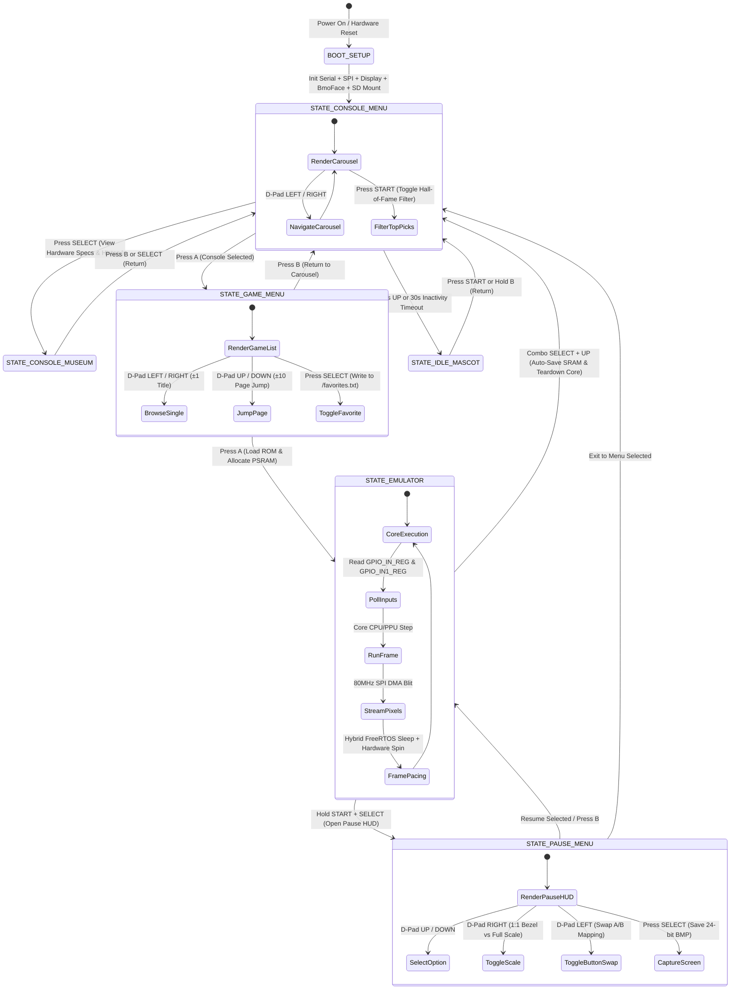

# Software Design Document (SDD)
**Project:** ESP32-S3-Handheld-Gaming-Console (BMO Edition)  
**Target Platform:** ESP32-S3-WROOM-1-N16R8 (Dual-Core Xtensa LX7 @ 240MHz, 16MB Quad SPI Flash, 8MB Octal SPI PSRAM)  
**Target Display:** ST7789VW 2.4" SPI TFT (240×320 Physical, 320×240 Landscape Viewport) on Shared 80MHz FSPI Bus  
**Document Version:** 4.0 (Comprehensive Master Specification — Updated 2026-11-07)  
**Status:** Approved Architectural Ground Truth  
**Authoritative Reference:** Firmware Engineering Team & AI Agent Governance Framework  

---

## Table of Contents
1. [Architectural Authority & Engineering Purpose](#1-architectural-authority--engineering-purpose)
2. [Physical Hardware Specification & Electrical Ground Truth](#2-physical-hardware-specification--electrical-ground-truth)
3. [Hardware Topology, Pin Assignment Matrix & Register Mapping](#3-hardware-topology-pin-assignment-matrix--register-mapping)
4. [System Architecture, RTOS Tasking & Deterministic State Machine](#4-system-architecture-rtos-tasking--deterministic-state-machine)
5. [Memory Architecture, Latency Hierarchy & Cache Invariants](#5-memory-architecture-latency-hierarchy--cache-invariants)
6. [Display Subsystem, Hardware SPI Bus Physics & Video Blitting Pipeline](#6-display-subsystem-hardware-spi-bus-physics--video-blitting-pipeline)
7. [Procedural Mascot Face Engine (BmoFace) & Vector SDF Mathematics](#7-procedural-mascot-face-engine-bmoface--vector-sdf-mathematics)
8. [Multi-Emulator Suite & Core Lifecycle Contracts](#8-multi-emulator-suite--core-lifecycle-contracts)
9. [Input Subsystem, Zero-Wait Dual Register Polling & Debounce Engine](#9-input-subsystem-zero-wait-dual-register-polling--debounce-engine)
10. [Storage Subsystem, SD Card Indexing, Binary Fast Cache & Save Management](#10-storage-subsystem-sd-card-indexing-binary-fast-cache--save-management)
11. [Dormant Peripheral Subsystems & Hardware Safety Guardrails](#11-dormant-peripheral-subsystems--hardware-safety-guardrails)
12. [3D Handheld Simulator & In-Browser WebAssembly Platform](#12-3d-handheld-simulator--in-browser-webassembly-platform)
13. [Host Verification Harness, Guardian Ground Truth Engine & CI Testing](#13-host-verification-harness-guardian-ground-truth-engine--ci-testing)
14. [Autonomous AI Agent Governance, Invariants & Anti-Patterns](#14-autonomous-ai-agent-governance-invariants--anti-patterns)

---

## 1. Architectural Authority & Engineering Purpose

The **ESP32-S3 Handheld Gaming Console** is a custom handheld gaming console firmware engineered for the Espressif ESP32-S3 microcontroller. The system unites two real-time engines in a single firmware image:
1. **A 14-System Retro Gaming Emulation Suite:** Custom C/C++ emulator cores executing cycle-accurate or scanline-accurate CPU and video loops across 14 historical platforms (Game Boy, Game Boy Color, NES, Sega Master System, Game Gear, Genesis, SNES, PC Engine, Atari 2600, ColecoVision, WonderSwan, Neo Geo Pocket, Atari Lynx, PICO-8 runtime, and classic DOOM).
2. **A Procedural Vector Mascot Animation System ("BMO"):** An interactive 320×240 character face synthesized entirely via real-time 2D Signed Distance Fields (SDF), second-order harmonic oscillator spring physics, and autonomous life simulation routines without static bitmap graphics.

### Design Principles
- **Hardware Ground Truth Over Software Abstraction:** Hardware is permanently soldered on a 2.54 mm perfboard. Software must adapt strictly to physical wiring rather than assuming theoretical pinouts.
- **Zero Heap Allocations in Hot Paths:** No emulator core, scanline renderer, or frame update loop may invoke `malloc()`, `new`, or `heap_caps_malloc()` during `runFrame()`. All buffers are statically allocated or reserved at initialization.
- **Zero-Wait Atomic Hardware Polling:** Input buttons are sampled through direct 32-bit register reads (`GPIO_IN_REG` and `GPIO_IN1_REG`) rather than sequential Arduino `digitalRead()` calls.
- **Fail-Safe Peripheral Gating:** Features without physical circuitry (battery voltage divider, I2S DAC amplifier) must compile to zero-overhead no-ops via compile-time preprocessor flags (`FEATURE_BATTERY_MONITOR = 0`, `FEATURE_AUDIO = 0`) to prevent bootloops and bus faults.
- **Deterministic Multi-Core Work Distribution:** Emulation CPU/PPU cycles and input handling execute on Core 1, while display SPI DMA transfers and background I/O execute on Core 0 under FreeRTOS synchronization.

---

## 2. Physical Hardware Specification & Electrical Ground Truth

The console is constructed around an Espressif ESP32-S3-WROOM-1 module permanently wired to peripheral modules.

### Microcontroller Core Specification
- **SoC:** Espressif ESP32-S3 (Xtensa Dual-Core 32-bit LX7 microprocessor).
- **Core Clock:** 240 MHz (CPU Frequency setting: `240MHz (WiFi)`).
- **Internal SRAM:** 512 KB total on-chip SRAM (~400 KB usable for IRAM and DRAM after bootloader and FreeRTOS allocations).
- **External Flash Memory:** 16 MB Quad SPI (QIO) Flash running at 80 MHz.
  - *Hard Stop:* Flash mode MUST be set to `Flash Mode: QIO 80MHz`. Setting Flash Mode to OPI causes an immediate flash cache fault and bootloop because the physical flash chip is Quad SPI.
- **External PSRAM:** 8 MB Octal SPI (OPI) PSRAM running at 80 MHz in the memory-mapped window.
  - *Setting:* `PSRAM: OPI PSRAM`. Setting PSRAM to Quad SPI impairs throughput and breaks 14-core memory buffers.
- **Boot Strapping Pins:** GPIO 0, 3, 45, 46. Kept isolated from user input switches to prevent forcing invalid bootloader modes at startup.
- **Dedicated Internal PSRAM Pins:** GPIO 33 through 37 are internally bonded to the octal PSRAM die. They are strictly unavailable for general I/O.

### Display Panel Specification
- **Display Controller:** Sitronix ST7789VW SPI TFT controller.
- **Panel Size:** 2.4-inch active diagonal (active area 4.88 × 3.66 cm, 4:3 aspect ratio).
- **Physical Resolution:** 240 × 320 physical pixels.
- **Logical Resolution:** 320 × 240 landscape viewport (`rotation = 3`).
- **Bus Interface:** Shared Hardware SPI peripheral (`FSPI`) running at **80 MHz** with SPI Mode 0 (CPOL=0, CPHA=0).
- **Color Format:** 16-bit RGB565 / BGR565 byte-swapped big-endian.
- **Panel Initialization Register:** Setting BGR bit (`0x08`) in `MADCTL` register (`0x36`) at startup corrects red/blue channel inversion.
- **Backlight Control:** BLK tied to 3.3V power rail for constant brightness.

### Storage Subsystem Specification
- **Storage Type:** MicroSD Card slot via 6-pin SPI breakout.
- **Bus Topology:** Shared FSPI bus (`SCK` on GPIO 12, `MOSI` on GPIO 11, `MISO` on GPIO 15, `CS` on GPIO 13).
- **SPI Transfer Rate:** 25 MHz for MicroSD FAT32 file streaming.
- **Bus Synchronization:** Mutex-guarded via `SpiArbiter::lock()` and `SpiArbiter::unlock()`.
- **Power Requirement:** 5V VBUS rail. The breakout module incorporates an onboard 3.3V LDO regulator that drops out if supplied with 3.3V.
- **Level Shifter Electrical Risk:** Standard 5V breakouts output 5V logic on `MISO` (GPIO 15). The ESP32-S3 internal clamping diodes shunt this excess voltage onto the internal 3.3V rail, spiking it to ~4.4V and causing flash/PSRAM cache crashes. Mitigation: native 3.3V MicroSD wiring or 10 kΩ series current-limiting resistor.

### Power & Battery Architecture
- **Bench Supply:** 5V via USB-C (COM/UART port with dedicated USB-to-UART bridge IC).
- **Handheld Battery Configuration:**
  - Option A: 4× AA NiMH rechargeable cells in series (~4.8V nominal).
  - Option B: 2× AA NiMH rechargeable cells (~2.4V nominal) stepped up via a synchronous boost converter rated for ≥1A output at 5.0V feeding the 5V devkit pin.
  - NiMH Charging Contract: NiMH cells must be removed from the chassis and recharged in a dedicated external NiMH charger. **Connecting a TP4056 module to NiMH cells is strictly forbidden** (TP4056 is designed exclusively for 3.7V single-cell Lithium-ion 4.2V CC/CV chemistry).
  - Power Isolation: Schottky diodes placed on both the USB 5V and battery boost 5V lines prevent reverse current flow.
  - Power Budget: ST7789 backlight (~80 mA), Octal PSRAM + CPU @ 240 MHz (~170 mA), peaking at ~600 mA during SD reads. The battery supply must sustain ≥1A peak.

---

## 3. Hardware Topology, Pin Assignment Matrix & Register Mapping

The console's physical pin assignments are centralized in `firmware/BmoGameboy/src/core/config.h`.

```
                       +----------------------------------+
                       |       ESP32-S3-N16R8 (240MHz)    |
                       |   16MB QIO Flash | 8MB OPI PSRAM |
                       +----------------------------------+
                                       |
     +-----------------+---------------+-----------------+-----------------+
     |                 |                                 |                 |
 [FSPI Bus]       [Button GPIOs]                   [Dormant I/O]    [Dormant I2C]
 (Shared 80MHz)   (Active-Low)                     (Gated = 0)      (Reserved)
  SCK  : GPIO 12   UP    : GPIO 4   A     : GPIO 16  BATTERY: GPIO 1   SDA: GPIO 43
  MOSI : GPIO 11   DOWN  : GPIO 5   B     : GPIO 17  I2S_BCLK:GPIO 38  SCL: GPIO 44
  TFT_CS:GPIO 10   LEFT  : GPIO 6   START : GPIO 18  I2S_LRC :GPIO 39
  TFT_DC:GPIO 8    RIGHT : GPIO 7   SELECT: GPIO 21  I2S_DIN :GPIO 40
  TFT_RST:GPIO 9   X     : GPIO 14  Y     : GPIO 42
  SD_CS: GPIO 13   L     : GPIO 47  R     : GPIO 48
  SD_MISO:GPIO 15
```

### Complete Hardware Pin Matrix

| Pin Net | GPIO # | Peripheral / Line | Mode / Electrical Config | Polling Register | Physical Function | Invariant / Safety Rule |
| :--- | :--- | :--- | :--- | :--- | :--- | :--- |
| `TFT_SCK` | 12 | FSPI Clock | Output Push-Pull (80MHz) | — | ST7789 Clock | Shared with SD Card clock |
| `TFT_MOSI` | 11 | FSPI MOSI | Output Push-Pull (80MHz) | — | ST7789 Data In | Shared with SD Card data in |
| `TFT_CS` | 10 | ST7789 Chip Select | Output Active-Low | — | Display Select | Asserted only during display blits |
| `TFT_DC` | 8 | Data / Command | Output Push-Pull | — | Register Select | LOW = Command, HIGH = Data parameter |
| `TFT_RST` | 9 | Display Reset | Output Active-Low | — | Hardware Reset | Strobed at `DisplayEmu::begin()` |
| `SD_CS` | 13 | MicroSD Chip Select | Output Active-Low | — | SD Select | Asserted only during SD transfers |
| `SD_MISO` | 15 | MicroSD Data Out | Input with Pull-up | — | SD Read Line | Dedicated return line for SD reads |
| `BTN_UP` | 4 | D-Pad Up | `INPUT_PULLUP` | `GPIO_IN_REG` | D-Pad Up | Active-low, reads 0 on press |
| `BTN_DOWN` | 5 | D-Pad Down | `INPUT_PULLUP` | `GPIO_IN_REG` | D-Pad Down | Active-low, reads 0 on press |
| `BTN_LEFT` | 6 | D-Pad Left | `INPUT_PULLUP` | `GPIO_IN_REG` | D-Pad Left | Active-low, reads 0 on press |
| `BTN_RIGHT`| 7 | D-Pad Right | `INPUT_PULLUP` | `GPIO_IN_REG` | D-Pad Right | Active-low, reads 0 on press |
| `BTN_A` | 16 | Action Button A | `INPUT_PULLUP` | `GPIO_IN_REG` | Confirm / Primary | Active-low, reads 0 on press |
| `BTN_B` | 17 | Action Button B | `INPUT_PULLUP` | `GPIO_IN_REG` | Cancel / Secondary| Active-low, reads 0 on press |
| `BTN_START`| 18 | Start Button | `INPUT_PULLUP` | `GPIO_IN_REG` | Start / Pause | Active-low, reads 0 on press |
| `BTN_SELECT`| 21| Select Button | `INPUT_PULLUP` | `GPIO_IN_REG` | Menu Modifier | Combo trigger with UP exits emulator |
| `BTN_X` | 14 | Extended Action X | `INPUT_PULLUP` | `GPIO_IN_REG` | SNES X / Genesis C| Active-low, reads 0 on press |
| `BTN_Y` | 42 | Extended Action Y | `INPUT_PULLUP` | `GPIO_IN1_REG`| SNES Y / DOOM Prev| Upper register read (GPIO ≥ 32) |
| `BTN_L` | 47 | Left Shoulder | `INPUT_PULLUP` | `GPIO_IN1_REG`| Left Trigger | Upper register read (GPIO ≥ 32) |
| `BTN_R` | 48 | Right Shoulder | `INPUT_PULLUP` | `GPIO_IN1_REG`| Right Trigger | Upper register read (GPIO ≥ 32); shares RGB LED pin |
| `BATTERY_ADC_PIN` | 1 | Battery Voltage ADC| Analog In | — | **DORMANT** | Gated by `FEATURE_BATTERY_MONITOR=0`; do not read floating pin |
| `I2S_BCLK` | 38 | I2S Bit Clock | Output | — | **DORMANT** | Gated by `FEATURE_AUDIO=0`; reserved for MAX98357A DAC |
| `I2S_LRC` | 39 | I2S Word Select | Output | — | **DORMANT** | Gated by `FEATURE_AUDIO=0`; reserved for MAX98357A DAC |
| `I2S_DIN` | 40 | I2S Data Out | Output | — | **DORMANT** | Gated by `FEATURE_AUDIO=0`; reserved for MAX98357A DAC |
| `I2C_SDA` | 43 | I2C Serial Data | Open-Drain Pull-up | — | **DORMANT** | Reserved for optional FM24C FRAM save memory |
| `I2C_SCL` | 44 | I2C Serial Clock | Open-Drain Pull-up | — | **DORMANT** | Reserved for optional FM24C FRAM save memory |

### Physical Layout & Assembly Geometry
The physical controls and elements align to an 8.8 cm width × 12.4 cm height × 3.2 cm thickness enclosure assembled on a 2.54 mm (0.1") pitch prototype perfboard cut to 31 × 46 holes (7.9 × 11.7 cm):
- **Display Window:** 5.0 × 3.8 cm opening centered at `(4.4, 3.3) cm` from front top-left edge.
- **D-Pad Cluster:** 2.8 × 2.8 cm total span, 0.95 cm arm width, centered at `(2.2, 8.4) cm` (tact switches spaced ±1.0 cm from center).
- **ABXY Diamond:** Aligned square to the 2.54 mm perfboard grid (not tilted 15°). 0.9 cm diameter caps:
  - Top (X): `(6.6, 7.4) cm`
  - Left (Y): `(5.6, 8.4) cm`
  - Right (A): `(7.6, 8.4) cm`
  - Bottom (B): `(6.6, 9.4) cm`
  - Spacing: 1.41 cm diagonal center-to-center distance; 0.51 cm clearance between adjacent caps.
- **Select & Start:** Horizontal stadium pills (1.4 × 0.5 cm) placed side-by-side at `(3.4, 11.0) cm` and `(5.4, 11.0) cm` on the lower-left beneath the D-pad cluster.
- **Shoulder Triggers (L / R):** 2.2 × 0.6 cm right-angle tact switches mounted directly along the top rim at `(1.7, 0.3) cm` (L) and `(7.1, 0.3) cm` (R).
- **Enclosure Flanks & Back:**
  - Left/Right Sides: 7-hole acoustic speaker array patterns and vertical "B M O" typography with arm socket ports.
  - Rear Panel: 5 vertical cooling vent capsule slits (`| | | | |`), raised access panel (3.4 × 6.2 cm door centered at `x = 4.4 cm, y = 9.0 cm`) secured by 4 corner screws, and recessed horizontal finger latch pocket.

---

## 4. System Architecture, RTOS Tasking & Deterministic State Machine

The firmware lifecycle is governed by FreeRTOS task scheduling and a deterministic finite state machine implemented in `firmware/BmoGameboy/BmoGameboy.ino`.



### FreeRTOS Dual-Core Execution Model
- **Core 1 (Application & Emulation Core):** Executes the Arduino `setup()` and `loop()` tasks. Manages the active state machine, reads button inputs via atomic register sampling, runs the active emulator's CPU/PPU frame cycle, and evaluates BMO mascot procedural SDF math.
- **Core 0 (Display & Async I/O Core):** Drives asynchronous SPI display blits (`DisplayEmu::vDisplayTask`) and handles background file streaming operations when DMA double-buffering is active.
- **Thread Safety & Arbitration:** Shared hardware peripherals (the FSPI bus connecting ST7789 and MicroSD) are strictly serialized through `SpiArbiter::lock()` and `SpiArbiter::unlock()`. No SD card file transfer is permitted while a display frame blit is in flight.

### Finite State Descriptions
1. **`STATE_CONSOLE_MENU` (Carousel View):**
   - Renders a 15-system carousel (GB, GBC, NES, WAD, SMS, GG, PCE, ATARI, PICO-8, GENESIS, SNES, WSWAN, NGP, LYNX, COLEM) using smooth spring-damper carousel interpolation.
   - Displays real-time game counts discovered from MicroSD directory indexing and baked Flash ROMs.
   - Renders a real-time animated corner mascot face (`BmoFace`, 40×40) cached via dirty-flag tracking (`BmoFace::isDirty()`).
   - Pressing **`START`** toggles the curated **`[TOP PICK]`** Hall-of-Fame filter, allowing instant navigation across top titles.
2. **`STATE_CONSOLE_MUSEUM` (Hardware Specs & History):**
   - Displays verified historical hardware specifications for the selected console (CPU architecture, clock speeds, RAM, VRAM, sound synthesis channels, native display resolution, color palette limits).
   - Lists major architectural breakthroughs and hallmark games.
   - Pressing **`B`** or **`SELECT`** returns to the carousel.
3. **`STATE_GAME_MENU` (ROM Library Browser):**
   - Displays a scrollable, sorted catalog of games for the selected system (supports up to 36,000 games allocated dynamically in Octal PSRAM).
   - Fast Navigation: **LEFT / RIGHT** browses single titles; **UP / DOWN** executes rapid ±10 page jumps across large libraries.
   - Cover Art Streaming: Streams 64×64 RGB565 `.raw` or `.bmp` box art dynamically from `/boxart/` or `/covers/`. If missing, renders a stylized console cartridge badge.
   - Pressing **`SELECT`** toggles favorite status, writing immediately to `/favorites.txt`.
   - Pressing **`B`** returns to the console carousel.
   - Pressing **`A`** allocates working RAM, loads the ROM into PSRAM, flashes a celebratory mascot face, and initializes the emulator core.
4. **`STATE_EMULATOR` (Active Gameplay):**
   - Executes the active engine frame-by-frame via `Core::runFrame()`.
   - Samples 12 inputs atomically via `GPIO_IN_REG` and `GPIO_IN1_REG`.
   - Paces video refresh using hybrid FreeRTOS sleep (`delay()`) and sub-millisecond hardware timer spinning (`ets_delay_us()`).
   - Immediate Exit Combo: Pressing **`SELECT + UP`** automatically flushes battery SRAM to `/saves/<game>.sav`, invokes `Core::destroy()`, releases allocated PSRAM, and transitions safely to `STATE_CONSOLE_MENU`.
5. **`STATE_PAUSE_MENU` (In-Game Overlay):**
   - Holding **`START + SELECT`** pauses emulation and composites a translucent pause HUD over the active game framebuffer.
   - Options: Resume, Save State (slots 1–5), Load State (slots 1–5), Display Scaling (1:1 with console bezel vs scaled), Button Swap (A/B), and Exit to Menu.
   - Pressing **`SELECT`** captures the current framebuffer and saves an uncompressed 24-bit `.bmp` screenshot to `/screenshots/`.
6. **`STATE_IDLE_MASCOT` (Living Mascot Mode):**
   - Activated by pressing **`UP`** from the carousel or after 30 seconds of inactivity.
   - Evaluates real-time 320×240 procedural Signed Distance Fields in Octal PSRAM.
   - Interactive Gamepad Features: D-pad directs facial gaze; **`A`** triggers playful winks; **`B`** triggers blushing (holding **`B`** exits); **`SELECT`** triggers dialogue bubbles with typewriter animations; **`UP`** toggles dance party routines; **`START`** returns to the carousel.

---

## 5. Memory Architecture, Latency Hierarchy & Cache Invariants

The ESP32-S3-N16R8 implements a three-tier memory hierarchy. Internal SRAM is single-cycle but strictly capacity-constrained, while Octal PSRAM provides high density with higher transaction latency:

```
+-----------------------------------------------------------------------------------+
| ESP32-S3-N16R8 Physical Memory Architecture                                        |
|                                                                                   |
| [Internal SRAM: 512 KB Total (~400 KB Usable)]                                    |
|   ├── IRAM (.text / IRAM_ATTR): Zero-Wait Single-Cycle Instruction Memory         |
|   │     ├── Scanline scaling and color transform kernels                          |
|   │     ├── Fast ROM read dispatch callbacks (gb_rom_read, gb_rom_read16)         |
|   │     ├── Low-level SPI DMA interrupt service routines                          |
|   │     └── Direct register GPIO input sampling routines                          |
|   ├── DRAM (.bss / .data / MALLOC_CAP_INTERNAL): Zero-Wait Data Memory            |
|   │     ├── 32-byte cache-aligned emulator CPU contexts (struct gb_s, agnes_t)    |
|   │     ├── Scanline row pixel buffers (rowBuffer[480] 4-byte aligned)            |
|   │     ├── Display DMA descriptors and SPI transfer ring buffers                 |
|   │     └── FreeRTOS task stacks (vDisplayTask, main loop task)                   |
|                                                                                   |
| [External Octal PSRAM: 8 MB @ 80MHz OPI (MALLOC_CAP_SPIRAM)]                      |
|   ├── Dynamic ROM Staging Buffer: Up to 4 MB per loaded game                      |
|   ├── Cartridge Save RAM: 128 KB per active emulator session                      |
|   ├── Dynamic ROM Catalog Index: Up to 36,000 game entries (~2.3 MB)              |
|   ├── BmoFace Procedural Canvas: 320×240 RGB565 vector buffer (153.6 KB)         |
|   ├── Full-Screen Menu Framebuffer: 320×240 RGB565 canvas (153.6 KB)              |
|   └── DOOM Engine Dynamic Heap: ~6 MB game zone allocation                        |
|                                                                                   |
| [External Quad SPI Flash: 16 MB @ 80MHz QIO]                                      |
|   ├── nvs Partition (20 KB): Non-Volatile Storage (settings, calibrations)        |
|   ├── otadata Partition (8 KB): OTA boot selection metadata                       |
|   ├── app0 Partition (8 MB): Firmware executable + Baked Fallback ROMs (.rodata)  |
|   └── ffat Partition (~7.9 MB): Internal Flash FAT storage                        |
+-----------------------------------------------------------------------------------+
```

### Memory Engineering Invariants
1. **32-Byte D-Cache Line Alignment:** Core CPU emulator state structures are declared with `__attribute__((aligned(32)))` to prevent CPU register state from straddling 32-byte cache lines.
2. **Zero-Wait IRAM Execution:** Hot execution paths (ROM read callbacks, scanline rasterizers, and SPI DMA triggers) are decorated with `IRAM_ATTR`. This avoids instruction cache stalls across the ~280,000 instruction iterations executed per 60Hz frame.
3. **Zero Heap Allocations in Hot Loops:** No emulator core or rendering loop may call `malloc()`, `new`, or `heap_caps_malloc()` during `runFrame()`. All working memory is pre-allocated at `begin()` and released at `destroy()`.
4. **Coalesced 32-Bit Memory Stores:** Scaled pixel rasterization converts 4 input pixels to 6 output pixels and writes them directly as three 32-bit aligned stores (`uint32_t* out32`), eliminating unaligned memory write penalties on the Xtensa architecture.

---

## 6. Display Subsystem, Hardware SPI Bus Physics & Video Blitting Pipeline

### Physical Display Parameters
- **Display Controller:** Sitronix ST7789VW
- **Physical Panel Resolution:** 240 × 320 pixels
- **Logical System Resolution:** 320 × 240 pixels (Landscape orientation via `rotation = 3`)
- **Bus Interface:** Shared Hardware SPI peripheral (`FSPI`) running at **80 MHz**
- **Hardware Register Initialization:** Overwrites `MADCTL` register (`0x36`) with `0xA0 | 0x08` at boot to enable the BGR color bit, preventing panel-level color inversion.
- **Wire Pixel Format:** **BGR565 Byte-Swapped (Big-Endian on Wire)**. Because `SPI.writeBytes()` transmits the low-order byte first, all lookup tables and UI palettes pre-swap color bytes (`((c & 0xFF) << 8) | ((c >> 8) & 0xFF)`), resulting in zero runtime byte-swapping overhead during frame blits.

### 80 MHz SPI Bus Physics & Timing Budgets
- **SPI Clock Period ($T_{\text{clk}}$):** $1 / 80\text{ MHz} = 12.5\text{ ns}$
- **Byte Transmission Latency:** $8 \times 12.5\text{ ns} = 100\text{ ns}$ (10 MB/sec peak wire throughput)
- **Address Window Setup Latency:** $4 \times 100\text{ ns} + \text{CS/DC setup} \approx 1.2\ \mu\text{s}$

### Mathematical Hardware Bus & Frame Transmission Physics Model

| Platform / Viewport | Native Resolution | Rendered Output | Frame Size | Raw Wire Time | Target Refresh | Frame Budget ($T_{\text{frame}}$) | Sequential CPU Budget | Parallel DMA CPU Budget | Bus Saturation |
| :--- | :--- | :--- | :--- | :--- | :--- | :--- | :--- | :--- | :--- |
| **Game Boy (DMG)** | 160×144 | 240×216 (1.5×) | 103,680 B | **10.37 ms** | 59.73 Hz | 16.74 ms | **6.37 ms (38.1%)** | **16.74 ms (100%)** | 61.9% |
| **Game Boy Color** | 160×144 | 240×216 (1.5×) | 103,680 B | **10.37 ms** | 59.73 Hz | 16.74 ms | **6.37 ms (38.1%)** | **16.74 ms (100%)** | 61.9% |
| **NES** | 256×240 | 256×240 (1:1) | 122,880 B | **12.29 ms** | 60.10 Hz | 16.64 ms | **4.35 ms (26.1%)** | **16.64 ms (100%)** | 73.9% |
| **DOOM** | 320×200 | 320×200 (1:1) | 128,000 B | **12.80 ms** | 35.00 Hz | 28.57 ms | **15.77 ms (55.2%)** | **28.57 ms (100%)** | 44.8% |
| **Master System** | 256×192 | 256×192 (1:1) | 98,304 B | **9.83 ms** | 59.92 Hz | 16.69 ms | **6.86 ms (41.1%)** | **16.69 ms (100%)** | 58.9% |
| **Game Gear** | 160×144 | 160×144 (1:1) | 46,080 B | **4.61 ms** | 59.92 Hz | 16.69 ms | **12.08 ms (72.4%)** | **16.69 ms (100%)** | 27.6% |
| **PC Engine** | 256×240 | 256×240 (1:1) | 122,880 B | **12.29 ms** | 59.82 Hz | 16.72 ms | **4.43 ms (26.5%)** | **16.72 ms (100%)** | 73.5% |
| **Atari 2600** | 160×192 | 160×192 (1:1) | 61,440 B | **6.15 ms** | 60.00 Hz | 16.67 ms | **10.52 ms (63.1%)** | **16.67 ms (100%)** | 36.9% |
| **PICO-8** | 128×128 | 128×128 (1:1) | 32,768 B | **3.28 ms** | 30.00 Hz | 33.33 ms | **30.05 ms (90.2%)** | **33.33 ms (100%)** | 9.8% |
| **Sega Genesis** | 320×224 | 320×224 (1:1) | 143,360 B | **14.34 ms** | 59.92 Hz | 16.69 ms | **2.35 ms (14.1%)** | **16.69 ms (100%)** | 85.9% |
| **Super Nintendo**| 256×224 | 256×224 (1:1) | 114,688 B | **11.47 ms** | 60.10 Hz | 16.64 ms | **5.17 ms (31.1%)** | **16.64 ms (100%)** | 68.9% |
| **WonderSwan** | 224×144 | 224×144 (1:1) | 64,512 B | **6.45 ms** | 75.47 Hz | 13.25 ms | **6.80 ms (51.3%)** | **13.25 ms (100%)** | 48.7% |
| **Neo Geo Pocket**| 160×152 | 160×152 (1:1) | 48,640 B | **4.87 ms** | 59.73 Hz | 16.74 ms | **11.87 ms (70.9%)** | **16.74 ms (100%)** | 29.1% |
| **Atari Lynx** | 160×102 | 160×102 (1:1) | 32,640 B | **3.27 ms** | 75.00 Hz | 13.33 ms | **10.06 ms (75.5%)** | **13.33 ms (100%)** | 24.5% |
| **ColecoVision** | 256×192 | 256×192 (1:1) | 98,304 B | **9.83 ms** | 60.00 Hz | 16.67 ms | **6.84 ms (41.0%)** | **16.67 ms (100%)** | 59.0% |
| **Menu UI (Full)**| 320×240 | 320×240 (Full) | 153,600 B | **15.36 ms** | 60.00 Hz | 16.67 ms | **1.31 ms (7.8%)** | **16.67 ms (100%)** | 92.1% |

### High-Performance Atomic SPI Streaming Protocol
Traditional Arduino display libraries execute window address configuration (`setAddrWindow`) on every scanline (144–240 times per frame), introducing massive bus command overhead. The firmware implements an atomic frame streaming protocol:

```cpp
// 1. Assert CS once and set window coordinates for the entire frame
DisplayEmu::startFrame();       

// 2. Emulator scanline callback streams pixel buffer directly over SPI FIFO/DMA
DisplayEmu::streamPixelRow(rowBuffer, 240);

// 3. Deassert CS once upon frame completion
DisplayEmu::endFrame();         
```
This reduces SPI transaction setup from **144–240 transactions/frame to 1 transaction/frame**, saving over 1.8 ms of bus overhead per frame.

---

## 7. Procedural Mascot Face Engine (BmoFace) & Vector SDF Mathematics

The BMO mascot face is rendered entirely via real-time **Procedural 2D Signed Distance Fields (SDF)** evaluated natively into a 320×240 Octal PSRAM canvas (`MALLOC_CAP_SPIRAM`), consuming 0 bytes of precious internal DRAM.

```
       [ Mathematical Parameters ]
  eye_radius, eye_squash, mouth_curvature
                   │
                   ▼
  [ 2D Signed Distance Field Evaluation ]
        d_eye(x, y), d_mouth(x, y)
                   │
                   ▼
  [ Analytical Anti-Aliasing: smoothstep() ]
                   │
                   ▼
  [ 320x240 RGB565 Framebuffer in Octal PSRAM ]
                   │
                   ▼
  [ DisplayEmu::pushPixelsAt() SPI DMA Blit ]
```

### Mathematical Architecture
1. **Analytic 2D Signed Distance Primitives:**
   - **Circle:** $f_{\text{circle}}(p, r) = \|p\| - r$
   - **Ellipse:** Evaluated via quadratic approximation for subpixel pupil squash and stretch.
   - **Smooth Minimum (Mouth Blending):** Evaluated using polynomial $s_{\min}$ for organic curvature:
     $$s_{\min}(a, b, k) = \max\left(k - |a - b|, 0\right), \quad \text{result} = \min(a, b) - \frac{s_{\min}^2}{4k}$$
2. **Subpixel Analytic Anti-Aliasing:** Every geometry edge is evaluated across an exact 1.2-pixel transition band using `smoothstep()`:
   $$\alpha = \text{clamp}\left(\frac{0.6 - d}{1.2}, 0.0, 1.0\right)$$
   This produces vector-smooth rendering without jagged pixelation.
3. **Harmonic Spring Physics Engine:** Facial squash, stretch, and position transitions are governed by a second-order harmonic oscillator model:
   $$\ddot{x} + 2\zeta\omega_n\dot{x} + \omega_n^2 x = 0$$
   With damping ratio $\zeta \approx 0.72$ and natural frequency $\omega_n \approx 20\text{ rad/s}$, creating cartoon spring dynamics.
4. **Autonomous Life Simulation:**
   - **Sinusoidal Breathing:** Continuous periodic micro-scaling of facial geometry ($T \approx 3.2\text{ s}$).
   - **Autonomous Eye Saccades:** Stochastic target fixation shifts occurring every 1.5–4.0 seconds.
   - **Multi-Phase Eyelid Blinking:** Asymmetric parabolic blink curve (fast snap down, slight dwell, cushioned return).
   - **Sleep Particles:** Floating procedural "Z" particles using harmonic drift when in `SLEEPY` or `DEEP_DREAMING` states.
5. **16-State Emotion Matrix:**
   `IDLE_CONTENT`, `HAPPY_WINK`, `ECSTATIC_LAUGH`, `SURPRISED`, `CURIOSITY_LOOK`, `SLEEPY`, `DEEP_DREAMING`, `YAWNING`, `SMUG_COOL`, `MUSIC_GROOVING`, `LOVE_ENAMORED`, `DERP_PLAYFUL`, `DETERMINED`, `TICKLED_GIGGLE`, `GLITCH_CYBER`, `ERROR_PANIC`.
6. **Typewriter Speech Bubble System:** Procedural vector speech bubble with rounded borders and directional speech tail. Text is wrapped dynamically and rendered with a non-blocking typewriter character advance timer.

---

## 8. Multi-Emulator Suite & Core Lifecycle Contracts

All 14 emulator engines adhere strictly to the unified C++ lifecycle contract:

```cpp
class EmulatorCoreContract {
public:
  static bool begin(const uint8_t* romData, size_t romSize);
  static void updateJoypad();
  static void runFrame();
  static void destroy();
  static void saveBatteryRam();
  static void loadBatteryRam();
  static bool saveState(int slot);
  static bool loadState(int slot);
};
```

### Detailed Core Engine Specifications

| # | System / Platform | Engine Name | Key Source Files | Memory Footprint | Video Output & Scaling | Special Hardware Notes |
|---|---|---|---|---|---|---|
| 1 | **Game Boy (DMG)** | Peanut-GB | `src/emulators/emu_peanut.cpp`, `src/vendor/peanut_gb/` | 128KB PSRAM Cart RAM | 160×144 → 240×216 (1.5× Nearest Neighbor) | Pre-computed 256-entry classic green palette table (`PAL_256`) |
| 2 | **Game Boy Color (CGB)** | Walnut-CGB | `src/emulators/emu_walnut.cpp`, `src/vendor/walnut_cgb/` | 128KB PSRAM Cart RAM | 160×144 → 240×216 (1.5× Nearest Neighbor) | Dual-speed CGB CPU, native 64-color palette, unaligned-safe flash access |
| 3 | **NES (Famicom)** | Agnes | `src/emulators/emu_nes.cpp`, `src/vendor/agnes/` | Agnes context in PSRAM | 256×240 Native 1:1 Direct Blit | 6502 CPU + 2C02 PPU, mappers 0, 1, 2, 4, pre-swapped NES palette |
| 4 | **DOOM (Classic)** | doomgeneric | `src/emulators/emu_doom.cpp`, `src/vendor/doom/` | ~6MB PSRAM Zone Heap | 320×200 Native 1:1 Letterboxed (Y+20) | Streams `.wad` directly via POSIX `fopen()` / `fread()`, bypassing ROM RAM buffer |
| 5 | **Sega Master System / GG**| SMSPlus | `src/emulators/emu_sms.cpp`, `src/vendor/smsplus/` | PSRAM ROM + VRAM | SMS 256×192 / GG 160×144 Native 1:1 Blit | Z80 CPU + TMS9918/SMS VDP + SN76489 PSG emulation |
| 6 | **PC Engine / TG-16** | PCE-Core | `src/emulators/emu_pce.cpp`, `src/vendor/pce/` | PSRAM ROM + Work RAM | 256×240 Native 1:1 Centered Blit | HuC6280 CPU + HuC6270 VDC / HuC6260 VCE |
| 7 | **Atari 2600 (VCS)** | Atari-Core | `src/emulators/emu_atari.cpp`, `src/vendor/stella/` | Static RAM context | 160×192 Native 1:1 Centered Blit | MOS 6507 CPU + RIOT 6532 + TIA renderer; supports 2–32 KiB ROMs |
| 8 | **PICO-8 Runtime** | PICO-8-Core| `src/emulators/emu_pico.cpp`, `src/vendor/pico8/` | 32KB RAM map in PSRAM | 128×128 Native 1:1 Centered Blit | Draw-bytecode runner & 16-color authentic palette (not Lua script engine) |
| 9 | **Sega Genesis / MD** | Genesis-Core| `src/emulators/emu_genesis.cpp`, `src/vendor/genesis/`| PSRAM ROM + 64KB 68K RAM | 320×224 Native 1:1 Centered Blit | Motorola 68000 CPU + YM7101 VDP |
| 10| **Super Nintendo (SNES)** | SNES-Core | `src/emulators/emu_snes.cpp`, `src/vendor/snes/` | PSRAM Cart + WRAM | 256×224 Native 1:1 Centered Blit | 65C816 CPU + S-PPU scanlines, LoROM/HiROM, 16-bit pad registers (A,B,X,Y,L,R) |
| 11| **WonderSwan / Color** | WSwan-Core | `src/emulators/emu_wswan.cpp`, `src/vendor/wswan/` | PSRAM Cart + Work RAM | 224×144 Native 1:1 Centered Blit | NEC V30MZ CPU + custom Swan video ASIC |
| 12| **Neo Geo Pocket / Color**| NGP-Core | `src/emulators/emu_ngp.cpp`, `src/vendor/ngp/` | PSRAM Cart + 16KB RAM | 160×152 Native 1:1 Centered Blit | Toshiba TLCS-900/H CPU + K1GE / K2GE video processor |
| 13| **Atari Lynx** | Lynx-Core | `src/emulators/emu_lynx.cpp`, `src/vendor/lynx/` | PSRAM dynamic buffers | 160×102 Native 1:1 Centered Blit | MOS 65SC02 CPU + Mikey + Suzy hardware sprite blitter |
| 14| **ColecoVision / SG-1000**| Coleco-Core| `src/emulators/emu_colem.cpp`, `src/vendor/colem/` | PSRAM VRAM + 1KB RAM | 256×192 Native 1:1 Centered Blit | Z80A CPU + TMS9918A VDP + SN76489 sound generator |

### Universal Teardown Contract
To prevent memory leaks and crash bugs when switching between games:
1. Battery SRAM is automatically serialized to `/saves/<game>.sav`.
2. All dynamic buffers allocated via `heap_caps_malloc(MALLOC_CAP_SPIRAM)` are freed.
3. Peripheral handles and active SPI parameters are reset.
4. Function pointers and Joypad masks are reset to idle defaults.

---

## 9. Input Subsystem, Zero-Wait Dual Register Polling & Debounce Engine

### Pin Mapping & Electrical Architecture
All 12 inputs use internal pull-up resistors (`INPUT_PULLUP`). One switch lead connects to the GPIO, the other connects to GND:
- **D-Pad:** `BTN_UP` = GPIO 4, `BTN_DOWN` = GPIO 5, `BTN_LEFT` = GPIO 6, `BTN_RIGHT` = GPIO 7
- **Action Buttons:** `BTN_A` = GPIO 16, `BTN_B` = GPIO 17, `BTN_START` = GPIO 18, `BTN_SELECT` = GPIO 21
- **Extended Buttons:** `BTN_X` = GPIO 14, `BTN_Y` = GPIO 42, `BTN_L` = GPIO 47, `BTN_R` = GPIO 48

### Atomic Dual-Register Hardware Polling
Because the ESP32-S3 has 49 GPIO pins, the hardware status registers are divided into lower (`GPIO_IN_REG`, GPIO 0–31) and upper (`GPIO_IN1_REG`, GPIO 32–48) 32-bit registers. The firmware samples both registers in a single atomic cycle in `Buttons::update()`:

```cpp
// Direct atomic register reads (PERF-18 optimization)
uint32_t gpio_in  = REG_READ(GPIO_IN_REG);   // GPIO 0..31 (D-Pad, A, B, Start, Select, X)
uint32_t gpio_in1 = REG_READ(GPIO_IN1_REG);  // GPIO 32..48 (Y=42, L=47, R=48)

// Bitmask unpacking into gb_joypad_state (0 = pressed, 1 = released)
Buttons::gb_joypad_state = 0xFF;
if (!(gpio_in & (1UL << BTN_UP)))     Buttons::gb_joypad_state &= ~(1 << 6);
if (!(gpio_in & (1UL << BTN_DOWN)))   Buttons::gb_joypad_state &= ~(1 << 7);
if (!(gpio_in & (1UL << BTN_LEFT)))   Buttons::gb_joypad_state &= ~(1 << 5);
if (!(gpio_in & (1UL << BTN_RIGHT)))  Buttons::gb_joypad_state &= ~(1 << 4);
if (!(gpio_in & (1UL << BTN_A)))      Buttons::gb_joypad_state &= ~(1 << 0);
if (!(gpio_in & (1UL << BTN_B)))      Buttons::gb_joypad_state &= ~(1 << 1);
if (!(gpio_in & (1UL << BTN_START)))  Buttons::gb_joypad_state &= ~(1 << 3);
if (!(gpio_in & (1UL << BTN_SELECT))) Buttons::gb_joypad_state &= ~(1 << 2);

// Upper register buttons (Y, L, R)
bool y_pressed = !(gpio_in1 & (1UL << (BTN_Y - 32)));
bool l_pressed = !(gpio_in1 & (1UL << (BTN_L - 32)));
bool r_pressed = !(gpio_in1 & (1UL << (BTN_R - 32)));
```

### Menu vs Gameplay Debouncing
- **Gameplay Emulation:** Zero debounce latency. Direct bitmask forwarding ensures 0 ms input lag.
- **Menu Navigation:** Non-blocking timestamp debounce (`DEBOUNCE_MS = 200`) ensures smooth carousel and menu scrolling without double-skipping or stalling FreeRTOS tasks.

---

## 10. Storage Subsystem, SD Card Indexing, Binary Fast Cache & Save Management

### SD Card Directory Layout
```
/ (Root)
├── [ROM files (.gb, .gbc, .nes, .wad, .sms, .gg, .pce, .a26, .p8, .gen, .sfc, .ws, .ngp, .lnx, .col)]
├── boxart/                # 64x64 RGB565 .raw or 16/24-bit .bmp cover art
├── covers/                # Fallback box art directory
├── saves/                 # .sav battery SRAM and .st0-.st4 save state files
├── screenshots/           # 24-bit uncompressed .bmp screen captures
├── favorites.txt          # Plaintext list of starred ROM filenames
├── history.txt            # Plaintext list of recently played titles
└── .bmo_index             # Binary fast-cache index of scanned games
```

### Binary Fast Cache (`.bmo_index`) Specification
Scanning 30,000+ files on a FAT32 MicroSD card via SPI can take 15–30 seconds. The console creates a binary cache file (`/.bmo_index`) on first scan, allowing subsequent cold boots to populate the catalog in under 15 ms:
- **Magic Signature:** 4 bytes (`0x42 0x4D 0x4F 0x49` = `"BMOI"`).
- **Version Number:** `uint32_t` format version (current: `2`).
- **Entry Count:** `uint32_t` total count of indexed ROMs.
- **Records:** Array of fixed-size binary records:
  - `char filename[64]` (null-terminated).
  - `uint32_t fileSize` (bytes).
  - `uint8_t consoleType` (`RomType` enum).
  - `uint8_t flags` (bit 0 = baked flash, bit 1 = favorite, bit 2 = top pick).
- **Integrity:** CRC32 checksum over the entire index payload. If the CRC mismatches or an SD card insertion change is detected, the cache is rebuilt automatically.

### Multi-Slot Save States & Battery RAM
- **Battery RAM (.sav):** On emulator teardown, active cartridge SRAM (up to 128 KB) is flushed to `/saves/<rom_basename>.sav`. On ROM load, the file is restored into PSRAM before CPU execution begins.
- **Save States (.st0 – .st4):** The pause menu supports 5 discrete save state slots per game. Each slot writes a complete CPU register context, VRAM/WRAM banks, and timer states accompanied by a CRC32 integrity check.

---

## 11. Dormant Peripheral Subsystems & Hardware Safety Guardrails

To allow future hardware revisions without breaking software stability, drivers for unpopulated hardware are fully implemented but compile to zero-overhead no-ops:

### 1. Battery Power Management (`src/core/battery.cpp`, `FEATURE_BATTERY_MONITOR = 0`)
- **Hardware Architecture:** Designed for a 100 kΩ / 100 kΩ precision 2:1 voltage divider connected to `BATTERY_ADC_PIN` (GPIO 1).
- **Driver Architecture:** Reads raw ADC via ADC1 Channel 0, applies polynomial calibration curve, and computes a 16-sample moving average.
- **Brownout Protection:** If battery voltage drops below 3.3V, displays a low-battery icon and triggers `esp_deep_sleep_start()` to protect Lithium cells from over-discharge.
- **Hard Stop:** Gated by `FEATURE_BATTERY_MONITOR = 0` in `config.h`. Reading floating GPIO 1 causes ADC instability and boot loops on the ESP32-S3.

### 2. Digital I2S Audio (`src/core/audio_i2s.cpp`, `FEATURE_AUDIO = 0`)
- **Hardware Architecture:** Designed for a MAX98357A Mono Class-D I2S DAC connected to `I2S_BCLK` = 38, `I2S_LRC` = 39, `I2S_DIN` = 40.
- **Driver Architecture:** Configures ESP-IDF I2S DMA circular buffers (4 × 512 bytes) streaming 16-bit audio at 44.1 kHz.
- **Hard Stop:** Gated by `FEATURE_AUDIO = 0`. Unwired I2S DMA buffers waste internal SRAM and trigger timeout assertions.

### 3. I2C FRAM Non-Volatile Memory (`src/core/fram_save.cpp`)
- **Hardware Architecture:** Reserved for Fujitsu MB85RC / FM24C Ferroelectric RAM on `I2C_SDA` = 43 and `I2C_SCL` = 44.
- **Driver Architecture:** Provides $10^{14}$ write endurance for real-time state persistence without wear-out.

---

## 12. 3D Handheld Simulator & In-Browser WebAssembly Platform

The repository includes a web workstation in `tools/bmo_simulator/`:

### 1. Interactive 3D WebGL Handheld Enclosure (`bmo_3d_console.js`)
Built with Three.js to exact physical centimeter hardware dimensions:
- **Geometry & Scale:** 8.8 cm width × 12.4 cm height × 3.2 cm thickness with 0.6 cm corner radius.
- **Dynamic Display Texture:** ST7789 2.4" display window (5.0 × 3.8 cm) updated in real time via a `THREE.CanvasTexture` projecting live 320×240 companion animations and emulator frames.
- **Controls & Detailing:** 2.54 mm perfboard square-grid ABXY diamond, cross D-pad, lower-left horizontal Select/Start pills, top L/R shoulder triggers, USB-C opening, SD slot, power switch, side 7-hole acoustic speakers, side "B M O" arm sockets, and rear 5 cooling vents with 4-screw battery door.
- **Color Parity & Studio Lighting:** Configured with `LinearEncoding` and `NoToneMapping` to prevent color bleaching, ensuring 100% color-picker parity with 2D CSS tokens (`#5FB49C` chassis, `#FFE033` D-pad, `#4CAF50` X, `#F48FB1` Y, `#52A6BA` A, `#E8175D` B, `#1A4B42` bezel).
- **Studio Tone Controls:** Sliders for Light intensity (30–200%), Saturation (0–200%), and Color Temperature (Cool Blue to Warm Amber, -100 to +100).
- **Raycasting Interaction:** Clicking 3D buttons depresses them with spring recoil and routes input events to the emulator.
- **Camera Presets:** Front, 3D Iso, Top, Left, Right, Back, and Reset views.
- **Theme Materials:** BMO Teal, DMG Gray, Atomic Purple, and OLED Black.

### 2. Browser WebAssembly Emulation Platform
- Compiles the C emulator cores (Peanut-GB, Agnes, Stella, ColecoVision) and `bmo_face.cpp` to WebAssembly (`bmo_playtest_cores.wasm`) via the WASI SDK.
- Executes user-uploaded ROMs directly in the browser with authentic display viewports, color palettes, and input mapping.

---

## 13. Host Verification Harness, Guardian Ground Truth Engine & CI Testing

### Native x64 Host Test Harness (`tools/host_cores_runner.c`)
Compiles 11 custom C cores into a native x64 binary using MSVC `cl.exe` or GCC without requiring an ESP32 device:
- Executes 50-frame golden runs per core.
- Verifies CPU instruction dispatch and memory access.
- Validates PRG-RAM persistence and save-state determinism (save @ frame 25 → run to 50 → restore @ 25 → re-run to 50 → assert exact FNV-1a framebuffer hash match).

### Guardian Verification Suite (`tools/guardian/`)
A Python command-line verification engine:
- `python -m tools.guardian doctor`: Preflight hardware safety, pin map, and toolchain checks.
- `python -m tools.guardian diff-audit`: Pre-commit safety gate verifying AST rules and document truth.
- `python -m tools.guardian ui-audit`: Audits CSS and display code for design token compliance and contrast.
- `python -m tools.guardian bus-calc`: Calculates 80MHz FSPI wire latencies and compute budgets.
- `python -m tools.guardian bench-host`: Runs microbenchmarks on SDF math, atomic GPIO reads, and coalesced stores.
- `python -m tools.guardian clang-tidy`: Runs LLVM `clang-tidy` across all custom C cores.
- `python -m tools.guardian mcp`: Zero-dependency JSON-RPC 2.0 Model Context Protocol server exposing project tools.

### 9-Phase CI Repository Validator (`scripts/validate_repo.py`)
```
+-------------------------------------------------------------------------+
| AI Guardian 9-Phase CI Validation Pipeline                              |
|                                                                         |
| [Phase 0] Binary Compilation Gate (Arduino CLI, 16MB QIO, 8MB OPI)      |
| [Phase 1] Python Syntax & AST Audit across all tools/scripts            |
| [Phase 2] Firmware Safety Guardrails (FEATURE_* flags check)            |
| [Phase 3] Flash Budget & Vendor Source Tree Allocation Audit            |
| [Phase 4] Structural Soundness & Partition Scheme Check                 |
| [Phase 5] ROM Archive & Checksum Health Validation                      |
| [Phase 6] Rules & Manifest Integrity (AST Index Compiler)               |
| [Phase 7] Cross-Document & Rule Truth Verification                      |
| [Phase 8] UI Design System & Anti-AI-Slop Compliance Audit              |
+-------------------------------------------------------------------------+
```

---

## 14. Autonomous AI Agent Governance, Invariants & Anti-Patterns

To guarantee that autonomous AI agents and human engineers collaborate without regressions, the repository enforces strict rules catalogued in `.agents/rules/`:

### Core Hard Stops (`00_hard_stops.md`)
1. **Never Enable `FEATURE_BATTERY_MONITOR` on Unwired Hardware:** Floating GPIO 1 triggers erratic ADC readings and boot loops.
2. **Never Build with `FlashMode=opi`:** The flash chip is Quad SPI. Building with `FlashMode=opi` causes a black screen and flash cache fault.
3. **Never Fabricate Unverified Test Results:** Never claim a test passed or state a pin assignment without verifying it in the current session.
4. **Never Commit Copyrighted Commercial ROMs:** Freely-licensed homebrew ROMs and user-provided SD cards only.
5. **Never Use AI Jargon or Marketing Filler (Rule 43):** Documentation, code comments, and commit messages must remain technical, factual, and free of buzzwords.

### Common Agent Mistakes Catalog (Anti-Patterns M-1 to M-20)
- **M-1 (Split-Brain Pinout):** Hardcoding a pin number instead of including `src/core/config.h`.
- **M-2 (Heap Allocation in Frame Loop):** Calling `malloc()` during `runFrame()`.
- **M-3 (Blocking SPI Transactions):** Using `setAddrWindow()` on every scanline instead of atomic streaming.
- **M-4 (Unsynchronized SD Access):** Reading SD card files without acquiring `SpiArbiter::lock()`.
- **M-5 (Wrong Flash Mode):** Attempting to build with `FlashMode=opi`.
- **M-6 (Single Register Polling):** Sampling only `GPIO_IN_REG` and ignoring `GPIO_IN1_REG` for GPIOs ≥ 32.
- **M-7 (NiMH TP4056 Hazard):** Suggesting TP4056 charging for AA NiMH battery cells.

### Git Commit Discipline
All commits must follow the two-part commit message structure:
```bash
git commit -m "type(scope): concise summary" -m "- bullet point 1
- bullet point 2
- Verified: validate_repo.py (Phase 0-8 PASS)"
```
